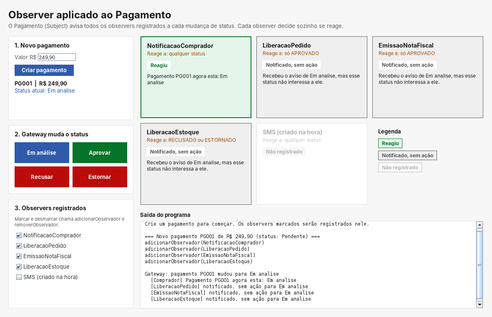
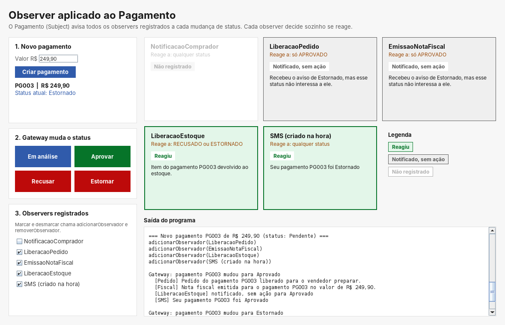

# Interface Gráfica do Fluxo de Pagamento (Observer)

> Iniciativa extra da SubEquipe 03 no foco de GoFs Comportamentais: uma interface gráfica em **Swing** para demonstrar o padrão **Observer** aplicado ao subsistema de pagamento, além da demonstração mínima exigida pelas diretrizes.

## 1. Por que é uma iniciativa extra

A entrega mínima do foco pede o modelo, o código e um vídeo do padrão em execução. Isso já estava atendido pela classe `Main`, que executa cinco cenários no terminal.

A interface gráfica **não era obrigatória**. Ela foi feita porque a saída do terminal mostra apenas os observadores que **reagiram**, e esconde uma característica central do padrão: **todos os observadores registrados são avisados** a cada mudança de estado, e cada um decide sozinho se reage. A interface torna essa decisão visível.

## 2. O que a interface mostra

| Área da tela | O que faz | Papel no padrão |
|---|---|---|
| **1. Novo pagamento** | Cria um pagamento com o valor informado e registra os observadores marcados | Cria o ConcreteSubject (`Pagamento`) |
| **2. Gateway muda o status** | Botões Em análise, Aprovar, Recusar e Estornar | Fazem o papel do Client (`GatewayPagamento`) |
| **3. Observers registrados** | Marcar ou desmarcar um observador | Chama `adicionarObservador` ou `removerObservador` em tempo de execução |
| **Cartões** | Um cartão por observador | Mostram o resultado da última notificação |
| **Saída do programa** | Histórico textual de tudo o que aconteceu | O mesmo conteúdo que apareceria no terminal |

Cada cartão assume uma de três situações:

| Situação | Cor | Significado |
|---|---|---|
| **Reagiu** | Verde | O observador foi avisado e executou sua ação |
| **Notificado, sem ação** | Cinza | O observador foi avisado, mas o novo status não interessa a ele |
| **Não registrado** | Apagado | O observador não está na lista do pagamento |

Além dos quatro observadores do sistema, a interface oferece um observador de **SMS** criado na própria tela. Ao marcá-lo, ele passa a reagir sem nenhuma alteração na classe `Pagamento`, o que demonstra a principal vantagem do padrão.

## 3. Como funciona por dentro

A interface usa as **classes reais** do projeto, sem modificá-las. Para saber se cada observador reagiu, ela registra no `Pagamento` um `ObservadorMonitorado`, que:

1. também implementa `ObservadorDePagamento`, então o `Pagamento` o trata como qualquer outro observador;
2. repassa o aviso ao observador real;
3. captura o que o observador real imprimiu: se imprimiu algo, ele **reagiu**; se não, ele **ignorou** o status.

Essa ideia de envolver um objeto com outro de mesma interface lembra o padrão estrutural **Decorator**. A limitação é que a interface depende da saída de texto dos observadores: um observador que reagisse sem imprimir nada apareceria como "Notificado, sem ação".

O Swing foi escolhido por já fazer parte da plataforma Java, o que manteve o projeto sem dependências externas e compilável apenas com o `javac`.

## 4. Demonstração

<div style="text-align:center;">



<p><strong>Interface Gráfica</strong>: em análise. Só o comprador reage; os outros três são notificados e ignoram. <em>Autor: João Paulo Barbosa Pereira Nunes</em></p>

</div>

<div style="text-align:center;">



<p><strong>Interface Gráfica</strong>: estorno após remover o comprador e adicionar o SMS. O SMS reage sem nenhuma alteração no Pagamento. <em>Autor: João Paulo Barbosa Pereira Nunes</em></p>

</div>

A demonstração completa, com todas as imagens e o vídeo, está na página [Fluxo de Pagamento (Observer)](</Base/Relatórios/Subequipe03/GofsComportamentais/FluxoDePagamento(StrategyObserver).md>), seção 7.

## 5. Como executar

O código está no repositório, no arquivo [InterfaceGrafica.java](<https://github.com/UnBArqDsw2026-2-Turma01/2026.2-T01-_G1_ProjetoComercioEletronico_Entrega_03/blob/main/docs/Base/Relat%C3%B3rios/Subequipe03/src/comportamentais/FluxoDeCompra(Observer)/src/InterfaceGrafica.java>). Requer Java 17 ou superior. A partir da pasta do projeto:

```bash
javac -encoding UTF-8 -d out $(find src -name "*.java")
java -cp out InterfaceGrafica
```

---

## Histórico de Versões

| Versão | Data | Descrição | Autor(es) | Revisor(es) |
| -- | -- | -- | -- | -- |
| 1.0 | 15/10/2026 | Criação da página sobre a interface gráfica do Observer | João Paulo Barbosa Pereira Nunes | José Joaquim da Silva Neto, Júlia Santana Campos e Pedro Henrique Gomes |
