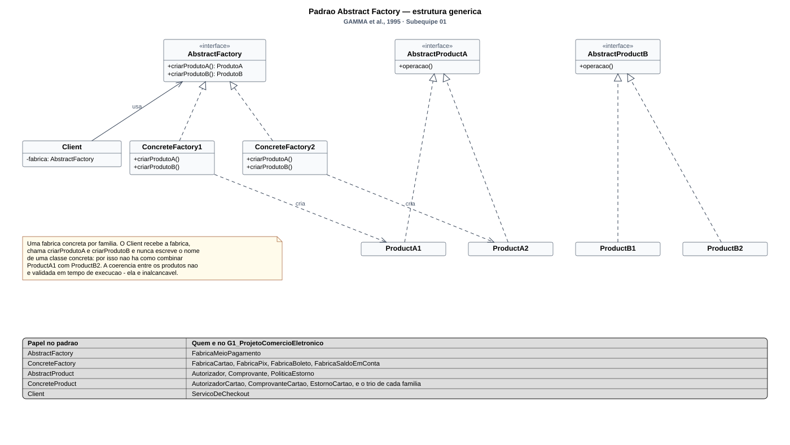
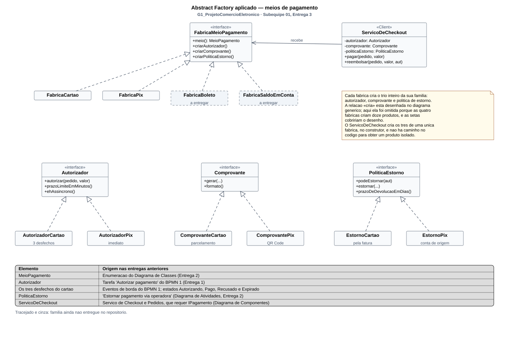

# GoF Criacional — Abstract Factory: meios de pagamento

Conforme a divisão registrada na [reunião de 18/10/2026](/ReunioesAtas/Subequipe1/Ata18_10.md), este é o artefato criacional da Subequipe 01. O **dono do artefato** é **Patrick Anderson Carvalho dos Santos** (modelagem, cliente, demonstração e vídeo), e cada um dos outros quatro integrantes implementa e documenta uma família de produtos.

---

## 1. Contexto: o problema

Quatro achados independentes das entregas anteriores convergem para o mesmo ponto:

| Achado | Origem |
| -- | -- |
| Os meios de pagamento são quatro: cartão, Pix, boleto e saldo em conta | Enumeração `MeioPagamento`, Diagrama de Classes (Entrega 2) |
| A autorização pode ser aprovada, recusada ou expirar por tempo | Eventos de borda do BPMN 1 (Entrega 1); estados `Autorizando`, `Pago`, `Recusado` e `Expirado` (Entrega 2) |
| O comprovante muda de formato conforme o meio | Recorte B da Engenharia Reversa (Entrega 1) |
| A reclamação pode terminar em estorno, pelo caminho por onde o dinheiro veio | Rich Picture e Diagrama de Atividades; transição `Em disputa → Reembolsado` |

Juntando-os, aparece o problema: escolhido um meio de pagamento, o checkout precisa de **três objetos que têm obrigatoriamente de ser do mesmo meio** — quem autoriza, o comprovante que o comprador recebe e a política de estorno. Um comprovante de boleto para uma autorização de cartão é uma combinação inválida que o código tem de tornar impossível, e não apenas improvável.

---

## 2. Fundamentação: o padrão Abstract Factory

**Intenção.** "Fornecer uma interface para criação de famílias de objetos relacionados ou dependentes sem especificar suas classes concretas" (GAMMA et al., 2000).

**Por que ele, e não o Factory Method.** O Factory Method criaria *um* produto por meio de pagamento, e não daria conta da coerência entre os três. O que torna o Abstract Factory necessário aqui é a `PoliticaEstorno`: o caminho de volta do dinheiro depende do caminho de ida, e os dois objetos precisam nascer juntos.

**As consequências que o GoF descreve, e o que elas significam aqui.**

| Consequência (GAMMA et al., 2000) | Como ela aparece nos meios de pagamento |
| -- | -- |
| Isola as classes concretas | O `ServicoDeCheckout` não escreve `new AutorizadorCartao()` em lugar nenhum. Ele conhece quatro interfaces e nada mais |
| Facilita trocar famílias inteiras | Trocar o meio de pagamento é trocar **um** objeto — a fábrica. Nenhuma outra linha do checkout muda |
| Promove a coerência entre produtos | É a razão de termos escolhido este padrão: comprovante, autorizador e política de estorno nascem juntos e combinam por construção |
| Dificulta acrescentar um **novo tipo de produto** | Se amanhã a família precisar de um quarto produto — digamos, uma política de antifraude —, a interface `FabricaMeioPagamento` muda e **as quatro fábricas** precisam mudar junto |

A quarta linha é o preço que pagamos conscientemente. Acrescentar uma *família* é barato: uma classe de fábrica e três produtos, sem tocar em nada existente — foi exatamente assim que as famílias Pix e Cartão entraram em paralelo, por pessoas diferentes. Acrescentar um *produto à família* é caro, e isso está na seção de visão crítica.

**Por que não o Builder.** O Builder monta **um** objeto complexo por etapas, e a variação está no processo de construção. Aqui não há objeto complexo: há três objetos simples que precisam ser do mesmo tipo. O Builder foi, aliás, o outro finalista criacional da reunião de 16/10 — mas para a `ConsultaCatalogo`, e não para o pagamento; caiu porque as suas peças são sequencialmente dependentes e dividiam mal entre cinco pessoas.

**Por que não o Prototype.** O Prototype cria por cópia de um exemplar já configurado, e serve quando instanciar é caro ou quando a configuração do objeto é o que varia. Os nossos produtos são leves e sem estado; o que varia não é a configuração de um objeto, é **qual conjunto de classes** usar. Clonar um `AutorizadorCartao` não produziria um `AutorizadorPix`.

**Por que não o Factory Method, em uma frase.** Ele resolve "qual subclasse criar", uma decisão de cada vez. O nosso problema é "quais três classes criar **juntas**", e é a `PoliticaEstorno` que torna isso obrigatório: o caminho de volta do dinheiro depende do caminho de ida.

---

## 3. Modelagem (Notação UML)

### 3.1. Modelagem genérica

[](../Assets/AbstractFactoryGenerico.svg ":ignore")

<sub>Clique na imagem para abrir em tela cheia, com zoom.</sub>

> _Figura 1 — Estrutura genérica do padrão Abstract Factory. As interfaces ficam na linha de cima e as classes concretas embaixo, lado a lado: cada fábrica concreta realiza a fábrica abstrata, e cada produto concreto realiza o seu produto abstrato. A legenda ao pé mapeia cada papel do padrão para a classe correspondente neste projeto. Fonte: Subequipe 01, 2026, a partir de GAMMA et al. (2000)._

### 3.2. Modelagem aplicada

[](../Assets/AbstractFactoryAplicado.svg ":ignore")

<sub>Clique na imagem para abrir em tela cheia, com zoom.</sub>

> _Figura 2 — Abstract Factory aplicado aos meios de pagamento. As quatro fábricas concretas aparecem lado a lado sob `FabricaMeioPagamento`; abaixo, um bloco por produto abstrato, com as classes concretas de cada família. As famílias Boleto e Saldo em conta estão tracejadas e em cinza porque ainda não chegaram ao repositório. A legenda embutida rastreia cada elemento ao achado da Entrega 1 ou 2 que o sustenta. Fonte: Subequipe 01, 2026._

**Decisões de modelagem.**

- **As fábricas concretas estão lado a lado, e não empilhadas.** Não é estética: empilhadas, a seta de realização de uma atravessaria a caixa da outra. Os dois diagramas foram gerados por um script que recusa a imagem quando uma aresta cruza um classificador, e esta disposição é a que passou nessa verificação.
- **Um bloco por produto abstrato, e não por família.** A alternativa — agrupar as três classes de cada família — deixava as setas de realização cruzando o desenho inteiro. Agrupando por produto, cada concreta fica logo abaixo da sua interface. O custo é que a família deixa de ser visível como bloco, e por isso ela aparece no rótulo de cada caixa.
- **As famílias não entregues estão no desenho, tracejadas.** Omiti-las daria a impressão de um padrão com duas famílias, quando o modelo prevê quatro. O tracejado diz o que é projeto e o que é código.
- **A relação `«cria»` aparece só no diagrama genérico.** Nas quatro famílias seriam doze setas partindo de quatro origens, cobrindo o desenho. A nota do diagrama aplicado registra a omissão em vez de deixá-la implícita.

---

## 4. Papéis no padrão

| Papel GoF | Classe | Autor da fatia |
| -- | -- | -- |
| AbstractFactory | `FabricaMeioPagamento` | Pedro Luciano de Azevedo |
| AbstractProduct | `Autorizador`, `Comprovante`, `PoliticaEstorno` | Pedro Luciano de Azevedo |
| ConcreteFactory + ConcreteProduct | Família **Cartão de crédito** | Patrick Anderson Carvalho dos Santos |
| ConcreteFactory + ConcreteProduct | Família **Pix** | Maria Clara Sena de Lima |
| ConcreteFactory + ConcreteProduct | Família **Boleto** | Guilherme Davila Rodrigues Carneiro Sampaio |
| ConcreteFactory + ConcreteProduct | Família **Saldo em conta** | Guilherme Costa Zanella |
| Client | `ServicoDeCheckout`, `Main` | Patrick Anderson Carvalho dos Santos |

Código no repositório: [`src/criacionais/MeiosDePagamento(AbstractFactory)`](https://github.com/UnBArqDsw2026-2-Turma01/2026.2-T01-_G1_ProjetoComercioEletronico_Entrega_03/tree/main/docs/Base/Relat%C3%B3rios/Subequipe01/src/criacionais)

---

## 5. Implementação, fatia por fatia

### 5.1. Contratos: fábrica e produtos abstratos — Pedro Luciano de Azevedo

#### A fábrica abstrata

```java
public interface FabricaMeioPagamento {
    MeioPagamento meio();
    Autorizador criarAutorizador();
    Comprovante criarComprovante();
    PoliticaEstorno criarPoliticaEstorno();
}
```

Três métodos de criação, um por produto da família. O cliente escolhe a fábrica uma única vez, no início do checkout, e dali em diante **nunca mais decide** qual autorizador, comprovante ou política de estorno usar — é isso que torna impossível, e não apenas improvável, combinar produtos de famílias diferentes.

O método `meio()` não cria nada: devolve a constante de `MeioPagamento` que a família atende. Ele existe para o cliente registrar no pedido qual caminho foi seguido, sem precisar de `instanceof`.

**A seleção da fábrica fica no cliente, não na interface.** Seria cômodo pôr aqui um `static FabricaMeioPagamento para(MeioPagamento meio)`, mas isso faria a fábrica abstrata conhecer todas as suas implementações concretas — exatamente a dependência que o padrão existe para eliminar. A escolha vive em `ServicoDeCheckout`, e está documentada na seção 5.6.

#### Os três produtos abstratos

```java
public interface Autorizador {
    Autorizacao autorizar(String pedido, Dinheiro valor);
    int prazoLimiteEmMinutos();
    boolean ehAssincrono();
}
```

Os dois métodos além de `autorizar` vêm diretamente da Entrega 1, e não de conveniência de projeto:

- **`prazoLimiteEmMinutos()`** é o evento de borda de temporizador que o BPMN 1 colocou sobre *Informar meio de pagamento*, e que a Máquina de Estados do Pedido traduziu como `after(tempo limite) → Expirado`. O prazo varia com o meio — um boleto não expira no mesmo tempo que um Pix —, então pertence à família, e não ao checkout.
- **`ehAssincrono()`** distingue o meio cujo desfecho chega depois (boleto) daquele que responde na hora (Pix, saldo). É a diferença que decide se o pedido vai direto a `Pago` ou fica aguardando confirmação externa.

```java
public interface Comprovante {
    String gerar(String pedido, Dinheiro valor, Autorizacao autorizacao);
    String formato();
}
```

`formato()` devolve o tipo do comprovante — "QR Code", "linha digitável", "recibo de parcelamento". É o método que torna visível, na demonstração, que o comprovante acompanha o meio: trocada a fábrica, o formato muda sem que o cliente peça.

```java
public interface PoliticaEstorno {
    boolean podeEstornar(Autorizacao autorizacao);
    String estornar(String pedido, Dinheiro valor);
    int prazoDeDevolucaoEmDias();
}
```

**Este é o produto que torna o Abstract Factory necessário.** Com apenas autorizador e comprovante, um Factory Method por meio resolveria. O estorno muda o quadro porque o caminho de volta do dinheiro **depende do caminho de ida**: não existe "estornar um boleto" — a devolução é por depósito; já o saldo em conta volta na hora. Autorizador e política de estorno precisam nascer juntos, e é exatamente isso que uma fábrica de famílias garante.

A origem está no fluxo de reclamação do Rich Picture (Entrega 1), na ação *Estornar pagamento via operadora* do Diagrama de Atividades e na transição `Em disputa → Reembolsado` da Máquina de Estados (Entrega 2) — três artefatos, de três autores diferentes, apontando para a mesma operação.

#### A classe de apoio `Autorizacao`

```java
public final class Autorizacao {
    public enum Status { APROVADO, RECUSADO, EXPIRADO }
    public static Autorizacao aprovada(String identificador, String detalhe) { ... }
    public static Autorizacao recusada(String detalhe) { ... }
    public static Autorizacao expirada(String detalhe) { ... }
}
```

Os três estados não foram inventados: são os desfechos que a Máquina de Estados do Pedido já registrava. `APROVADO` leva a `Pago`, `RECUSADO` ao estado `Recusado` (evento de borda de erro do BPMN 1) e `EXPIRADO` ao estado `Expirado` (evento de borda de temporizador). As fábricas estáticas existem para que cada família não precise repetir a montagem do objeto.

#### Domínio reaproveitado da Entrega 2

`Dinheiro` (valor em centavos, com `parcelar(n)` sem perda de arredondamento) e `MeioPagamento` (as quatro constantes) vêm do Diagrama de Classes da Entrega 2, decisões 10 e 8 respectivamente. Nenhum dos dois foi criado para esta entrega — e é esse reaproveitamento que mantém o elo entre os três módulos do projeto.

### 5.2. Família Cartão de crédito — Patrick Anderson Carvalho dos Santos

O cartão é a família com **os três desfechos**. As outras três respondem sim ou não; só o cartão percorre os dois eventos de borda que o [BPMN 1 da Entrega 1](https://unbarqdsw2026-2-turma01.github.io/2026.2-T01-_G1_ProjetoComercioEletronico_Entrega_02/#/Base/Relat%C3%B3rios/Subequipe01/BPMN) modelou sobre a tarefa *Autorizar pagamento* — o de erro e o de temporizador — e que a [Máquina de Estados do Pedido](https://unbarqdsw2026-2-turma01.github.io/2026.2-T01-_G1_ProjetoComercioEletronico_Entrega_02/#/Base/Relat%C3%B3rios/Subequipe01/ModelagemDinamica/DiagramaDeMaquinaDeEstados) transformou em dois estados distintos.

| Produto | Classe | O que o cartão responde |
| -- | -- | -- |
| Fábrica concreta | `FabricaCartao` | `meio()` devolve `MeioPagamento.CARTAO` |
| Autorizador | `AutorizadorCartao` | Síncrono, com três desfechos possíveis |
| Comprovante | `ComprovanteCartao` | Recibo com o rateio das parcelas |
| Política de estorno | `EstornoCartao` | Crédito na próxima fatura, em 30 dias |

**Os três desfechos, e por que são três e não dois.** `Recusado` e `Expirado` são estados diferentes na Máquina de Estados do Pedido, e a página daquela entrega explica por quê: um é resposta da operadora, o outro é passagem do tempo. A ordem das verificações no código reflete isso — a janela é checada **antes** da operadora, porque um pedido expirado nunca chega a ser recusado:

```java
@Override
public Autorizacao autorizar(String pedido, Dinheiro valor) {
    // Evento de borda de temporizador do BPMN 1: a janela fecha antes de a
    // operadora ser consultada, entao nao ha o que recusar - ha o que expirar.
    if (minutosDecorridosNaTentativa > PRAZO_LIMITE_DE_DEMONSTRACAO_EM_MINUTOS) {
        return Autorizacao.expirada("Janela de " + PRAZO_LIMITE_DE_DEMONSTRACAO_EM_MINUTOS
                + " min encerrada apos " + minutosDecorridosNaTentativa
                + " min; pedido expirado antes da autorizacao");
    }
    if (valor.centavos() == 0) {
        return Autorizacao.recusada("Cobranca de valor zero nao e aceita pela operadora");
    }
    // Evento de borda de erro do BPMN 1.
    if (valor.centavos() > LIMITE_DE_DEMONSTRACAO_EM_CENTAVOS) {
        return Autorizacao.recusada("Limite do cartao insuficiente para " + valor);
    }
    return Autorizacao.aprovada("CARTAO-" + pedido, ...);
}
```

**Como o `Main` exercita os três sem quebrar o padrão.** O desfecho expirado depende do tempo, e o contrato `Autorizador` não tem parâmetro para isso. A saída foi tornar a **fábrica** configurável, e não o produto: o cliente escolhe a família — o que o padrão permite — e nunca instancia um produto:

```java
desfecho("aprovado",                  new FabricaCartao(),            VALOR);
desfecho("recusado (acima do limite)", new FabricaCartao(),            Dinheiro.emReais(900000));
desfecho("expirado (fora da janela)",  FabricaCartao.aposMinutos(45),  VALOR);
```

Saída real dos três:

```text
- aprovado -> APROVADO
  Autorizada pela operadora em 0 min
  reembolso: Estorno de R$ 299,90 do pedido PED-2026-0001 solicitado a operadora; credito aparece na proxima fatura (prazo de 30 dia(s))

- recusado (acima do limite) -> RECUSADO
  Limite do cartao insuficiente para R$ 9000,00
  reembolso: Nada a estornar no pedido PED-2026-0001: a cobranca nao chegou a ser capturada (RECUSADO)

- expirado (fora da janela) -> EXPIRADO
  Janela de 15 min encerrada apos 45 min; pedido expirado antes da autorizacao
  reembolso: Nada a estornar no pedido PED-2026-0001: a cobranca nao chegou a ser capturada (EXPIRADO)
```

Repare na terceira linha de cada bloco: a política de estorno **recusa** os dois desfechos que não capturaram valor. É `podeEstornar(autorizacao)` devolvendo `false` — a família inteira se comportando de forma coerente, não uma validação espalhada pelo checkout.

**O parcelamento.** É o que distingue o comprovante do cartão dos demais. O rateio usa `Dinheiro.parcelar(n)`, do domínio do Pedro, que distribui o resto da divisão inteira uma unidade por vez:

```text
  Parcelamento ..: 3x
    parcela 1/3 ...: R$ 99,97
    parcela 2/3 ...: R$ 99,97
    parcela 3/3 ...: R$ 99,96
```

99,97 + 99,97 + 99,96 = 299,90. Nenhum centavo se perde, e é por isso que a decisão 10 do [Diagrama de Classes da Entrega 2](https://unbarqdsw2026-2-turma01.github.io/2026.2-T01-_G1_ProjetoComercioEletronico_Entrega_02/#/Base/Relat%C3%B3rios/Subequipe01/ModelagemEstatica/DiagramaDeClasses) guardou dinheiro como inteiro em centavos, e não como ponto flutuante.

**O estorno, e por que ele precisa ser da mesma família.** O `EstornoCartao` devolve pela fatura, em 30 dias; o `EstornoPix` devolve na conta de origem, no mesmo dia. O mesmo pedido, estornado pela política errada, informaria ao comprador um prazo que não existe. A ação *Estornar pagamento via operadora* do [Diagrama de Atividades](https://unbarqdsw2026-2-turma01.github.io/2026.2-T01-_G1_ProjetoComercioEletronico_Entrega_02/#/Base/Relat%C3%B3rios/Subequipe01/ModelagemDinamica/DiagramaDeAtividades) é uma só no desenho; aqui ela tem quatro implementações, e a fábrica garante que a executada seja a do meio pelo qual o dinheiro entrou.

**O que é parâmetro de demonstração nesta família.** Três números: a janela de 15 minutos, o limite de R$ 5.000,00 e o prazo de 30 dias. Nenhum foi observado — o Recorte B da Entrega 1 parou antes da tela de pagamento, de propósito, porque avançar exigiria confirmar uma compra real. Os três estão nomeados no código com `DE_DEMONSTRACAO` para que ninguém os leia como afirmação sobre a plataforma.

### 5.3. Família Pix — Maria Clara Sena de Lima

A família Pix existe na demonstração para fazer **contraste com o boleto**. Os dois meios respondem às mesmas três perguntas da `FabricaMeioPagamento` com respostas opostas. Esse contraste mostra que a fábrica abstrata separa famílias diferentes de fato, e não variações cosméticas de uma mesma família.

| Produto | Classe | Resposta do Pix | Contraste com o boleto |
| -- | -- | -- | -- |
| Fábrica concreta | `FabricaPix` | `meio()` devolve `MeioPagamento.PIX` | `FabricaBoleto` |
| Autorizador | `AutorizadorPix` | Síncrono: `ehAssincrono()` é `false` e o desfecho volta na mesma chamada | O boleto fica em `Autorizando` até a compensação |
| Comprovante | `ComprovantePix` | `formato()` é `"QR Code"` e o texto cita o identificador da transação gerado pelo `AutorizadorPix` | Linha digitável |
| Política de estorno | `EstornoPix` | Devolução para a conta de origem, no mesmo dia (`prazoDeDevolucaoEmDias()` é `0`) | Depósito em conta informada pelo comprador |

**A fábrica.** É a única classe da família que o `ServicoDeCheckout` chega a ver, e mesmo assim só como `FabricaMeioPagamento`. As classes do pacote `familias.pix` ficam invisíveis para o cliente:

```java
public final class FabricaPix implements FabricaMeioPagamento {

    @Override public MeioPagamento meio()                   { return MeioPagamento.PIX; }
    @Override public Autorizador criarAutorizador()         { return new AutorizadorPix(); }
    @Override public Comprovante criarComprovante()         { return new ComprovantePix(); }
    @Override public PoliticaEstorno criarPoliticaEstorno() { return new EstornoPix(); }
}
```

**De onde vem o Pix como família.** O Pix não aparece pela primeira vez nesta entrega. Na Entrega 2, ele é uma das quatro constantes da enumeração `MeioPagamento` no Diagrama de Classes da Subequipe 01. No [Diagrama de Classes da Subequipe 03](https://unbarqdsw2026-2-turma01.github.io/2026.2-T01-_G1_ProjetoComercioEletronico_Entrega_02/#/Base/Relat%C3%B3rios/Subequipe03/ModelagemEstatica/DiagramaDeClasses), ele já tinha comportamento próprio: um `ProcessadorPix` separado do `ProcessadorCartao`, para que `Pagamento` não precisasse de `if metodo == PIX ... else if metodo == CARTAO`. O `AutorizadorPix` é esse processador. A diferença é que agora ele não vem sozinho: nasce na mesma fábrica que o comprovante e o estorno que precisam combinar com ele.

**Autorização imediata.** No Pix o desfecho volta na mesma chamada. Por isso o pedido passa direto de `Autorizando` para `Pago`, ou para `Recusado`, na [Máquina de Estados do Pedido](https://unbarqdsw2026-2-turma01.github.io/2026.2-T01-_G1_ProjetoComercioEletronico_Entrega_02/#/Base/Relat%C3%B3rios/Subequipe01/ModelagemDinamica/DiagramaDeMaquinaDeEstados) (Entrega 2), sem ficar esperando compensação:

```java
@Override
public Autorizacao autorizar(String pedido, Dinheiro valor) {
    if (valor.centavos() == 0) {
        return Autorizacao.recusada("Pix sem valor nao pode ser gerado");
    }
    return Autorizacao.aprovada("PIX-" + pedido,
            "Pix confirmado na hora; sem espera por compensacao");
}

@Override public int prazoLimiteEmMinutos() { return PRAZO_DE_DEMONSTRACAO_EM_MINUTOS; }
@Override public boolean ehAssincrono()     { return false; }
```

**Por que o prazo é "de demonstração".** A Máquina de Estados do Pedido deixou `after(tempo limite)` **sem valor numérico de propósito**: "escrever `after(30min)` seria inventar um número" (Entrega 2, decisão 2). O prazo nunca foi observado, porque o Recorte B da Entrega 1 parou antes da tela de pagamento. Como o contrato `Autorizador` exige um `int`, a família devolve uma constante cujo nome diz o que ela é: um parâmetro para a demonstração rodar, e não uma afirmação sobre a plataforma. O mesmo vale para `prazoDeDevolucaoEmDias()` no `EstornoPix`.

**Por que comprovante e estorno precisam ser da mesma família.** O `ComprovantePix` imprime o identificador que o `AutorizadorPix` gerou. O `EstornoPix` devolve o dinheiro para a conta de origem e só aceita estornar quando o Pix original foi confirmado:

```java
@Override
public boolean podeEstornar(Autorizacao autorizacao) {
    // So existe o que devolver se o Pix original foi confirmado.
    return autorizacao.aprovada();
}
```

Um `ComprovantePix` aplicado a uma autorização de boleto apontaria para uma transação Pix que não existe. Um `EstornoPix` aplicado a um cartão devolveria o dinheiro por um caminho diferente do de ida. São exatamente as combinações que a `FabricaPix` impede ao criar os três produtos juntos.

**Saída da família em execução**: chamada isolada dos três produtos, antes de o `Main` integrar as quatro famílias, para o pedido `PED-1001` de R$ 159,90:

```text
Pix | assincrono=false | prazo=30min | QR Code
APROVADO (PIX-PED-1001) - Pix confirmado na hora; sem espera por compensacao
Comprovante Pix
  Pedido ........: PED-1001
  Valor .........: R$ 159,90
  Transacao .....: PIX-PED-1001
  QR Code .......: [PIX-PED-1001|15990]
  Situacao ......: pago na hora
Devolucao Pix de R$ 159,90 do pedido PED-1001 enviada para a conta de origem
```

**De onde vem cada decisão da família.** Cada elemento tem uma de três fontes: um modelo das Entregas 1 e 2, uma decisão da reunião de 18/10 ou um parâmetro de demonstração. Os parâmetros de demonstração existem só porque o contrato exige um valor que nenhuma entrega observou.

| Elemento | Fonte |
| -- | -- |
| Pix como família própria | Enumeração `MeioPagamento`, Diagrama de Classes da Subequipe 01 (Entrega 2); `ProcessadorPix`, Diagrama de Classes da Subequipe 03 (Entrega 2) |
| Desfechos `APROVADO` e `RECUSADO` | Estados `Pago` e `Recusado` da Máquina de Estados do Pedido (Entrega 2); evento de borda de erro do BPMN 1 (Entrega 1) |
| Existência de um prazo para pagar | `after(tempo limite) → Expirado` na Máquina de Estados do Pedido; evento de borda de temporizador do BPMN 1 |
| Estorno pelo caminho de ida | Estorno via instituição financeira no Rich Picture (Entrega 1); *Estornar pagamento via operadora* por `IPagamento` no Diagrama de Atividades e no de Componentes; `Em disputa → Reembolsado / estornar pagamento` (Entrega 2) |
| `ehAssincrono() == false` e formato `"QR Code"` | Contratos fixados na [reunião de 18/10/2026](/ReunioesAtas/Subequipe1/Ata18_10.md): o Pix é o contraste com o boleto |
| 30 minutos de prazo e devolução em 0 dias | Parâmetros de demonstração. O valor real não foi observado, porque o Recorte B parou antes da tela de pagamento, e a Entrega 2 deixou `after(tempo limite)` sem número pelo mesmo motivo |
| Conteúdo do QR Code e identificador `PIX-<pedido>` | Simulação, para que a demonstração seja reproduzível |

Código: [`fabrica/FabricaPix.java`](https://github.com/UnBArqDsw2026-2-Turma01/2026.2-T01-_G1_ProjetoComercioEletronico_Entrega_03/tree/main/docs/Base/Relat%C3%B3rios/Subequipe01/src/criacionais/MeiosDePagamento(AbstractFactory)/fabrica/FabricaPix.java) e [`familias/pix/`](https://github.com/UnBArqDsw2026-2-Turma01/2026.2-T01-_G1_ProjetoComercioEletronico_Entrega_03/tree/main/docs/Base/Relat%C3%B3rios/Subequipe01/src/criacionais/MeiosDePagamento(AbstractFactory)/familias/pix).

### 5.4. Família Boleto — Guilherme Davila Rodrigues Carneiro Sampaio

O boleto bancário é a família que materializa o comportamento **essencialmente assíncrono** do pagamento e a **assimetria do estorno**. Enquanto no Pix e no saldo a autorização sai na mesma chamada e o cartão obtém desfecho síncrono com a adquirente, o boleto bancário depende do tempo de compensação da rede bancária. Além disso, a devolução não volta pelo mesmo canal de ida — não existe a operação técnica de "estornar um boleto bancário", exigindo depósito em conta corrente indicada pelo comprador. Essa assimetria operacional entre autorização e devolução é precisamente o tipo de problema que justifica a adoção do padrão Abstract Factory: os três produtos precisam nascer com garantias de compatibilidade mútua.

| Produto | Classe | Resposta do Boleto | Contraste com os demais meios |
| -- | -- | -- | -- |
| Fábrica concreta | `FabricaBoleto` | `meio()` devolve `MeioPagamento.BOLETO` | `FabricaCartao`, `FabricaPix`, `FabricaSaldoEmConta` |
| Autorizador | `AutorizadorBoleto` | Assíncrono (`ehAssincrono()` é `true`): pedido fica em `Autorizando` até liquidação | Pix e Saldo respondem na hora; Cartão contata adquirente no momento |
| Comprovante | `ComprovanteBoleto` | `formato()` é `"linha digitável"` com representação numérica para pagamento | QR Code (Pix), recibo com parcelamento (Cartão), recibo de débito (Saldo) |
| Política de estorno | `EstornoBoleto` | Devolução por depósito bancário (`prazoDeDevolucaoEmDias()` é `3`) | Cartão estorna na fatura; Pix devolve na conta de origem; Saldo credita na hora |

**A fábrica concreta.** O cliente (`ServicoDeCheckout`) interage apenas através da interface `FabricaMeioPagamento`, desconhecendo completamente a existência das classes em `familias.boleto`:

```java
public final class FabricaBoleto implements FabricaMeioPagamento {

    @Override public MeioPagamento meio()                   { return MeioPagamento.BOLETO; }
    @Override public Autorizador criarAutorizador()         { return new AutorizadorBoleto(); }
    @Override public Comprovante criarComprovante()         { return new ComprovanteBoleto(); }
    @Override public PoliticaEstorno criarPoliticaEstorno() { return new EstornoBoleto(); }
}
```

**Autorização assíncrona.** A emissão do boleto gera uma autorização com status aprovado para fins de geração da cobrança, mas declara explicitamente `ehAssincrono() == true`. Na [Máquina de Estados do Pedido](https://unbarqdsw2026-2-turma01.github.io/2026.2-T01-_G1_ProjetoComercioEletronico_Entrega_02/#/Base/Relat%C3%B3rios/Subequipe01/ModelagemDinamica/DiagramaDeMaquinaDeEstados) (Entrega 2), isso significa que o pedido permanece em `Autorizando` até que o evento assíncrono de conciliação bancária traga a confirmação do pagamento:

```java
@Override
public Autorizacao autorizar(String pedido, Dinheiro valor) {
    if (valor.centavos() == 0) {
        return Autorizacao.recusada("Boleto com valor zero nao pode ser emitido");
    }
    return Autorizacao.aprovada("BOL-" + pedido,
            "Boleto gerado aguardando compensacao bancaria (assincrono)");
}

@Override public int prazoLimiteEmMinutos() { return PRAZO_DE_DEMONSTRACAO_EM_MINUTOS; } // 4320 min (3 dias)
@Override public boolean ehAssincrono()     { return true; }
```

**Comprovante com linha digitável.** Ao contrário de um comprovante pós-pago ou QR Code dinâmico, o boleto entrega a linha digitável simulada que permite o pagamento na rede bancária:

```java
@Override
public String gerar(String pedido, Dinheiro valor, Autorizacao autorizacao) {
    if (!autorizacao.aprovada()) {
        return "Boleto do pedido " + pedido + " nao pode ser emitido: " + autorizacao.detalhe();
    }
    String codigoBanco = "341";
    String linhaDigitavel = String.format("%s91.00000 00000.000000 00000.000000 8 %010d",
            codigoBanco, valor.centavos());

    return "Boleto Bancario\n"
            + "  Pedido ........: " + pedido + "\n"
            + "  Valor .........: " + valor + "\n"
            + "  Transacao .....: " + autorizacao.identificador() + "\n"
            + "  Linha digitavel: " + linhaDigitavel + "\n"
            + "  Situacao ......: emitido, aguardando compensacao";
}

@Override public String formato() { return "linha digitavel"; }
```

**Política de estorno e a assimetria do boleto.** O `EstornoBoleto` evidencia o porquê da necessidade do Abstract Factory. Um comprador não pode receber estorno de boleto no mesmo canal da emissão; é mandatório solicitar os dados bancários para depósito em conta corrente. A coerência entre os produtos impede que o checkout aplique uma rotina de estorno automático via gateway ou de crédito em fatura:

```java
@Override
public boolean podeEstornar(Autorizacao autorizacao) {
    return autorizacao.aprovada();
}

@Override
public String estornar(String pedido, Dinheiro valor) {
    return "Devolucao de " + valor + " do pedido " + pedido
            + " solicitada via deposito em conta corrente indicada pelo comprador";
}

@Override public int prazoDeDevolucaoEmDias() { return PRAZO_DE_DEMONSTRACAO_EM_DIAS; } // 3 dias
```

**Elo com a modelagem das Entregas 1 e 2.**
- **Diagrama de Componentes (Subequipe 02, Entrega 2):** o componente externo `Operadora de Pagamento` e a integração com sistemas bancários externos refletem a dependência de serviços externos para a liquidação do título.
- **Diagrama de Classes (Subequipe 01, Entrega 2):** constante `BOLETO` na enumeração `MeioPagamento`.
- **Diagrama de Atividades (Entrega 2):** a ação *Estornar pagamento via operadora* no encerramento da disputa/reclamação recebe aqui a especialização concreta adequada ao meio não rastreável de devolução.

**Saída real da família em execução no `cliente.Main`:**

```text
- Boleto bancario | comprovante em linha digitavel | janela de 4320 min | compensacao assincrona | devolucao em 3 dia(s)
  autorizacao: APROVADO (BOL-PED-2026-0001) - Boleto gerado aguardando compensacao bancaria (assincrono)
  Boleto Bancario
    Pedido ........: PED-2026-0001
    Valor .........: R$ 299,90
    Transacao .....: BOL-PED-2026-0001
    Linha digitavel: 34191.00000 00000.000000 00000.000000 8 0000029990
    Situacao ......: emitido, aguardando compensacao
  reembolso: Devolucao de R$ 299,90 do pedido PED-2026-0001 solicitada via deposito em conta corrente indicada pelo comprador (prazo de 3 dia(s))
```

**O que é inferido nesta família:** o prazo de vencimento de 3 dias (4320 minutos), o prazo de depósito de 3 dias úteis e o formato exato da linha digitável simulada. Como o Recorte B da Engenharia Reversa (Entrega 1) encerrou antes da emissão definitiva da cobrança para não gerar custo financeiro real, esses detalhes foram inferidos com base nas práticas mercadológicas e declarados explicitamente no código como parâmetros de demonstração.

Código: [`fabrica/FabricaBoleto.java`](https://github.com/UnBArqDsw2026-2-Turma01/2026.2-T01-_G1_ProjetoComercioEletronico_Entrega_03/tree/main/docs/Base/Relat%C3%B3rios/Subequipe01/src/criacionais/MeiosDePagamento(AbstractFactory)/fabrica/FabricaBoleto.java) e [`familias/boleto/`](https://github.com/UnBArqDsw2026-2-Turma01/2026.2-T01-_G1_ProjetoComercioEletronico_Entrega_03/tree/main/docs/Base/Relat%C3%B3rios/Subequipe01/src/criacionais/MeiosDePagamento(AbstractFactory)/familias/boleto).

### 5.5. Família Saldo em conta — Guilherme Costa Zanella

O saldo em conta é a família em que **o dinheiro nunca sai da plataforma**: não há operadora, banco nem compensação do outro lado. Isso muda as respostas às três perguntas da `FabricaMeioPagamento`, e muda principalmente a última. O estorno desta família é o fecho do [Diagrama de Atividades](https://unbarqdsw2026-2-turma01.github.io/2026.2-T01-_G1_ProjetoComercioEletronico_Entrega_02/#/Base/Relat%C3%B3rios/Subequipe01/ModelagemDinamica/DiagramaDeAtividades) que modelei na Entrega 2: a mediação decide pelo reembolso, a reclamação encerra como `REEMBOLSADA`, e o dinheiro volta.

| Produto | Classe | Resposta do saldo em conta | Em contraste com |
| -- | -- | -- | -- |
| Fábrica concreta | `FabricaSaldoEmConta` | `meio()` devolve `MeioPagamento.SALDO_EM_CONTA`; cria **um** autorizador e o entrega também ao comprovante e ao estorno | As outras fábricas, em que os produtos não compartilham estado |
| Autorizador | `AutorizadorSaldo` | Síncrono e **interno**: a decisão é uma consulta ao saldo, e a recusa tem motivo conhecido (saldo insuficiente) | Pix, também síncrono, mas porque a resposta vem rápido **de fora**; boleto, que espera a compensação |
| Comprovante | `ComprovanteSaldo` | `formato()` é `"recibo de debito em conta"` e informa o **saldo restante** | QR Code (Pix), recibo de parcelamento (cartão), linha digitável (boleto) |
| Política de estorno | `EstornoSaldo` | Crédito de volta no **mesmo saldo**, na hora (`prazoDeDevolucaoEmDias()` é `0`) | Cartão, que devolve na fatura em 30 dias; boleto, que só devolve por depósito |

**A fábrica: os três produtos sobre o mesmo saldo.** Nas outras famílias, a coerência entre os produtos é de tipo: o comprovante do Pix combina com o autorizador do Pix porque cita o identificador que ele gerou. No saldo em conta ela é também de **estado**. O autorizador debita o saldo, o comprovante informa quanto restou e o estorno credita de volta. Se cada produto tivesse o seu saldo, o comprovante mostraria um valor que não foi debitado, e o estorno devolveria o dinheiro a um saldo que não pagou nada. A fábrica impede isso criando um único `AutorizadorSaldo`, que guarda o saldo, e entregando esse mesmo objeto aos outros dois produtos:

```java
public final class FabricaSaldoEmConta implements FabricaMeioPagamento {

    private final AutorizadorSaldo autorizador;

    public FabricaSaldoEmConta()                         { this(Dinheiro.emReais(SALDO_DE_DEMONSTRACAO_EM_CENTAVOS)); }
    public FabricaSaldoEmConta(Dinheiro saldoDisponivel) { this.autorizador = new AutorizadorSaldo(saldoDisponivel); }

    @Override public MeioPagamento meio()                   { return MeioPagamento.SALDO_EM_CONTA; }
    @Override public Autorizador criarAutorizador()         { return autorizador; }
    @Override public Comprovante criarComprovante()         { return new ComprovanteSaldo(autorizador); }
    @Override public PoliticaEstorno criarPoliticaEstorno() { return new EstornoSaldo(autorizador); }
}
```

O construtor sem argumentos é o que o `CatalogoDeFabricas` usa para instanciar a fábrica pelo nome, do mesmo jeito que as outras três. O segundo existe para exercitar o caso de saldo insuficiente. Em nenhum dos dois o `ServicoDeCheckout` enxerga a ligação entre os produtos: ele recebe uma `FabricaMeioPagamento`, e só.

**Autorização interna.** O desfecho sai na mesma chamada, como no Pix, mas por outro motivo: no Pix a resposta vem rápido de fora; aqui ela nem precisa sair da plataforma. É também a única família em que o **motivo** da recusa é conhecido pela própria plataforma, e não devolvido por um terceiro:

```java
@Override
public Autorizacao autorizar(String pedido, Dinheiro valor) {
    if (valor.centavos() == 0) {
        return Autorizacao.recusada("Pagamento com saldo sem valor nao pode ser autorizado");
    }
    if (saldo.centavos() < valor.centavos()) {
        return Autorizacao.recusada("Saldo insuficiente: disponivel " + saldo
                + ", necessario " + valor);
    }
    // Dinheiro nao tem subtracao (valores negativos sao recusados): debito em centavos.
    saldo = new Dinheiro(saldo.centavos() - valor.centavos(), saldo.moeda());
    return Autorizacao.aprovada("SALDO-" + pedido,
            "Debitado do saldo em conta; nenhuma operadora envolvida");
}

@Override public int prazoLimiteEmMinutos() { return PRAZO_DE_DEMONSTRACAO_EM_MINUTOS; } // 10
@Override public boolean ehAssincrono()     { return false; }
```

O prazo segue a regra das demais famílias: a Máquina de Estados do Pedido deixou `after(tempo limite)` sem número, porque ele nunca foi observado. O valor é, portanto, um parâmetro de demonstração, com um nome que diz isso. É menor que o do Pix só porque não há nada externo a esperar.

**O estorno, e o que ele revela sobre o meu próprio diagrama.** No Diagrama de Atividades, o desfecho `REEMBOLSADA` passa por *Estornar pagamento via operadora*, que sai por `IPagamento`. Modelei essa ação em `fork` com a notificação justamente por ser uma chamada externa, que leva tempo, e para que a reclamação só encerrasse quando o estorno fosse efetivado (decisão 5 daquela página). No saldo em conta essa suposição não vale: não existe operadora, o estorno é um lançamento interno, e o dinheiro volta na hora para o saldo de onde saiu.

```java
@Override
public boolean podeEstornar(Autorizacao autorizacao) {
    // So ha o que devolver se o debito original aconteceu.
    return autorizacao.aprovada();
}

@Override
public String estornar(String pedido, Dinheiro valor) {
    autorizador.creditar(valor);
    return "Estorno de " + valor + " do pedido " + pedido
            + " creditado de volta no saldo em conta; saldo atual " + autorizador.saldo();
}
```

Isso não invalida o diagrama, mas mostra um limite dele: modelei o reembolso como se todo estorno saísse pela operadora, e o caminho de volta do dinheiro **depende do meio por onde ele veio**. É o mesmo argumento que a seção 5.1 usa para justificar o Abstract Factory no lugar do Factory Method. A pergunta que o diagrama deixou implícita, "estornar por onde?", passa a ser respondida pela fábrica de cada família.

**Elo com o Rich Picture.** O achado que registrei como não previsto na Entrega 1 foi que "produto, dinheiro, informação e reclamação passam todos pela plataforma". O saldo em conta é a forma extrema dessa centralidade: o dinheiro não sai da plataforma nem na ida nem na volta. É por isso que a recusa e o estorno são decididos dentro dela.

**Saída da família em execução**, no `cliente.Main` (seção 6), para o pedido `PED-2026-0001` de R$ 299,90, com o saldo de demonstração de R$ 500,00:

```text
- Saldo em conta | comprovante em recibo de debito em conta | janela de 10 min | resposta imediata | devolucao em 0 dia(s)
  autorizacao: APROVADO (SALDO-PED-2026-0001) - Debitado do saldo em conta; nenhuma operadora envolvida
  Recibo de debito em conta
    Pedido ........: PED-2026-0001
    Valor .........: R$ 299,90
    Transacao .....: SALDO-PED-2026-0001
    Saldo restante : R$ 200,10
    Situacao ......: pago na hora, sem sair da plataforma
  reembolso: Estorno de R$ 299,90 do pedido PED-2026-0001 creditado de volta no saldo em conta; saldo atual R$ 500,00 (prazo de 0 dia(s))
```

O saldo restante do comprovante (R$ 200,10) e o saldo depois do estorno (R$ 500,00) só batem porque os três produtos leem e escrevem no mesmo saldo. Essa é a coerência que a `FabricaSaldoEmConta` garante. Com um saldo de R$ 50,00, o mesmo pedido é recusado com `Saldo insuficiente: disponivel R$ 50,00, necessario R$ 299,90`, o comprovante informa que nenhum valor foi debitado e `podeEstornar` devolve `false`.

**De onde vem cada decisão da família.** Esta é a família com a origem mais fraca das quatro, e isso precisa estar dito. A Entrega 1 não observou saldo em conta em nenhum ponto, porque o Recorte B parou antes da tela de pagamento, e a existência do meio vem só da enumeração da Entrega 2. Todo o comportamento é inferido e está marcado como tal no código (`INFERIDO` nos comentários de `AutorizadorSaldo` e `EstornoSaldo`).

| Elemento | Fonte |
| -- | -- |
| Saldo em conta como família própria | Constante `SALDO_EM_CONTA` da enumeração `MeioPagamento`, Diagrama de Classes (Entrega 2) |
| Desfechos `APROVADO` e `RECUSADO` | Estados `Pago` e `Recusado` da Máquina de Estados do Pedido (Entrega 2); tarefa *Autorizar pagamento* e evento de borda de erro do BPMN 1 (Entrega 1) |
| Estorno como fecho da reclamação | Processo 3 do Rich Picture, "resposta ou reembolso" (Entrega 1); desfecho `REEMBOLSADA` do Diagrama de Atividades e transição `Em disputa → Reembolsado` da Máquina de Estados (Entrega 2) |
| Dinheiro que não sai da plataforma | Achado da centralidade da plataforma no Rich Picture (Entrega 1) |
| Recusa por saldo insuficiente | **Inferido**: é a regra mínima para que um meio chamado "saldo" faça sentido |
| Estorno interno, imediato, no mesmo saldo | **Inferido**: decorre de não haver operadora no caminho de ida |
| 10 minutos de prazo, devolução em 0 dias e saldo de R$ 500,00 | Parâmetros de demonstração; os valores reais não foram observados |
| Identificador `SALDO-<pedido>` e texto do recibo | Simulação, para que a demonstração seja reproduzível |

**Limites desta fatia.**

- **Pagamento combinado não é modelado.** Pagar parte em saldo e parte em outro meio exigiria duas famílias no mesmo pedido, que é justamente a combinação que a fábrica abstrata existe para impedir.
- **O autorizador acumula duas responsabilidades.** Ele autoriza e também guarda o saldo. Foi uma escolha para manter a família nos quatro arquivos combinados; num sistema real, o saldo seria uma conta própria, fora do autorizador.
- **Não há tratamento de concorrência.** Dois pedidos debitando o mesmo saldo ao mesmo tempo poderiam passar os dois pela verificação. Na demonstração, com um pedido por vez, isso não aparece; num sistema real, o débito teria de ser atômico.

Código: [`fabrica/FabricaSaldoEmConta.java`](https://github.com/UnBArqDsw2026-2-Turma01/2026.2-T01-_G1_ProjetoComercioEletronico_Entrega_03/tree/main/docs/Base/Relat%C3%B3rios/Subequipe01/src/criacionais/MeiosDePagamento(AbstractFactory)/fabrica/FabricaSaldoEmConta.java) e [`familias/saldo/`](https://github.com/UnBArqDsw2026-2-Turma01/2026.2-T01-_G1_ProjetoComercioEletronico_Entrega_03/tree/main/docs/Base/Relat%C3%B3rios/Subequipe01/src/criacionais/MeiosDePagamento(AbstractFactory)/familias/saldo).

### 5.6. Cliente: `ServicoDeCheckout` — Patrick Anderson Carvalho dos Santos

O cliente é onde o padrão se prova. Se ele conseguir escrever o nome de uma classe concreta, o Abstract Factory não está fazendo nada.

**Uma escolha, no construtor.** Os três produtos são criados de uma vez, da **mesma** fábrica, e guardados:

```java
public ServicoDeCheckout(FabricaMeioPagamento fabrica) {
    this.meio             = fabrica.meio();
    this.autorizador      = fabrica.criarAutorizador();
    this.comprovante      = fabrica.criarComprovante();
    this.politicaEstorno  = fabrica.criarPoliticaEstorno();
}
```

Daí em diante o checkout nunca mais decide nada sobre meio de pagamento. `pagar`, `comprovanteDe` e `reembolsar` só delegam. Não existe no código um caminho que crie um produto isolado — e é essa ausência, e não uma validação, que torna a combinação inválida **inalcançável**. Não há `if` de meio de pagamento em lugar nenhum do cliente.

**Por que a seleção da fábrica não fica na interface da fábrica.** Seria tentador dar a `FabricaMeioPagamento` um método `static para(MeioPagamento)`. Isso faria a fábrica abstrata conhecer todas as suas implementações — exatamente a dependência que o padrão existe para remover. No GoF a fábrica concreta é escolhida **uma única vez, na inicialização**, e é o que faz o `CatalogoDeFabricas`, uma classe do pacote `cliente`.

**Uma decisão de organização, não de arquitetura.** O `CatalogoDeFabricas` resolve as fábricas pelo nome da classe, e não por referência direta:

```java
private static FabricaMeioPagamento instanciar(MeioPagamento meio) {
    String nome = CLASSES.get(meio);
    try {
        Class<?> tipo = Class.forName(nome);
        return (FabricaMeioPagamento) tipo.getDeclaredConstructor().newInstance();
    } catch (ClassNotFoundException ausente) {
        return null;                 // familia ainda nao entregue
    } ...
}
```

O motivo é a forma como a subequipe trabalha, e está registrado como tal no código. As quatro famílias são escritas por quatro pessoas, em paralelo, na mesma branch (decisão 9 da ata de 18/10). Uma referência direta a `FabricaBoleto` impediria o artefato de compilar até o Guilherme Davila commitar a dele; e registrar a família nova exigiria editar este arquivo, o que a decisão 10 da mesma ata proíbe. Resolvendo por nome, o artefato compila e roda hoje, mostra quais famílias faltam e de quem são, e passa a mostrar quatro assim que as duas restantes chegarem — sem ninguém tocar no arquivo de ninguém.

É uma concessão consciente: reflexão é mais frágil que uma referência verificada pelo compilador. Em um sistema real, com as quatro famílias prontas, um `switch` explícito seria melhor. A troca está registrada aqui para que ela seja lida como decisão, e não como descuido.

**A saída que mostra o estado da integração.** O `Main` percorre as quatro constantes de `MeioPagamento` e exibe o que existe:

```text
- Cartao de credito | comprovante em recibo de parcelamento | janela de 15 min | resposta imediata | devolucao em 30 dia(s)
- Pix | comprovante em QR Code | janela de 30 min | resposta imediata | devolucao em 0 dia(s)
- Boleto bancario: familia ainda nao entregue (responsavel: Guilherme Davila Rodrigues Carneiro Sampaio)
- Saldo em conta: familia ainda nao entregue (responsavel: Guilherme Costa Zanella)
```

Duas famílias, dois comportamentos distintos, o mesmo cliente — e a terceira e a quarta entram sem que uma linha do `ServicoDeCheckout` mude.

---

## 6. Execução (vídeo com o padrão em execução)

> **Vídeo a gravar por Patrick Anderson Carvalho dos Santos.** O artefato já compila e roda; o vídeo será gravado quando as famílias Boleto e Saldo em conta estiverem no repositório, para que a demonstração mostre as quatro.

**Como reproduzir, para quem quiser conferir sem o vídeo.** O artefato é autocontido e não tem dependência externa além do JDK:

```bash
cd "docs/Base/Relatórios/Subequipe01/src/criacionais/MeiosDePagamento(AbstractFactory)"
make run
```

**O que a execução mostra, em três partes:**

1. **O mesmo pedido pelas quatro famílias** — `PED-2026-0001`, R$ 299,90. Cada família imprime o seu resumo, a autorização, o comprovante no seu formato e o estorno com o seu prazo. As famílias ainda não entregues aparecem nomeadas, com o responsável.
2. **Os três desfechos do cartão** — aprovado, recusado por limite e expirado por tempo, com o estorno recusando os dois últimos.
3. **Por que a combinação inválida não acontece** — o resumo lado a lado das famílias disponíveis, mostrando que cada trio é coerente de ponta a ponta.

Verificado com `javac 21.0.11`, sem avisos de compilação.

---

## 7. Rastreabilidade

| Elemento do código | Vem de | Entrega |
| -- | -- | -- |
| `MeioPagamento` com quatro constantes | Enumeração do Diagrama de Classes | 2 |
| `Dinheiro` em centavos e `parcelar` | Decisão 10 do Diagrama de Classes; padrão *Money* | 2 |
| `Autorizacao.Status` | Estados `Pago`, `Recusado` e `Expirado` da Máquina de Estados | 2 |
| `Autorizador.prazoLimiteEmMinutos` | Evento de borda de temporizador do BPMN 1; `after(tempo limite)` | 1 e 2 |
| `Autorizador.ehAssincrono` | Recorte B — o checkout foi interrompido antes da tela de pagamento (limite declarado) | 1 |
| `PoliticaEstorno` | Rich Picture; *Estornar pagamento via operadora* no Diagrama de Atividades | 1 e 2 |
| `ServicoDeCheckout` | Componente `Serviço de Checkout e Pedidos` | 2 |

---

## 8. Visão crítica

> _A preencher coletivamente. Ponto de partida registrado na reunião de 18/10: o Recorte B da Engenharia Reversa **parou antes da tela de pagamento**, porque avançar exigiria uma compra real. Tudo o que este artefato afirma sobre o comportamento interno de cada meio é, portanto, inferido — e precisa estar marcado como tal, como a subequipe faz desde a Entrega 1._

---

## 9. Referências

GAMMA, Erich; HELM, Richard; JOHNSON, Ralph; VLISSIDES, John. **Padrões de Projeto: soluções reutilizáveis de software orientado a objetos**. Porto Alegre: Bookman, 2000.

FOWLER, Martin. **Patterns of Enterprise Application Architecture**. Boston: Addison-Wesley, 2002.

---

## Histórico de Versões

| Versão | Data | Descrição | Autor(es) | Revisor(es) |
| -- | -- | -- | -- | -- |
| 1.0 | 18/10/2026 | Criação da página: contexto, fundamentação, papéis no padrão e estrutura das seções por integrante | Pedro Luciano de Azevedo | -- |
| 1.1 | 18/10/2026 | Documentação dos contratos: fábrica abstrata, os três produtos abstratos, a classe de apoio `Autorizacao` e o domínio reaproveitado da Entrega 2 | Pedro Luciano de Azevedo | -- |
| 1.2 | 18/10/2026 | Seção 5.3: família Pix (fábrica, autorizador síncrono, comprovante em QR Code e devolução), com trechos de código e rastreabilidade de cada decisão às Entregas 1 e 2 (`ProcessadorPix`, Máquina de Estados do Pedido) | Maria Clara Sena de Lima | -- |
| 1.3 | 18/10/2026 | Seções 2, 3, 5.2, 5.6 e 6: consequências do GoF e contraste com Builder e Prototype; modelagem UML genérica e aplicada; família Cartão de crédito com os três desfechos; cliente `ServicoDeCheckout` e seleção de família; roteiro de execução | Patrick Anderson Carvalho dos Santos | -- |
| 1.4 | 18/10/2026 | Seção 5.5: família Saldo em conta (fábrica que entrega o mesmo autorizador ao comprovante e ao estorno, autorização interna, recibo de débito em conta e estorno imediato), com trechos de código, saída de execução, fonte de cada decisão e o limite que a família revela no Diagrama de Atividades da Entrega 2 | Guilherme Costa Zanella | -- |
| 1.5 | 18/10/2026 | Seção 5.4: família Boleto bancário (autorização assíncrona, comprovante com linha digitável e estorno assimétrico por depósito), com trechos de código, saída real de execução, elo com o componente externo do Diagrama de Componentes e parâmetros de demonstração | Guilherme Davila Rodrigues Carneiro Sampaio | -- |

