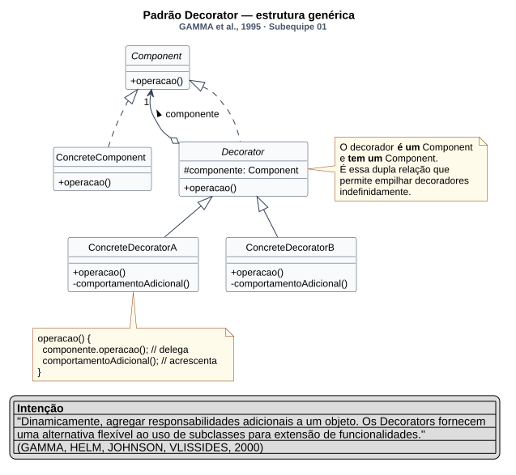
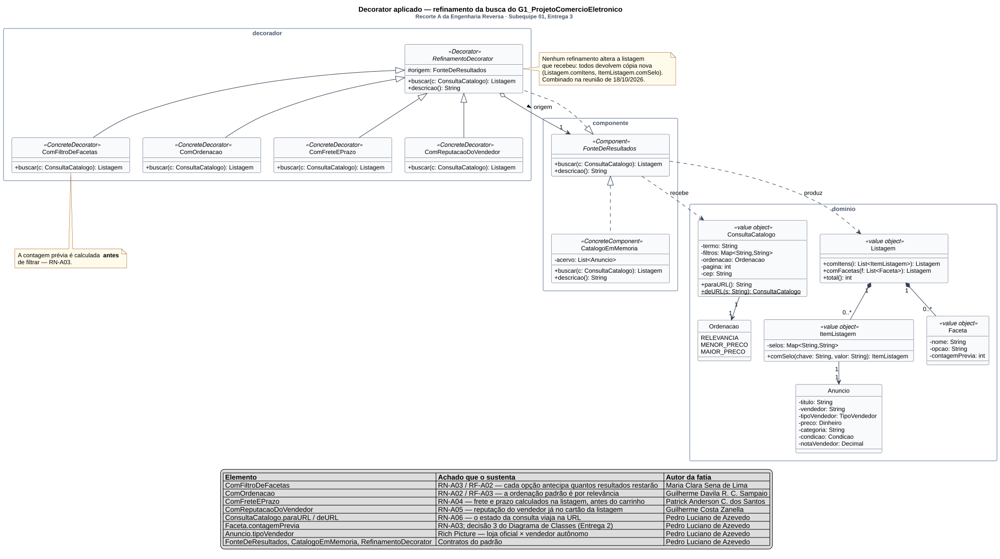

# GoF Estrutural — Decorator: refinamento da busca

Conforme a divisão registrada nas reuniões de [16/10](/ReunioesAtas/Subequipe1/Ata16-10.md) e [18/10/2026](/ReunioesAtas/Subequipe1/Ata18_10.md), este é o artefato estrutural da Subequipe 01. O **dono do artefato** é **Pedro Luciano de Azevedo** (modelagem, componente base, demonstração e vídeo), e cada um dos outros quatro integrantes implementa e documenta um refinamento concreto.

---

## 1. Contexto: o problema

A busca do G1_ProjetoComercioEletronico não é uma operação única. O Recorte A da [Engenharia Reversa](https://unbarqdsw2026-2-turma01.github.io/2026.2-T01-_G1_ProjetoComercioEletronico_Entrega_01/#/Base/Relat%C3%B3rios/SubEquipe01/EngenhariaReversa) da Entrega 1 registrou quatro comportamentos que se acumulam sobre o mesmo resultado:

| Regra | O que a observação registrou |
| -- | -- |
| RN-A02 / RF-A03 | A ordenação padrão é por relevância, e o comprador pode trocá-la |
| RN-A03 / RF-A02 | As facetas são cumulativas e cada opção exibe antecipadamente quantos resultados restarão |
| RN-A04 | Frete e prazo são calculados a partir do CEP, antes do carrinho |
| RN-A05 | A reputação do vendedor aparece já no cartão da listagem |

Esses refinamentos são **opcionais, cumulativos e combináveis em ordem variável** — o comprador aplica uma faceta, reordena, aplica outra. Nenhum deles é obrigatório, e nenhum deles exclui os demais.

A implementação ingênua seria uma classe `CatalogoCompleto` que fizesse tudo, com um parâmetro booleano por refinamento. Ela tem dois defeitos conhecidos: cresce a cada novo refinamento, e obriga a mexer no código da busca — que funciona — para acrescentar qualquer coisa nova. A alternativa por herança é pior: quatro refinamentos combináveis dariam dezesseis subclasses.

> **Elo com a Entrega 2.** No Diagrama de Casos de Uso, *Filtrar por facetas* e *Ordenar listagem* são `«extend»` de *Buscar produto* — comportamento opcional, acrescentado em condições específicas, sem que o caso base conheça a extensão. `«extend»` na UML e Decorator no código são a mesma afirmação sobre o sistema, em notações diferentes. Foi esse elo que decidiu a escolha do padrão na reunião de 18/10.

---

## 2. Fundamentação: o padrão Decorator

**Intenção.** "Dinamicamente, agregar responsabilidades adicionais a um objeto. Os *Decorators* fornecem uma alternativa flexível ao uso de subclasses para extensão de funcionalidades" (GAMMA et al., 2000).

**A estrutura.** O decorador **é um** componente (implementa a mesma interface) e **tem um** componente (guarda a referência para quem ele envolve). É essa dupla relação que permite empilhar decoradores indefinidamente sem que o cliente perceba a diferença — para quem chama, uma pilha de quatro refinamentos e o catálogo cru são o mesmo tipo.

**Quando o GoF recomenda usá-lo.** Três das quatro situações descritas pelos autores se aplicam aqui:

1. acrescentar responsabilidades a objetos individuais de forma dinâmica e transparente;
2. quando as responsabilidades podem ser retiradas;
3. quando a extensão por subclasses é impraticável pela explosão combinatória.

**Por que ele, e não o Strategy.** O Strategy troca *um* algoritmo por outro; aqui os refinamentos não se substituem, eles se **empilham**. É a distinção que o próprio GoF faz: o Decorator muda a pele do objeto, o Strategy muda as suas entranhas.

**Por que ele, e não o Chain of Responsibility.** Os dois montam cadeias, mas com propósitos opostos: na cadeia de responsabilidade, **um** elo trata a requisição e a cadeia para; aqui **todos** os elos contribuem, e o resultado final é a soma de todos eles.

---

## 3. Modelagem (Notação UML)

### 3.1. Modelagem genérica

[](../Assets/DecoratorGenerico.svg ":ignore")

<sub>Clique na imagem para abrir em tela cheia, com zoom.</sub>

> _Figura 1 — Estrutura genérica do padrão Decorator. `Decorator` implementa `Component` e agrega um `Component`: é um e tem um. A nota ao pé mostra o corpo típico de `operacao()` em um decorador concreto — delega e acrescenta. Fonte: Subequipe 01, 2026, a partir de GAMMA et al. (2000)._

### 3.2. Modelagem aplicada

[](../Assets/DecoratorAplicado.svg ":ignore")

<sub>Clique na imagem para abrir em tela cheia, com zoom.</sub>

> _Figura 2 — Decorator aplicado ao refinamento da busca. Três pacotes espelhando as pastas do código: `componente`, `decorador` e `dominio`. Estereótipos `«Component»`, `«ConcreteComponent»`, `«Decorator»` e `«ConcreteDecorator»` marcam o papel de cada classe no padrão. A legenda embutida rastreia cada elemento ao achado da Entrega 1 que o sustenta e identifica o autor de cada fatia. Fonte: Subequipe 01, 2026._

**Decisões de modelagem.**

- **Os pacotes espelham as pastas do código**, e não os conceitos do domínio. A escolha é deliberada: o diagrama serve para verificar a implementação, e um leitor que abra o repositório encontra `componente/`, `decorador/` e `dominio/` com exatamente essas classes.
- **A agregação, e não a composição, entre `RefinamentoDecorator` e `FonteDeResultados`.** O decorador não é dono da fonte que envolve: a mesma instância de `CatalogoEmMemoria` pode ser envolvida por cadeias diferentes, e sobrevive a elas.
- **Os quatro refinamentos concretos aparecem sem atributos.** O que distingue um do outro é o corpo de `buscar()`, e não a estrutura — exibir campos inexistentes só para preencher a caixa tornaria o diagrama menos fiel.
- **A legenda identifica o autor de cada fatia.** É a forma de o próprio artefato mostrar o rastro individual que as Diretrizes pedem, sem depender do quadro de participações.

---

## 4. Papéis no padrão

| Papel GoF | Classe | Autor da fatia |
| -- | -- | -- |
| Component | `FonteDeResultados` | Pedro Luciano de Azevedo |
| ConcreteComponent | `CatalogoEmMemoria` | Pedro Luciano de Azevedo |
| Decorator | `RefinamentoDecorator` | Pedro Luciano de Azevedo |
| ConcreteDecorator | `ComFiltroDeFacetas` | Maria Clara Sena de Lima |
| ConcreteDecorator | `ComOrdenacao` | Guilherme Davila Rodrigues Carneiro Sampaio |
| ConcreteDecorator | `ComFreteEPrazo` | Patrick Anderson Carvalho dos Santos |
| ConcreteDecorator | `ComReputacaoDoVendedor` | Guilherme Costa Zanella |
| Client | `cliente.Main` | Pedro Luciano de Azevedo |

Código no repositório: [`src/estruturais/RefinamentoDaBusca(Decorator)`](https://github.com/UnBArqDsw2026-2-Turma01/2026.2-T01-_G1_ProjetoComercioEletronico_Entrega_03/tree/main/docs/Base/Relat%C3%B3rios/Subequipe01/src/estruturais)

---

## 5. Implementação, fatia por fatia

### 5.1. Componente, decorador abstrato e domínio — Pedro Luciano de Azevedo

#### O componente

`FonteDeResultados` é a interface que torna o padrão possível: o catálogo cru e uma pilha de quatro refinamentos têm exatamente o mesmo tipo, e quem chama não distingue um do outro.

```java
public interface FonteDeResultados {
    Listagem buscar(ConsultaCatalogo consulta);
    String descricao();
}
```

O segundo método não faz parte do padrão: `descricao()` existe para a demonstração, devolvendo a cadeia montada como texto. Sem ele, o vídeo mostraria resultados diferentes sem deixar visível **por que** são diferentes. É um acréscimo ao padrão, e fica registrado como tal.

#### O componente concreto

`CatalogoEmMemoria` faz o mínimo que uma busca precisa fazer — casar o termo com o título do anúncio — e nada mais:

```java
@Override
public Listagem buscar(ConsultaCatalogo consulta) {
    List<ItemListagem> encontrados = new ArrayList<ItemListagem>();
    String termo = consulta.termo().toLowerCase();
    for (Anuncio anuncio : acervo) {
        if (termo.isEmpty() || anuncio.titulo().toLowerCase().contains(termo)) {
            encontrados.add(new ItemListagem(anuncio));
        }
    }
    return new Listagem(encontrados);
}
```

Ele é **deliberadamente pobre**: não filtra por faceta, não ordena, não calcula frete e não exibe reputação. Essa pobreza é o que torna visível, na demonstração, o que cada refinamento acrescenta. Um componente concreto que já fizesse metade do trabalho esconderia o efeito do padrão.

O acervo é fixo e em memória porque a engenharia reversa da Entrega 1 foi feita de caixa-preta: não há acesso ao catálogo real. Os oito anúncios reproduzem o que a observação registrou — várias ofertas para o mesmo item (RN-B09), lojas oficiais e vendedores autônomos com notas diferentes (Rich Picture), novos e usados.

#### O decorador abstrato

```java
public abstract class RefinamentoDecorator implements FonteDeResultados {

    protected final FonteDeResultados origem;

    protected RefinamentoDecorator(FonteDeResultados origem) {
        if (origem == null) {
            throw new IllegalArgumentException("Um decorador precisa envolver uma fonte de resultados");
        }
        this.origem = origem;
    }

    @Override
    public Listagem buscar(ConsultaCatalogo consulta) {
        return origem.buscar(consulta);
    }

    @Override
    public String descricao() {
        return origem.descricao() + " + " + getClass().getSimpleName();
    }
}
```

Três decisões neste trecho:

1. **`origem` é `protected final`.** Os refinamentos precisam alcançá-la por `super.buscar()`; ninguém precisa trocá-la depois de montada a cadeia.
2. **O construtor recusa `null`.** Um decorador sem fonte não é um decorador — falha no momento da montagem, e não na primeira busca.
3. **`buscar()` tem implementação padrão que repassa.** O GoF permite que o decorador abstrato seja `abstract` puro; aqui ele delega, para que um refinamento que só precise mexer na descrição não seja obrigado a reimplementar a busca.

#### O domínio herdado da Entrega 2

| Classe | De onde veio |
| -- | -- |
| `ConsultaCatalogo` | Decisão 2 do Diagrama de Classes — value object serializável; `paraURL`/`deURL` implementam RN-A06 |
| `Faceta` | Decisão 3 — `contagemPrevia` é atributo, não cálculo sob demanda |
| `Listagem` | `termosAlternativos` vem de RN-A01 / RF-A06 |
| `Dinheiro` | Decisão 10 — valor em centavos, padrão *Money* |
| `Anuncio` | Decisão 1 (Produto × Anuncio) e decisão 8 (`TipoVendedor` como enumeração) |
| `Ordenacao` | Enumeração do Diagrama de Classes; `RELEVANCIA` como padrão por RN-A02 |

**Imutabilidade como regra combinada.** `ConsultaCatalogo`, `Listagem` e `ItemListagem` são imutáveis, e todas as operações devolvem cópias (`comFiltro`, `comItens`, `comSelo`). A regra foi fixada na reunião de 18/10 e é o que garante que um refinamento nunca corrompa o resultado que recebeu do anterior — sem ela, a ordem da cadeia produziria efeitos colaterais difíceis de rastrear.

**Uma classe que não veio da Entrega 2: `ItemListagem`.** Os refinamentos de enriquecimento (frete, reputação) precisam acrescentar informação a cada resultado, e fazer isso em `Anuncio` obrigaria a mexer na classe de domínio a cada novo selo. `ItemListagem` separa o que o catálogo guarda do que a busca devolve, e é o que permite que `ComFreteEPrazo` e `ComReputacaoDoVendedor` existam sem tocar em `Anuncio`.

### 5.2. `ComFiltroDeFacetas` — Maria Clara Sena de Lima

`ComFiltroDeFacetas` é o refinamento que carrega **RN-A03 / RF-A02**: as facetas são cumulativas, e cada opção exibe **antes do clique** quantos resultados restarão. O decorador tem duas responsabilidades, sempre nesta ordem:

1. **montar as facetas** contando sobre a listagem que recebeu, antes de filtrar;
2. **filtrar os itens** pelos filtros da consulta: `categoria` (por exemplo, `Eletronicos`) e `condicao` (`NOVO` / `USADO`).

```java
@Override
public Listagem buscar(ConsultaCatalogo consulta) {
    Listagem recebida = super.buscar(consulta);

    // 1) contagem previa, calculada sobre a listagem recebida
    List<Faceta> facetas = new ArrayList<Faceta>();
    for (String dimensao : DIMENSOES) {
        facetas.addAll(contar(dimensao, recebida.itens(), consulta));
    }

    // 2) filtro cumulativo: o item precisa passar em todas as dimensoes
    List<ItemListagem> filtrados = new ArrayList<ItemListagem>();
    for (ItemListagem item : recebida.itens()) {
        if (passaNosFiltros(item, consulta, null)) {
            filtrados.add(item);
        }
    }

    return recebida.comItens(filtrados).comFacetas(facetas);
}
```

**Nunca altera o que recebeu.** O retorno é `recebida.comItens(...).comFacetas(...)`, uma `Listagem` nova. A listagem de quem está embaixo na cadeia continua intacta, conforme a regra combinada na reunião de 18/10.

**Contagem prévia em filtros cumulativos.** Contar as opções sobre todos os itens recebidos funcionaria quando nenhum filtro está ativo, mas daria um número errado quando há um: com `categoria=Eletronicos` aplicado, "condição: USADO" deve dizer quantos **eletrônicos** usados existem, porque é isso que resta se o comprador clicar. Por isso cada dimensão é contada sobre os itens que passam nos filtros **das outras dimensões**, e o filtro da própria dimensão é ignorado:

```java
private static List<Faceta> contar(String dimensao, List<ItemListagem> itens, ConsultaCatalogo consulta) {
    Map<String, Integer> contagem = new LinkedHashMap<String, Integer>();
    for (ItemListagem item : itens) {
        if (!passaNosFiltros(item, consulta, dimensao)) {   // ignora so a propria dimensao
            continue;
        }
        String opcao = valor(item, dimensao);
        Integer atual = contagem.get(opcao);
        contagem.put(opcao, atual == null ? 1 : atual + 1);
    }
    ...
}
```

Ignorar a própria dimensão é o que mantém as outras categorias visíveis, cada uma com a sua contagem, depois que o comprador escolhe uma. Assim ele pode trocar de categoria sem desfazer a busca. Na busca por "fone de ouvido":

| Consulta | Itens | Facetas devolvidas |
| -- | -- | -- |
| sem filtro | 7 | categoria: Eletronicos (4), Games (1), Esportes (1), Acessorios (1) · condicao: NOVO (6), USADO (1) |
| `categoria=Eletronicos` | 4 | categoria: Eletronicos (4), Games (1), Esportes (1), Acessorios (1) · condicao: **NOVO (3)**, USADO (1) |
| `categoria=Eletronicos&condicao=USADO` | 1 | categoria: **Eletronicos (1)** · condicao: NOVO (3), USADO (1) |

Na segunda linha, NOVO (3) + USADO (1) somam exatamente os 4 eletrônicos listados. Na terceira, cada número é o que o comprador veria ao trocar a opção daquela dimensão.

**Por que contar antes de filtrar, e o que isso custa.** Foi o que a observação registrou: a contagem chega pronta na resposta da busca, e não é calculada depois do clique. Por isso `Faceta.contagemPrevia` é atributo, e não cálculo sob demanda. O preço está no SIG da Entrega 1, como contribuição negativa sobre *Tempo de Resposta*: o decorador percorre a listagem uma vez por dimensão de faceta, mais uma vez para filtrar. Com duas dimensões e um acervo em memória o custo é desprezível. Em um catálogo real, ele cresce com o número de dimensões e é o primeiro candidato a ir para um índice.

**Elo com a Entrega 2.**

| Elemento | Entrega 2 |
| -- | -- |
| O decorador é opcional e só atua sobre uma busca que já trouxe resultados | Caso de uso *Filtrar Resultados*, `«extend»` de *Buscar Produtos* no [Diagrama de Casos de Uso](https://unbarqdsw2026-2-turma01.github.io/2026.2-T01-_G1_ProjetoComercioEletronico_Entrega_02/#/Base/Relat%C3%B3rios/Subequipe02/ModelagemEstatica/DiagramaDeCasosDeUso) |
| Alterar um filtro gera uma nova chamada a `buscar()`, que atravessa a cadeia inteira | Transição `ExibindoResultados → Buscando → ExibindoResultados` da [Máquina de Estados da busca](https://unbarqdsw2026-2-turma01.github.io/2026.2-T01-_G1_ProjetoComercioEletronico_Entrega_02/#/Base/Relat%C3%B3rios/Subequipe02/ModelagemDinamica/DiagramaDeMaquinaDeEstados); a decisão de reutilizar `Buscando` para filtros, ordenação e paginação é a mesma que faz todos os refinamentos rodarem dentro de uma única chamada |
| O filtro escolhido vive na consulta, e não no decorador | `ConsultaCatalogo` imutável e serializável na URL (RN-A06): o decorador lê `consulta.filtro(...)` e não guarda estado entre buscas |

**Limites desta fatia.** O caso de uso *Filtrar Resultados* cita categoria, preço, condição e frete. Esta fatia implementa as duas dimensões combinadas na reunião, categoria e condição. Faixa de preço e frete grátis ficam de fora: a faixa de preço pede intervalos em vez de valores discretos, e o frete depende de `ComFreteEPrazo` estar **abaixo** deste decorador na cadeia. Filtros com chaves que o decorador não conhece são ignorados por ele, sem erro, e ficam disponíveis para outro refinamento tratar.

Código: [`decorador/ComFiltroDeFacetas.java`](https://github.com/UnBArqDsw2026-2-Turma01/2026.2-T01-_G1_ProjetoComercioEletronico_Entrega_03/tree/main/docs/Base/Relat%C3%B3rios/Subequipe01/src/estruturais/RefinamentoDaBusca(Decorator)/decorador/ComFiltroDeFacetas.java).

### 5.3. `ComOrdenacao` — Guilherme Davila Rodrigues Carneiro Sampaio

`ComOrdenacao` é o refinamento que carrega **RN-A02 e RF-A03**: a ordenação padrão da busca é por relevância, e o comprador pode alternar para menor ou maior preço. Enquanto o `ComFiltroDeFacetas` altera o conjunto de itens retornados e os decoradores de enriquecimento acrescentam selos, o `ComOrdenacao` altera a **sequência** dos itens sem descartar nenhum elemento.

```java
@Override
public Listagem buscar(ConsultaCatalogo consulta) {
    Listagem recebida = super.buscar(consulta);

    List<ItemListagem> listaParaOrdenar = new ArrayList<ItemListagem>(recebida.itens());
    Ordenacao ordem = consulta.ordenacao();

    if (ordem == null || ordem == Ordenacao.RELEVANCIA) {
        // Preserva a ordem original do catalogo/fonte subjacente (inferencia declarada)
        return recebida.comItens(listaParaOrdenar);
    }

    if (ordem == Ordenacao.MENOR_PRECO) {
        Collections.sort(listaParaOrdenar, new Comparator<ItemListagem>() {
            @Override
            public int compare(ItemListagem a, ItemListagem b) {
                return Long.compare(a.anuncio().preco().centavos(), b.anuncio().preco().centavos());
            }
        });
    } else if (ordem == Ordenacao.MAIOR_PRECO) {
        Collections.sort(listaParaOrdenar, new Comparator<ItemListagem>() {
            @Override
            public int compare(ItemListagem a, ItemListagem b) {
                return Long.compare(b.anuncio().preco().centavos(), a.anuncio().preco().centavos());
            }
        });
    }

    return recebida.comItens(listaParaOrdenar);
}
```

**Nunca altera a listagem recebida.** Seguindo rigorosamente a regra combinada na reunião de 18/10, o decorador cria uma cópia da lista de itens (`new ArrayList<>(recebida.itens())`), realiza a ordenação sobre essa cópia e retorna uma nova `Listagem` via `recebida.comItens(...)`. A listagem recebida da fonte envolvida permanece imutável e preserva integralmente as facetas e termos alternativos previamente calculados.

**Por que `RELEVANCIA` preserva a ordem do catálogo e por que isso é inferência declarada.**
O critério real de relevância de um grande marketplace envolve cálculos internos complexos e proprietários (score textual ponderado por tf-idf / BM25, densidade de palavras-chave no anúncio, histórico de conversão e engajamento da oferta). Como a Engenharia Reversa da Entrega 1 foi estritamente de caixa-preta, não temos visibilidade da fórmula interna de ranqueamento. Assim, declarar que `Ordenacao.RELEVANCIA` aceita a ordem original emitida pelo motor do catálogo é uma **inferência declarada e deliberada**, e não uma omissão ou esquecimento de implementação.

**Elo com os modelos das Entregas 1 e 2.**
- **Diagrama de Casos de Uso (Entrega 2):** a ação *Ordenar listagem* foi modelada como uma extensão `«extend»` de *Buscar produtos*. O padrão Decorator reflete exatamente essa relação: um comportamento opcional que empilha sobre a busca básica sem acoplar o catálogo à lógica de classificação.
- **Diagrama de Atividades (Subequipe 02, Entrega 2):** o fluxo de busca e filtragem modelado na Subequipe 02 prevê a etapa de ranqueamento de ofertas após o join da busca concorrente.
- **Diagrama de Componentes (Subequipe 02, Entrega 2):** a responsabilidade equivale à do componente interno *Motor de Ranqueamento*, que recebe a lista e devolve ordenada.

**Saída de execução demonstrando as ordenações no catálogo:**

```text
RELEVANCIA (preservada):
  R$ 249,90 - Fone de ouvido bluetooth XZ-200
  R$ 219,90 - Fone de ouvido bluetooth XZ-200
  R$ 135,00 - Fone de ouvido bluetooth XZ-200 (usado)
  R$ 49,90 - Fone de ouvido com fio P2
  R$ 319,90 - Fone de ouvido gamer RGB
  R$ 179,00 - Fone de ouvido esportivo a prova dagua
  R$ 29,90 - Capa para fone de ouvido

MENOR PRECO:
  R$ 29,90 - Capa para fone de ouvido
  R$ 49,90 - Fone de ouvido com fio P2
  R$ 135,00 - Fone de ouvido bluetooth XZ-200 (usado)
  R$ 179,00 - Fone de ouvido esportivo a prova dagua
  R$ 219,90 - Fone de ouvido bluetooth XZ-200
  R$ 249,90 - Fone de ouvido bluetooth XZ-200
  R$ 319,90 - Fone de ouvido gamer RGB

MAIOR PRECO:
  R$ 319,90 - Fone de ouvido gamer RGB
  R$ 249,90 - Fone de ouvido bluetooth XZ-200
  R$ 219,90 - Fone de ouvido bluetooth XZ-200
  R$ 179,00 - Fone de ouvido esportivo a prova dagua
  R$ 135,00 - Fone de ouvido bluetooth XZ-200 (usado)
  R$ 49,90 - Fone de ouvido com fio P2
  R$ 29,90 - Capa para fone de ouvido
```

Código: [`decorador/ComOrdenacao.java`](https://github.com/UnBArqDsw2026-2-Turma01/2026.2-T01-_G1_ProjetoComercioEletronico_Entrega_03/tree/main/docs/Base/Relat%C3%B3rios/Subequipe01/src/estruturais/RefinamentoDaBusca(Decorator)/decorador/ComOrdenacao.java).

### 5.4. `ComFreteEPrazo` — Patrick Anderson Carvalho dos Santos

RN-A04 da Entrega 1 registrou que **frete e prazo dependem do CEP e são calculados ainda na listagem, antes do carrinho**. Foi esse achado que, no [Diagrama de Componentes da Entrega 2](https://unbarqdsw2026-2-turma01.github.io/2026.2-T01-_G1_ProjetoComercioEletronico_Entrega_02/#/Base/Relat%C3%B3rios/Subequipe01/ModelagemEstatica/DiagramaDeComponentes), obrigou o `Serviço de Catálogo` a requerer `IFrete` do `Serviço de Entrega` — a decisão 2 daquela página chamou isso de "uma decisão de produto com custo arquitetural": mostrar o frete cedo reduz o abandono no fim do funil, mas empurra uma dependência para o componente mais consultado do sistema. Este refinamento é aquela dependência, agora em código.

**Um decorador de enriquecimento.** Diferente do `ComFiltroDeFacetas`, que muda o conjunto de resultados, e do `ComOrdenacao`, que muda a sequência, este não remove nem reordena nada: só acrescenta dois selos a cada item.

| Selo | Exemplo | De onde vem |
| -- | -- | -- |
| `frete` | `R$ 39,40` | Faixa de peso de `Anuncio.pesoEmGramas()` mais acréscimo por região do CEP |
| `prazo` | `9 dia(s) util(eis)` | Região do CEP |

**A condição é a mesma do `«extend»`.** No [Diagrama de Sequência](https://unbarqdsw2026-2-turma01.github.io/2026.2-T01-_G1_ProjetoComercioEletronico_Entrega_02/#/Base/Relat%C3%B3rios/Subequipe01/ModelagemDinamica/DiagramaDeSequencia) o cálculo está dentro de um fragmento `opt` com a guarda *informa CEP*; no [Diagrama de Casos de Uso](https://unbarqdsw2026-2-turma01.github.io/2026.2-T01-_G1_ProjetoComercioEletronico_Entrega_02/#/Base/Relat%C3%B3rios/Subequipe01/ModelagemEstatica/DiagramaDeCasosDeUso), *Calcular frete por CEP* é `«extend»` de *Ver ficha do produto*, por RF-A04 ser opcional. Em código, isso é uma saída antecipada:

```java
@Override
public Listagem buscar(ConsultaCatalogo consulta) {
    Listagem recebida = super.buscar(consulta);

    // RN-A04 so se aplica quando ha CEP. Sem ele, nada a acrescentar: o
    // fragmento opt do Diagrama de Sequencia simplesmente nao executa.
    String cep = consulta.cep();
    if (cep == null || cep.trim().isEmpty()) {
        return recebida;
    }

    int regiao = regiaoDoCep(cep);
    List<ItemListagem> enriquecidos = new ArrayList<ItemListagem>(recebida.total());
    for (ItemListagem item : recebida.itens()) {
        int peso = item.anuncio().pesoEmGramas();
        enriquecidos.add(item
                .comSelo(SELO_FRETE, formatarCentavos(freteEmCentavos(peso, regiao)))
                .comSelo(SELO_PRAZO, prazoEmDias(regiao) + " dia(s) util(eis)"));
    }
    return recebida.comItens(enriquecidos);
}
```

Sem CEP, a listagem atravessa o decorador **sem alteração nenhuma** — não uma cópia vazia, a mesma listagem. É a tradução direta do `«extend»` da UML para o código: o comportamento opcional simplesmente não acontece.

**O CEP é usado só até onde a Entrega 1 permite.** A região sai do **primeiro dígito**, e nada além disso. RN-B04 registrou que o CEP é armazenado como oito dígitos sem separador, e foi só isso que se observou. Usar faixa de CEP real exigiria uma tabela que nunca vimos.

**O que é inferido, e está dito no código.** As tarifas — R$ 14,90, R$ 24,90 e R$ 39,90 por faixa de peso, mais R$ 3,50 por região — e o prazo de `2 + região` dias. Nenhum número desses foi observado: o Recorte A registrou que o frete é calculado por CEP na listagem, **não os valores nem a fórmula da transportadora**. O cabeçalho da classe marca os três blocos com `INFERIDO`, e as constantes têm `DEMONSTRACAO` no nome.

**Posição na cadeia: indiferente para o resultado, não para o custo.** Como só acrescenta informação, este decorador pode ficar em qualquer posição sem mudar o conjunto de itens. Mas colocado **depois** do `ComFiltroDeFacetas`, calcula frete apenas dos itens que sobraram. É um caso em que a ordem é irrelevante para a semântica e relevante para o desempenho — o oposto do par filtrar/ordenar.

**Verificação.** Como o `Main` ainda monta só o catálogo cru, a fatia foi exercitada por um conjunto de asserções à parte, com nove verificações, todas passando: a cadeia aparece em `descricao()`; a quantidade de itens não muda; com CEP todo item ganha os dois selos; sem CEP nenhum item ganha; **a listagem de origem não é alterada**; o item mais pesado não custa menos que o mais leve; um CEP de região distante tem prazo maior; e empilhar o decorador duas vezes não quebra.

Resultado de um item, com `cep=72230-130`:

```text
Fone de ouvido bluetooth XZ-200 - R$ 249,90 (AudioStore) | frete: R$ 39,40 | prazo: 9 dia(s) util(eis)
```

### 5.5. `ComReputacaoDoVendedor` — Guilherme Costa Zanella

`ComReputacaoDoVendedor` é o refinamento que carrega **RN-A05 / RF-A05**: todo produto de marketplace exibe a reputação do vendedor junto ao preço, já na listagem, com nota e número de avaliações por oferta. É um comportamento **observado**: a Engenharia Reversa registrou no cartão de produto "nota, número de avaliações e reputação do vendedor". O decorador acrescenta a cada item o selo `reputação`, com as três informações:

| Parte do selo | Exemplo | De onde vem |
| -- | -- | -- |
| Nota | `4,8 de 5` | `Anuncio.notaVendedor()`; RF-A05 |
| Número de avaliações | `(1532 avaliacoes)` | `Anuncio.quantidadeAvaliacoes()`; RF-A05 |
| Tipo de vendedor | `loja oficial` / `vendedor autonomo` | `Anuncio.TipoVendedor`; tensão do Rich Picture e decisão 8 do Diagrama de Classes |

```java
@Override
public Listagem buscar(ConsultaCatalogo consulta) {
    Listagem recebida = super.buscar(consulta);

    List<ItemListagem> enriquecidos = new ArrayList<ItemListagem>();
    for (ItemListagem item : recebida.itens()) {
        enriquecidos.add(item.comSelo(SELO, reputacao(item.anuncio())));
    }

    return recebida.comItens(enriquecidos);
}

/** "4,8 de 5 (1532 avaliacoes), loja oficial" — nota, volume e tipo (RF-A05). */
private static String reputacao(Anuncio anuncio) {
    return String.format(PT_BR, "%.1f de 5 (%d avaliacoes), %s",
            anuncio.notaVendedor(), anuncio.quantidadeAvaliacoes(),
            rotulo(anuncio.tipoVendedor()));
}
```

**Nunca altera o que recebeu.** Cada `comSelo` devolve uma cópia do item, e `comItens` devolve uma `Listagem` nova, que mantém as facetas de quem está embaixo na cadeia. Foi conferido em execução: depois de decorada, a listagem recebida continua com os itens sem nenhum selo, e as seis facetas montadas pelo `ComFiltroDeFacetas` passam intactas.

**Por que nota e número de avaliações juntos.** RF-A05 pede os dois, e o acervo mostra por quê: a `AudioStore` tem 4,8 em 1532 avaliações; a `Marcia Usados`, 3,6 em 41. Uma nota sozinha não diz quanto ela vale: é o volume que diz se a compradora pode confiar nela. O selo responde, **antes do clique**, à concern que desenhei para a Jenny no Rich Picture da Entrega 1: "o produto é confiável?".

**Exibe, mas não reordena nem filtra. Essa é a decisão principal desta fatia.** Seria fácil fazer este decorador "ajudar" a compradora, promovendo os vendedores mais bem avaliados. Não fiz, por dois motivos:

1. **Não há regra observada que sustente isso.** RN-A05 diz que a reputação é *exibida* na listagem. A ordem padrão é por relevância (RN-A02), e quem cuida dela na cadeia é o `ComOrdenacao`. Um decorador de enriquecimento que mexesse na ordem duplicaria uma responsabilidade que já tem dono.
2. **Tomaria partido na tensão do Rich Picture.** O conflito que registrei na Entrega 1 opõe a loja oficial ("eu pago mais, então apareço mais") e o vendedor autônomo ("por que meu anúncio nunca aparece na 1ª página?"). No acervo da demonstração, as lojas oficiais têm entre 903 e 1532 avaliações, e os autônomos entre 41 e 210. Ordenar por reputação empurraria todos os autônomos para baixo, e isso transformaria em regra do sistema exatamente a vantagem de que o vendedor autônomo reclama, sem nenhuma evidência de que a plataforma faça isso.

O tipo de vendedor entra no selo como **informação**, e não como critério: um vendedor autônomo pode ter nota melhor que uma loja oficial, e o selo mostra as duas coisas lado a lado sem sugerir que uma implique a outra.

Na busca por "fone de ouvido", com CEP informado e a cadeia `CatalogoEmMemoria + ComFiltroDeFacetas + ComFreteEPrazo + ComReputacaoDoVendedor` (todas as fatias já no repositório, exceto o `ComOrdenacao`):

```text
- Fone de ouvido bluetooth XZ-200 - R$ 249,90 (AudioStore) | frete: R$ 39,40 | prazo: 9 dia(s) util(eis) | reputação: 4,8 de 5 (1532 avaliacoes), loja oficial
- Fone de ouvido bluetooth XZ-200 - R$ 219,90 (Carlos Eletro) | frete: R$ 39,40 | prazo: 9 dia(s) util(eis) | reputação: 4,1 de 5 (87 avaliacoes), vendedor autonomo
- Fone de ouvido bluetooth XZ-200 (usado) - R$ 135,00 (Marcia Usados) | frete: R$ 39,40 | prazo: 9 dia(s) util(eis) | reputação: 3,6 de 5 (41 avaliacoes), vendedor autonomo
- Fone de ouvido com fio P2 - R$ 49,90 (AudioStore) | frete: R$ 39,40 | prazo: 9 dia(s) util(eis) | reputação: 4,8 de 5 (1532 avaliacoes), loja oficial
- Fone de ouvido gamer RGB - R$ 319,90 (GameHouse) | frete: R$ 39,40 | prazo: 9 dia(s) util(eis) | reputação: 4,6 de 5 (903 avaliacoes), loja oficial
- Fone de ouvido esportivo a prova dagua - R$ 179,00 (FitSound) | frete: R$ 39,40 | prazo: 9 dia(s) util(eis) | reputação: 4,3 de 5 (210 avaliacoes), vendedor autonomo
- Capa para fone de ouvido - R$ 29,90 (AcessoriosBR) | frete: R$ 39,40 | prazo: 9 dia(s) util(eis) | reputação: 3,9 de 5 (64 avaliacoes), vendedor autonomo
```

Duas coisas aparecem nessa saída:

- **Os selos se acumulam.** O `ComReputacaoDoVendedor` recebe os itens já com frete e prazo e acrescenta o seu selo sem apagar os anteriores, porque `comSelo` copia os selos existentes. É o empilhamento que o padrão promete, visível em uma linha.
- **A tensão do Rich Picture fica à vista.** As três primeiras linhas são o **mesmo** fone (RN-B09, várias ofertas para o mesmo item): a loja oficial é mais cara e mais bem avaliada; os dois autônomos são mais baratos e têm menos avaliações. O selo põe a informação na mesa, e a escolha entre preço e confiança fica com a compradora, sem que o sistema decida por ela. O conjunto e a ordem são idênticos aos do catálogo cru, o que também foi conferido em execução.

**Elo com as Entregas 1 e 2.**

| Elemento | Origem |
| -- | -- |
| Reputação na listagem, junto ao preço | RN-A05 e RF-A05, Recorte A da [Engenharia Reversa](https://unbarqdsw2026-2-turma01.github.io/2026.2-T01-_G1_ProjetoComercioEletronico_Entrega_01/#/Base/Relat%C3%B3rios/SubEquipe01/EngenhariaReversa) (Entrega 1) — observado |
| Tipo de vendedor no selo | Tensão loja oficial × vendedor autônomo no [Rich Picture](https://unbarqdsw2026-2-turma01.github.io/2026.2-T01-_G1_ProjetoComercioEletronico_Entrega_01/#/Base/Relat%C3%B3rios/SubEquipe01/ArtefatoGeneralista) (Entrega 1); `TipoVendedor` como enumeração, decisão 8 do Diagrama de Classes (Entrega 2) |
| O selo responde antes do clique | Concern da Jenny no Rich Picture: "o produto é confiável?" |
| Não reordena nem filtra | RN-A02 (a ordem é por relevância e pertence ao `ComOrdenacao`); ausência de regra observada que promova reputação |

**Limites desta fatia.**

- **A reputação é um número pronto.** A nota e o número de avaliações são atributos fixos do `Anuncio`, e não um cálculo sobre avaliações individuais: de caixa-preta, a Entrega 1 viu o número pronto, e não como ele é calculado.
- **Outras dimensões ficaram de fora.** A reputação na plataforma real pode incluir outras, como volume de vendas ou histórico de reclamações. Elas não foram registradas no Recorte A e, por isso, não estão aqui.
- **O selo é texto.** Um `Map<String, String>` em `ItemListagem` serve à demonstração, mas um consumidor que quisesse filtrar por nota teria de interpretar a string de volta. É sinal de que, em produção, a reputação deveria ser um tipo próprio.

Código: [`decorador/ComReputacaoDoVendedor.java`](https://github.com/UnBArqDsw2026-2-Turma01/2026.2-T01-_G1_ProjetoComercioEletronico_Entrega_03/tree/main/docs/Base/Relat%C3%B3rios/Subequipe01/src/estruturais/RefinamentoDaBusca(Decorator)/decorador/ComReputacaoDoVendedor.java).

---

## 6. Execução (vídeo com o padrão em execução)

> _A preencher por **Pedro Luciano de Azevedo**, depois que as quatro fatias subirem: vídeo mostrando a mesma consulta respondida pelo catálogo cru e pela cadeia completa, com a composição exibida por `descricao()`._

**Como compilar e executar:**

```bash
cd "docs/Base/Relatórios/Subequipe01/src/estruturais/RefinamentoDaBusca(Decorator)"
make run
```

Pré-requisito: JDK 8 ou superior. Instruções completas no [README do artefato](https://github.com/UnBArqDsw2026-2-Turma01/2026.2-T01-_G1_ProjetoComercioEletronico_Entrega_03/tree/main/docs/Base/Relat%C3%B3rios/Subequipe01/src/estruturais).

---

## 7. Rastreabilidade

| Elemento do código | Vem de | Entrega |
| -- | -- | -- |
| `ConsultaCatalogo` com `paraURL` / `deURL` | RN-A06; decisão 2 do Diagrama de Classes | 1 e 2 |
| `Faceta.contagemPrevia` | RN-A03 / RF-A02; decisão 3 do Diagrama de Classes | 1 e 2 |
| `Ordenacao.RELEVANCIA` como padrão | RN-A02 | 1 |
| Selos de frete e prazo | RN-A04; `IFrete` no Diagrama de Componentes | 1 e 2 |
| Selo de reputação | RN-A05; Rich Picture | 1 |
| `Listagem.termosAlternativos` | RN-A01 / RF-A06 | 1 |
| `Anuncio.TipoVendedor` | Rich Picture; decisão 8 do Diagrama de Classes | 1 e 2 |
| A cadeia de refinamentos | Diagrama de Sequência, mensagens 5–25 | 2 |
| A escolha do padrão | `«extend»` de *Filtrar por facetas* e *Ordenar listagem* no Diagrama de Casos de Uso | 2 |

---

## 8. Visão crítica

**A ordem da cadeia é semanticamente relevante, e o padrão não protege contra a montagem errada.** Ordenar antes de filtrar e filtrar antes de ordenar dão o mesmo conjunto, mas calcular a contagem prévia das facetas depois de um filtro já aplicado dá números diferentes de calculá-la antes. O Decorator torna a composição livre — e essa liberdade inclui compor errado. A cadeia correta está fixada em `Main` e documentada, mas nada no código impede outra montagem. É o preço da flexibilidade, e o GoF o reconhece ao listar "muitos objetos pequenos parecidos" entre as consequências do padrão.

**Dois tipos de refinamento convivem na mesma interface.** `ComFiltroDeFacetas` e `ComOrdenacao` mudam o **conjunto** de resultados; `ComFreteEPrazo` e `ComReputacaoDoVendedor` mudam **cada item**. Os quatro implementam `Listagem buscar(ConsultaCatalogo)` e empilham-se igual, mas são operações de naturezas diferentes. Um modelo mais rigoroso teria duas interfaces — uma de filtragem e outra de enriquecimento — ao custo de duas hierarquias e de perder a composição uniforme. A escolha foi pela uniformidade, e fica registrada como escolha, não como descuido.

**`descricao()` não é do padrão.** Ele existe para que a demonstração mostre a cadeia montada. É acréscimo didático: em produção, seria ruído na interface.

**O acervo é fixo.** A engenharia reversa foi de caixa-preta, então não há catálogo real para consultar. Os oito anúncios são suficientes para demonstrar os quatro refinamentos, mas não exercitam o que importaria em escala — o custo que o SIG da Entrega 1 atribuiu aos filtros facetados sobre *Tempo de Resposta* não aparece com oito itens.

**O que o artefato não cobre.** A rolagem infinita (e o RNF-A02 não satisfeito, que o Diagrama de Sequência da Entrega 2 explicou) não virou refinamento, embora coubesse como um. Ficou de fora por decisão de escopo: são cinco fatias para cinco pessoas, e um quinto refinamento desequilibraria a divisão. Está anotado como a evolução natural deste artefato.

**Ordenação em memória não escala para acervos massivos** (Guilherme Davila Rodrigues Carneiro Sampaio, `ComOrdenacao`). O decorador realiza `Collections.sort` em memória sobre a listagem de resultados já trazida da fonte. Em um catálogo de produção com centenas de milhares de produtos, ordenar em memória após recuperar itens inviabiliza a latência; a ordenação precisa ser delegada ao motor de busca/índice (como Elasticsearch) antes da paginação. O decorador atende ao escopo didático e à semântica do GoF, mas em grande escala a ordenação tende a ser parâmetro nativo do índice, e não um pós-processamento em camada de apresentação.

**Um refinamento de enriquecimento pode ser neutro, mas a cadeia não garante isso** (Guilherme Costa Zanella, `ComReputacaoDoVendedor`). Nada no padrão impede que um refinamento "só de exibição" passe a reordenar ou filtrar: a interface é a mesma, e a diferença está apenas no corpo de `buscar()`. A neutralidade do `ComReputacaoDoVendedor` diante da tensão entre loja oficial e vendedor autônomo é uma decisão documentada, e não uma garantia estrutural. É a mesma observação sobre os dois tipos de refinamento, vista de dentro de uma fatia: com uma interface própria de enriquecimento, que só recebesse e devolvesse `ItemListagem`, essa garantia viria do tipo.

---

## 9. Referências

GAMMA, Erich; HELM, Richard; JOHNSON, Ralph; VLISSIDES, John. **Padrões de Projeto: soluções reutilizáveis de software orientado a objetos**. Porto Alegre: Bookman, 2000.

FREEMAN, Eric; ROBSON, Elisabeth. **Use a Cabeça! Padrões de Projetos**. 2. ed. Rio de Janeiro: Alta Books, 2007.

FOWLER, Martin. **Patterns of Enterprise Application Architecture**. Boston: Addison-Wesley, 2002.

---

## Histórico de Versões

| Versão | Data | Descrição | Autor(es) | Revisor(es) |
| -- | -- | -- | -- | -- |
| 1.0 | 18/10/2026 | Criação da página: contexto, fundamentação, papéis no padrão e estrutura das seções por integrante | Pedro Luciano de Azevedo | -- |
| 1.1 | 18/10/2026 | Modelagem UML genérica e aplicada; documentação do componente, do decorador abstrato e do domínio; rastreabilidade e visão crítica | Pedro Luciano de Azevedo | -- |
| 1.2 | 18/10/2026 | Seção 5.2: refinamento `ComFiltroDeFacetas` (filtro cumulativo e contagem prévia por faceta disjuntiva), com trechos de código, exemplo de execução, custo registrado no SIG e elo com Casos de Uso e Máquina de Estados da Entrega 2 | Maria Clara Sena de Lima | -- |
| 1.3 | 18/10/2026 | Seção 5.4: refinamento `ComFreteEPrazo`, com o elo a RN-A04 e à interface `IFrete` do Diagrama de Componentes da Entrega 2, e as nove asserções que verificam a fatia | Patrick Anderson Carvalho dos Santos | -- |
| 1.4 | 18/10/2026 | Seção 5.5: refinamento `ComReputacaoDoVendedor` (selo de reputação com nota, número de avaliações e tipo de vendedor, sem reordenar nem filtrar), com trecho de código, saída da cadeia com frete e reputação empilhados e elo com RN-A05 / RF-A05 e o Rich Picture; limite da fatia acrescentado à visão crítica | Guilherme Costa Zanella | -- |
| 1.5 | 18/10/2026 | Seção 5.3: refinamento `ComOrdenacao` (ordenação por relevância, menor e maior preço, preservando ordem do catálogo para relevância como inferência declarada), saída real de execução, elo com Casos de Uso, Atividades e Componentes da Entrega 2 e limite na visão crítica | Guilherme Davila Rodrigues Carneiro Sampaio | -- |

