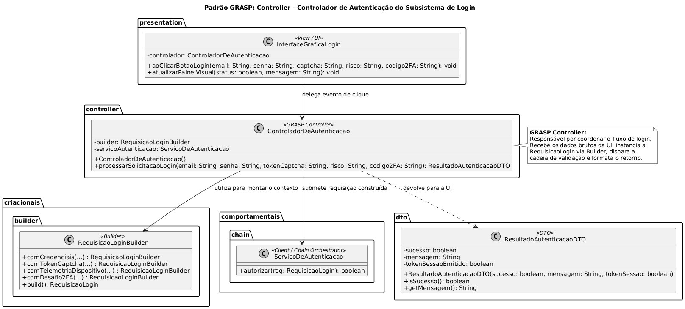
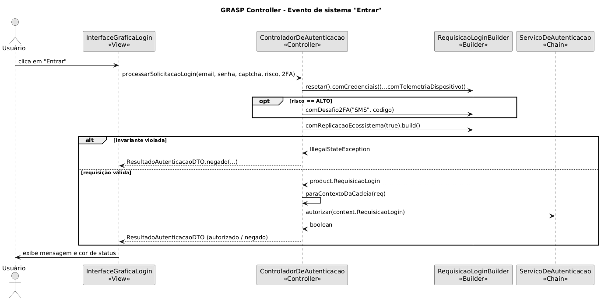

# GRASP Controller no Subsistema de Login

> Sistema em Java que modela a aplicação do princípio **GRASP Controller (Controlador)** no subsistema de **Login e Autenticação** do G1_ProjetoComercioEletronico: o `ControladorDeAutenticacao` é o primeiro objeto, além da camada de apresentação (Swing), a receber o evento de sistema "solicitar login". Ele isola a UI da lógica de negócio e coordena o fluxo entre o padrão criacional [Builder](<./ContextoDeLogin(Builder).md>) (montagem e validação do contexto) e o padrão comportamental [Chain of Responsibility](<./FluxoDeLogin(ChainOfResponsibility).md>) (barreiras de segurança), devolvendo à UI um `ResultadoAutenticacaoDTO` e refletindo os achados de Engenharia Reversa (**Achados L01 a L05**).

## Sumário

1. [Introdução](#1-introdução)
2. [Visão geral do sistema](#2-visão-geral-do-sistema)
3. [O modelo de controle e atribuição de responsabilidades](#3-o-modelo-de-controle-e-atribuição-de-responsabilidades)
4. [Fundamentação: o princípio GRASP Controller](#4-fundamentação-o-princípio-grasp-controller)
5. [Implementação, classe por classe](#5-implementação-classe-por-classe)
6. [Rastreabilidade com a Engenharia Reversa](#6-rastreabilidade-com-a-engenharia-reversa)
7. [Demonstração e Saída no Terminal](#7-demonstração-e-saída-no-terminal)
8. [Como compilar e executar](#8-como-compilar-e-executar)
9. [Decisões de projeto](#9-decisões-de-projeto)
10. [Relação com a literatura](#10-relação-com-a-literatura)
11. [Visão crítica](#11-visão-crítica)
12. [Melhorias propostas](#12-melhorias-propostas)
13. [Limitações desta documentação](#13-limitações-desta-documentação)
14. [Referências](#14-referências)

---

## 1. Introdução

### 1.1 Problema

Em arquiteturas orientadas a objetos, um erro comum de projeto é acoplar a camada de apresentação (botões e campos de uma interface Swing, ou controladores HTTP primitivos) diretamente às regras de negócio e à infraestrutura. No subsistema de Login, isso significaria que a `InterfaceGraficaLogin` precisaria, a cada clique:

- instanciar o `RequisicaoLoginConcretoBuilder` e conhecer a ordem dos seus passos (`comCredenciais`, `comTokenCaptcha`, `comTelemetriaDispositivo`, `comDesafio2FA`, `comReplicacaoEcossistema`);
- decidir quando o 2FA entra na montagem (somente em risco `ALTO`, **Achado-L03**);
- capturar a `IllegalStateException` de invariantes violadas;
- instanciar o `ServicoDeAutenticacao` e interpretar o retorno booleano da cadeia;
- converter tudo isso em mensagens e cores para a tela.

Uma View assim fica sobrecarregada com responsabilidades que não lhe competem, violando o Princípio da Responsabilidade Única (SRP), e torna impraticável testar a interface e a lógica separadamente. Além disso, a regra de login ficaria presa ao Swing: uma futura API REST teria de duplicá-la.

Existe ainda um problema de integração específico deste projeto: **os dois padrões já entregues modelam a requisição de login de formas diferentes** (ver seção 3.2), de modo que alguém precisa conectá-los. Sem um controlador, essa cola vazaria para a UI.

### 1.2 Abordagem

O sistema adota o princípio de atribuição de responsabilidade **GRASP Controller** (Larman, 2004): a responsabilidade de tratar o evento de sistema é atribuída a um **controlador de caso de uso** (`ControladorDeAutenticacao`), que não é uma classe de interface. O controlador atua como intermediário coordenador:

1. recebe os dados brutos da UI;
2. aciona o **Builder** para montar o contexto imutável `RequisicaoLogin` e validar suas invariantes (fail-fast);
3. adapta esse contexto ao modelo da cadeia e o submete ao `ServicoDeAutenticacao` (**Chain of Responsibility**);
4. traduz o resultado em um `ResultadoAutenticacaoDTO`, único tipo que a UI conhece.

O controlador **delega** a regra de negócio; ele apenas coordena.

### 1.3 Objetivos deste documento

- Descrever a arquitetura e o funcionamento do **GRASP Controller** no subsistema de Login.
- Demonstrar como o controlador conecta e coordena os padrões criacional e comportamental já desenvolvidos pela equipe.
- Evidenciar a rastreabilidade entre o controlador e os achados da Engenharia Reversa (**L01 a L05**).
- Registrar as decisões arquiteturais tomadas e as alternativas descartadas.
- Relacionar a solução com a literatura de projeto orientado a objetos (Craig Larman).
- Avaliar criticamente pontos fortes, fragilidades e oportunidades de evolução.

### 1.4 Escopo

O documento cobre **exclusivamente a camada controladora de coordenação do evento de login**, o DTO de resposta e a View que o consome. A montagem interna do payload pertence ao [Builder](<./ContextoDeLogin(Builder).md>) e a execução das barreiras de segurança pertence ao [Chain of Responsibility](<./FluxoDeLogin(ChainOfResponsibility).md>); ambos são reutilizados sem modificação.

### 1.5 Enquadramento na disciplina

Este trabalho complementa as diretrizes da disciplina _Arquitetura e Desenho de Software_ (Profa. Milene Serrano, UnB/FGA) como uma iniciativa extra voltada aos **Princípios GRASP (General Responsibility Assignment Software Patterns)**:

- **Princípio GRASP:** diretrizes fundamentais para atribuir responsabilidades a classes e objetos em projetos orientados a objetos.
- **Objetivo do Controller:** determinar qual objeto deve ser o primeiro, além da camada de UI, a receber e coordenar uma operação de sistema.

**Correspondência com a estrutura usada na disciplina**

| Estrutura de referência                  | Onde está nesta documentação                     |
| ---------------------------------------- | ------------------------------------------------ |
| Objetivo                                 | Seções 1.1 a 1.3 e 4.1                           |
| Modelagem genérica                       | Seção 2.4                                        |
| Participantes                            | Seções 2.3 e 2.5                                 |
| Modelagem aplicada/instanciada           | Seções 2.2 e 2.5                                 |
| Motivação                                | Seção 1.1                                        |
| Solução                                  | Seções 4 e 5                                     |
| Possível implementação                   | Seção 5 (código-fonte em pacotes)                |
| Teste e saída                            | Seção 7 (demonstração dos 5 cenários no console) |
| Rastreabilidade com artefatos anteriores | Seção 6                                          |
| Considerações finais e visão crítica     | Seções 11 e 13                                   |
| Referências                              | Seção 14                                         |

As seções 6 (rastreabilidade detalhada), 9 (decisões de projeto), 10 (relação com a literatura), 11 (visão crítica) e 12 (melhorias propostas) **vão além** da estrutura básica para aprofundamento qualitativo do artefato.

---

## 2. Visão geral do sistema

### 2.1 Estrutura de pastas

O GRASP Controller reside no diretório de iniciativas extras da Subequipe 03 e **reutiliza, sem cópia**, os códigos do Builder e da Chain por meio do `-sourcepath` do compilador (seção 8):

```text
GRASP_Controller/
├── controller/
│   └── ControladorDeAutenticacao.java   # Controller (GRASP): coordena Builder -> Chain -> DTO
├── dto/
│   └── ResultadoAutenticacaoDTO.java    # DTO imutável devolvido à UI
└── view/
    ├── InterfaceGraficaLogin.java       # View Swing: captura entradas e exibe o DTO
    └── MainControlador.java             # View de console: simula a UI em 5 cenários
```

Dependências reaproveitadas de outros módulos (não pertencem a esta pasta):

```text
criacionais/ContextoDeLogin(Builder)/                    # product/, builder/
comportamentais/FluxoDeLogin(ChainOfResponsibility)/     # context/, handler/, service/
```

### 2.2 Diagrama de classes (modelagem aplicada/instanciada)

<div style="text-align:center;">



<p><strong>GRASP Controller no Login</strong>: diagrama de classes da modelagem aplicada em PlantUML. <em>Autor: Pedro Henrique Gomes</em></p>

</div>

**Notação seguida:** seta de **associação** da `InterfaceGraficaLogin` para o `ControladorDeAutenticacao` (a View conhece apenas o Controller); seta tracejada de **dependência** da View para o `ResultadoAutenticacaoDTO` (consumo do resultado); **associação** do Controller para a interface `RequisicaoLoginBuilder` e para o `ServicoDeAutenticacao` (colaboradores coordenados); seta tracejada `<<creates>>` do Controller para o DTO; e dependências tracejadas do Controller para as duas versões de `RequisicaoLogin` (`product`, produzida pelo Builder; `context`, consumida pela Chain), evidenciando seu papel de adaptador. Note que **não há seta da View para Builder, Chain ou `RequisicaoLogin`**: esse é o isolamento que o padrão promove.

#### Diagrama de sequência (evento "Entrar")

<div style="text-align:center;">



<p><strong>GRASP Controller no Login</strong>: diagrama de classes da modelagem aplicada em PlantUML. <em>Autor: Pedro Henrique Gomes</em></p>

</div>

### 2.3 Papéis no padrão

| Papel (GRASP)                    | Classe no Projeto                                           | Responsabilidade                                                                                                |
| -------------------------------- | ----------------------------------------------------------- | --------------------------------------------------------------------------------------------------------------- |
| **Controller**                   | `ControladorDeAutenticacao`                                 | Recebe o evento de sistema da UI e coordena o fluxo Builder → Chain → DTO, sem conter regra de segurança.       |
| **View / UI**                    | `InterfaceGraficaLogin`, `MainControlador`                  | Captura entradas e exibe o DTO retornado; não contém decisão de segurança nem conhece Builder ou Chain.         |
| **Colaborador (criacional)**     | `RequisicaoLoginBuilder` / `RequisicaoLoginConcretoBuilder` | Monta o `RequisicaoLogin` imutável e valida invariantes (Achados L01, L02, L03, L05).                           |
| **Colaborador (comportamental)** | `ServicoDeAutenticacao`                                     | Monta e executa a cadeia de validadores; devolve `true`/`false`.                                                |
| **DTO (Data Transfer Object)**   | `ResultadoAutenticacaoDTO`                                  | Encapsula o resultado (sucesso, mensagem, token emitido) para exibição limpa na UI, sem expor o modelo interno. |

### 2.4 Comparação entre Modelagem Genérica (GRASP) e Modelagem Aplicada

| Elemento Teórico (Larman)                | Elemento na Modelagem Aplicada (Login)                                             |
| ---------------------------------------- | ---------------------------------------------------------------------------------- |
| Evento de Sistema (_System Event_)       | Clique em "Entrar" (`aoClicarBotaoLogin`)                                          |
| Operação do Sistema (_System Operation_) | `processarSolicitacaoLogin(...)`                                                   |
| Classe Controladora (_Controller_)       | `ControladorDeAutenticacao` (controlador de caso de uso)                           |
| Camada de Apresentação                   | `InterfaceGraficaLogin` (Swing) e `MainControlador` (console)                      |
| Camada de Domínio / Serviços             | `RequisicaoLoginBuilder` (criação) e `ServicoDeAutenticacao` (validação em cadeia) |
| Objeto de transferência                  | `ResultadoAutenticacaoDTO`                                                         |

### 2.5 Detalhamento dos Participantes e Colaboração

#### 2.5.1 Objetivo do padrão no domínio de Login

O **GRASP Controller** responde à pergunta _"quem trata o evento de login depois da tela?"_ com um objeto que não é a tela e não é a regra de negócio. Em vez de a View conhecer cinco passos de montagem, uma cadeia de quatro validadores e dois tipos de requisição, ela conhece **uma única operação** (`processarSolicitacaoLogin`) e **um único tipo de retorno** (`ResultadoAutenticacaoDTO`).

#### 2.5.2 Colaboração passo a passo entre os participantes

1. O usuário preenche os campos e clica em "Entrar"; a `InterfaceGraficaLogin` chama `controlador.processarSolicitacaoLogin(...)`.
2. O Controller chama `builder.resetar()` e encadeia `comCredenciais`, `comTokenCaptcha` e `comTelemetriaDispositivo`.
3. **Somente se o risco for `ALTO`**, o Controller chama `comDesafio2FA("SMS", codigo2FA)` (**Achado-L03**).
4. O Controller chama `comReplicacaoEcossistema(true)` (**Achado-L05**) e `build()`, que valida as invariantes.
5. Se o Builder lançar `IllegalStateException`, o Controller devolve um DTO negado **sem acionar a Chain**.
6. Caso contrário, o Controller converte o `product.RequisicaoLogin` em `context.RequisicaoLogin` e chama `servicoAutenticacao.autorizar(...)`.
7. O Controller traduz o booleano em `ResultadoAutenticacaoDTO.autorizado(...)` ou `negado(...)`.
8. A View recebe o DTO e atualiza o texto e a cor do painel de status.

---

## 3. O modelo de controle e atribuição de responsabilidades

### 3.1 Distribuição de responsabilidades por cenário

A tabela mostra, para cada cenário demonstrado na seção 7, **quem decide o quê**. A coluna do Controller nunca contém uma regra de segurança: ele apenas escolhe quais passos acionar e traduz o desfecho.

| Cenário                            | Controller (coordena)                                    | Builder (cria/valida)                           | Chain (decide)                                  | DTO devolvido à UI                 |
| ---------------------------------- | -------------------------------------------------------- | ----------------------------------------------- | ----------------------------------------------- | ---------------------------------- |
| **1. Risco baixo (caminho feliz)** | Não chama `comDesafio2FA`; adapta e submete              | Constrói com `exige2FA = false`                 | Elos 1–4 aprovam (bypass de 2FA, **L03**)       | `autorizado` (token emitido)       |
| **2. Risco alto + 2FA correto**    | Chama `comDesafio2FA("SMS", "123456")`; adapta e submete | Constrói com `exige2FA = true` e 2FA preenchido | Elo 3 sinaliza alerta; Elo 4 valida o código    | `autorizado` (token emitido)       |
| **3. Senha incorreta**             | Adapta e submete                                         | Constrói normalmente                            | **Elo 2 bloqueia** (**L02**), Elos 3–4 inativos | `negado`                           |
| **4. Token Captcha falso (bot)**   | Adapta e submete                                         | Constrói normalmente                            | **Elo 1 bloqueia** (**L01**), demais inativos   | `negado`                           |
| **5. Risco alto sem código 2FA**   | Chama `comDesafio2FA("SMS", "")`                         | **`build()` lança `IllegalStateException`**     | **Não é acionada**                              | `negado` com a mensagem do Builder |

### 3.2 Observações sobre o modelo

- **Dois modelos de requisição, um adaptador.** O Builder produz `product.RequisicaoLogin` (imutável, 10 atributos) e a Chain consome `context.RequisicaoLogin` (mutável, 5 atributos mais a flag `exige2FA`). São classes distintas, de pacotes distintos, e **nenhuma é subtipo da outra**. O Controller concentra a conversão no método privado `paraContextoDaCadeia`, de modo que nem a View nem os dois padrões precisam conhecer um ao outro.
- **O risco viaja nos metadados.** O `ValidadorRisco` decide por `metadadosDispositivo.contains("RISCO_ALTO")`. O adaptador serializa o nível de risco do Builder nesse texto (`IP=...|FP=...|RISCO_ALTO`), preservando o comportamento da Chain sem alterá-la.
- **2FA condicional.** O Builder marca `exige2FA = true` assim que `comDesafio2FA` é chamado (ou quando o risco é `ALTO`). Por isso o Controller **só chama `comDesafio2FA` quando o risco é `ALTO`**; chamá-lo sempre tornaria todo login exigente de 2FA e faria o cenário de risco baixo ser rejeitado pelo Builder.
- **Fail-fast antes da cadeia.** Um erro de invariante (cenário 5) é detectado no `build()`; a Chain, o banco simulado e o envio de SMS nunca são acionados.

---

## 4. Fundamentação: o princípio GRASP Controller

### 4.1 Intenção e Definição

Segundo Craig Larman (2004), o princípio **Controller** aborda a seguinte questão:

> _"Qual classe deve ser a primeira, além da camada de UI, a receber e coordenar uma operação de sistema?"_

A diretriz atribui a responsabilidade a uma classe que represente uma destas opções:

1. **Controlador de Caso de Uso / Sessão:** um objeto que trata todos os eventos de sistema de um caso de uso específico (aqui, `ControladorDeAutenticacao`).
2. **Controlador de Fachada:** um objeto que representa o sistema ou subsistema como um todo.

Larman também aponta que um controlador deve **delegar** o trabalho a outros objetos; se ele passa a conter lógica de negócio, torna-se um "controlador inchado" (_bloated controller_), com baixa coesão.

### 4.2 Quando usar

A literatura recomenda o padrão quando:

1. a camada de apresentação não deve conhecer o modelo de domínio nem os subsistemas de infraestrutura;
2. o mesmo caso de uso pode ser acionado por interfaces diferentes (desktop, web, API);
3. é preciso um ponto único para coordenar a sequência de operações de um caso de uso e traduzir seus resultados.

### 4.3 Benefícios Arquiteturais

| Benefício no catálogo GRASP | Como se manifesta neste sistema                                                                                                          |
| --------------------------- | ---------------------------------------------------------------------------------------------------------------------------------------- |
| **Baixo acoplamento da UI** | A `InterfaceGraficaLogin` depende só do Controller e do DTO; não importa `builder`, `product`, `context`, `handler` nem `service`.       |
| **Alta coesão**             | O fluxo de coordenação do login fica em um único ponto; a View só cuida de exibição, o Builder só de criação e a Chain só de validação.  |
| **Reuso de caso de uso**    | O mesmo controlador atende a View Swing e a View de console (`MainControlador`) sem duplicar código, e atenderia a um endpoint REST.     |
| **Testabilidade**           | O construtor com injeção de dependências permite testar o Controller com um Builder e um `ServicoDeAutenticacao` substitutos, sem Swing. |

### 4.4 Relação com outros princípios e padrões da SubEquipe 03

| Elemento                     | Pergunta que responde                                           | Papel no Login                                                                                                                                                             |
| ---------------------------- | --------------------------------------------------------------- | -------------------------------------------------------------------------------------------------------------------------------------------------------------------------- |
| **GRASP Controller**         | _Quem recebe e coordena o evento depois da UI?_                 | `ControladorDeAutenticacao`: orquestra criação, validação e resposta.                                                                                                      |
| **Builder** (GoF Criacional) | _Como montar um objeto complexo de forma segura e imutável?_    | Cria o `RequisicaoLogin` e garante invariantes antes da cadeia.                                                                                                            |
| **Chain of Responsibility**  | _Quais filtros sequenciais aprovam ou barram esta requisição?_  | Executa Captcha → Credenciais → Risco → 2FA com curto-circuito.                                                                                                            |
| **Facade** (GoF Estrutural)  | _Como oferecer uma interface simples a um subsistema complexo?_ | Semelhante em efeito (interface única para a UI), mas o Controller é um princípio de **atribuição de responsabilidade** sobre eventos, não uma estrutura de empacotamento. |

---

## 5. Implementação, classe por classe

> **Diretório do código-fonte:** `GRASP_Controller/` (iniciativas extras da Subequipe 03), com `controller/`, `dto/` e `view/`.

### 5.1 `ResultadoAutenticacaoDTO` (DTO — pacote `dto`)

```java
package dto;

public final class ResultadoAutenticacaoDTO {
    private final boolean sucesso;
    private final String mensagem;
    private final boolean tokenSessaoEmitido;

    public ResultadoAutenticacaoDTO(boolean sucesso, String mensagem, boolean tokenSessaoEmitido) {
        this.sucesso = sucesso;
        this.mensagem = mensagem;
        this.tokenSessaoEmitido = tokenSessaoEmitido;
    }

    public static ResultadoAutenticacaoDTO autorizado(String mensagem) {
        return new ResultadoAutenticacaoDTO(true, mensagem, true);
    }

    public static ResultadoAutenticacaoDTO negado(String mensagem) {
        return new ResultadoAutenticacaoDTO(false, mensagem, false);
    }

    public boolean isSucesso() { return sucesso; }
    public String getMensagem() { return mensagem; }
    public boolean isTokenSessaoEmitido() { return tokenSessaoEmitido; }

    @Override
    public String toString() {
        return "ResultadoAutenticacaoDTO{sucesso=" + sucesso
                + ", tokenSessaoEmitido=" + tokenSessaoEmitido
                + ", mensagem='" + mensagem + "'}";
    }
}
```

Os campos são `private final` e não há _setters_: o DTO é imutável. As fábricas estáticas `autorizado` e `negado` garantem que `tokenSessaoEmitido` só seja `true` quando `sucesso` for `true`, evitando combinações incoerentes.

### 5.2 `ControladorDeAutenticacao` (GRASP Controller — pacote `controller`)

```java
package controller;

import builder.RequisicaoLoginBuilder;
import builder.RequisicaoLoginConcretoBuilder;
import dto.ResultadoAutenticacaoDTO;
import product.RequisicaoLogin;
import service.ServicoDeAutenticacao;

public class ControladorDeAutenticacao {

    // Telemetria fixa de demonstração (a UI Swing não captura IP/fingerprint reais).
    private static final String IP_DEMO = "127.0.0.1";
    private static final String FINGERPRINT_DEMO = "WEB_CLIENT_SESSION";
    private static final String CANAL_2FA_PADRAO = "SMS";

    private final RequisicaoLoginBuilder builder;
    private final ServicoDeAutenticacao servicoAutenticacao;

    public ControladorDeAutenticacao() {
        this(new RequisicaoLoginConcretoBuilder(), new ServicoDeAutenticacao());
    }

    /** Construtor com injeção de dependências: permite testar o Controller com dublês. */
    public ControladorDeAutenticacao(RequisicaoLoginBuilder builder, ServicoDeAutenticacao servicoAutenticacao) {
        this.builder = builder;
        this.servicoAutenticacao = servicoAutenticacao;
    }

    /** Operação de sistema: tratamento do evento "clique em Entrar". */
    public ResultadoAutenticacaoDTO processarSolicitacaoLogin(
            String email, String senha, String tokenCaptcha, String nivelRisco, String codigo2FA) {

        System.out.println(">>> [GRASP Controller] Recebendo evento de sistema da UI...");
        System.out.println("[ControladorDeAutenticacao] Solicitacao de login recebida para: " + email);

        ResultadoAutenticacaoDTO resultado;
        try {
            // 1. Builder: monta o contexto imutável e valida as invariantes (fail-fast)
            RequisicaoLogin requisicao = montarRequisicao(email, senha, tokenCaptcha, nivelRisco, codigo2FA);

            // 2. Chain: adapta o contexto do Builder ao contexto da Chain e delega
            boolean autorizado = servicoAutenticacao.autorizar(paraContextoDaCadeia(requisicao));

            // 3. DTO: traduz o booleano da cadeia para a UI
            resultado = autorizado
                    ? ResultadoAutenticacaoDTO.autorizado("Autenticação bem-sucedida. Sessão replicada (Achado-L05).")
                    : ResultadoAutenticacaoDTO.negado("Falha na validação de segurança da cadeia.");

        } catch (IllegalStateException e) {
            // Invariante violada no Builder: a requisição nem chega a existir; a Chain não é acionada
            resultado = ResultadoAutenticacaoDTO.negado("Erro de validação do Builder: " + e.getMessage());
        }

        System.out.println(">>> [GRASP Controller] Retorno enviado à UI via DTO: " + resultado.getMensagem());
        return resultado;
    }

    private RequisicaoLogin montarRequisicao(
            String email, String senha, String tokenCaptcha, String nivelRisco, String codigo2FA) {

        builder.resetar()
                .comCredenciais(email, senha)
                .comTokenCaptcha(tokenCaptcha)
                .comTelemetriaDispositivo(IP_DEMO, FINGERPRINT_DEMO, nivelRisco);

        // O 2FA só entra na montagem quando o risco é ALTO (Achado-L03).
        // Chamar comDesafio2FA incondicionalmente forçaria exige2FA = true em todo login.
        if ("ALTO".equalsIgnoreCase(nivelRisco)) {
            builder.comDesafio2FA(CANAL_2FA_PADRAO, codigo2FA);
        }

        return builder.comReplicacaoEcossistema(true).build();
    }

    /**
     * Adaptador entre os dois modelos de requisição do projeto:
     * product.RequisicaoLogin (Builder, imutável) e context.RequisicaoLogin (Chain, mutável).
     */
    private context.RequisicaoLogin paraContextoDaCadeia(RequisicaoLogin r) {
        String metadados = "IP=" + r.getIpOrigem()
                + "|FP=" + r.getDeviceFingerprint()
                + "|RISCO_" + r.getNivelRisco().toUpperCase();

        return new context.RequisicaoLogin(
                r.getEmail(), r.getSenhaHash(), r.getTokenCaptchaEnterprise(),
                r.getCodigo2FA(), metadados);
    }
}
```

Pontos técnicos de destaque:

- **O Controller não decide segurança.** Ele não valida captcha, senha, risco nem 2FA; apenas escolhe quais passos do Builder acionar e traduz o resultado. Toda regra permanece nos módulos de origem.
- **Injeção de dependências.** O construtor sem argumentos monta a configuração padrão; o construtor com parâmetros permite substituir Builder e serviço em testes.
- **Nome qualificado para a segunda `RequisicaoLogin`.** O `import product.RequisicaoLogin` coexiste com o uso de `context.RequisicaoLogin` pelo nome completo, pois as duas classes têm o mesmo nome simples.
- **Tradução de exceção em resultado.** A `IllegalStateException` do Builder não chega à View: vira um DTO negado.

### 5.3 `InterfaceGraficaLogin` (View — pacote `view`)

```java
package view;

import controller.ControladorDeAutenticacao;
import dto.ResultadoAutenticacaoDTO;

import javax.swing.*;
import java.awt.*;

public class InterfaceGraficaLogin extends JFrame {

    private static final Color VERDE = new Color(0x2E7D32);
    private static final Color VERMELHO = new Color(0xC62828);

    private final ControladorDeAutenticacao controlador;

    private final JTextField campoEmail = new JTextField("pedro@unb.br", 20);
    private final JPasswordField campoSenha = new JPasswordField("HASH_SENHA_123", 20);
    private final JComboBox<String> comboCaptcha =
            new JComboBox<>(new String[]{"CAPTCHA_OK_TOKEN_VALIDO", "TOKEN_FALSO"});
    private final JComboBox<String> comboRisco = new JComboBox<>(new String[]{"BAIXO", "ALTO"});
    private final JTextField campoCodigo2FA = new JTextField("123456", 20);
    private final JButton botaoLogin = new JButton("Entrar");
    private final JLabel rotuloStatus = new JLabel("Aguardando autenticação...", SwingConstants.CENTER);

    public InterfaceGraficaLogin(ControladorDeAutenticacao controlador) {
        super("Login - GRASP Controller");
        this.controlador = controlador;
        montarTela();
        botaoLogin.addActionListener(e -> aoClicarBotaoLogin());
    }

    private void montarTela() {
        setDefaultCloseOperation(EXIT_ON_CLOSE);
        JPanel form = new JPanel(new GridLayout(0, 2, 8, 8));
        form.setBorder(BorderFactory.createEmptyBorder(16, 16, 8, 16));
        form.add(new JLabel("E-mail:"));          form.add(campoEmail);
        form.add(new JLabel("Senha (hash):"));    form.add(campoSenha);
        form.add(new JLabel("Token captcha:"));   form.add(comboCaptcha);
        form.add(new JLabel("Nível de risco:"));  form.add(comboRisco);
        form.add(new JLabel("Código 2FA:"));      form.add(campoCodigo2FA);

        rotuloStatus.setOpaque(true);
        rotuloStatus.setBorder(BorderFactory.createEmptyBorder(10, 10, 10, 10));

        JPanel rodape = new JPanel(new BorderLayout(8, 8));
        rodape.setBorder(BorderFactory.createEmptyBorder(0, 16, 16, 16));
        rodape.add(botaoLogin, BorderLayout.NORTH);
        rodape.add(rotuloStatus, BorderLayout.CENTER);

        add(form, BorderLayout.CENTER);
        add(rodape, BorderLayout.SOUTH);
        pack();
        setLocationRelativeTo(null);
    }

    /** Evento de sistema: a View apenas delega ao Controller. */
    private void aoClicarBotaoLogin() {
        ResultadoAutenticacaoDTO resultado = controlador.processarSolicitacaoLogin(
                campoEmail.getText(),
                new String(campoSenha.getPassword()),
                (String) comboCaptcha.getSelectedItem(),
                (String) comboRisco.getSelectedItem(),
                campoCodigo2FA.getText());
        exibir(resultado);
    }

    private void exibir(ResultadoAutenticacaoDTO resultado) {
        rotuloStatus.setText("<html><center>" + resultado.getMensagem() + "</center></html>");
        rotuloStatus.setBackground(resultado.isSucesso() ? VERDE : VERMELHO);
        rotuloStatus.setForeground(Color.WHITE);
    }

    public static void main(String[] args) {
        SwingUtilities.invokeLater(() ->
                new InterfaceGraficaLogin(new ControladorDeAutenticacao()).setVisible(true));
    }
}
```

A lista de `import` da View é a prova do desacoplamento: **apenas** `controller` e `dto`. Sua lógica se resume a `aoClicarBotaoLogin`, que apenas delega ao Controller, e `exibir`, que pinta o DTO.

### 5.4 `MainControlador` (View de console — pacote `view`)

```java
package view;

import controller.ControladorDeAutenticacao;
import dto.ResultadoAutenticacaoDTO;

public class MainControlador {
    private static final String EMAIL = "pedro@unb.br";
    private static final String SENHA = "HASH_SENHA_123";
    private static final String CAPTCHA_OK = "CAPTCHA_OK_TOKEN_VALIDO";

    public static void main(String[] args) {
        ControladorDeAutenticacao controlador = new ControladorDeAutenticacao();

        executar(controlador, "CENARIO 1: Risco baixo (bypass silencioso de 2FA)",
                EMAIL, SENHA, CAPTCHA_OK, "BAIXO", "");
        executar(controlador, "CENARIO 2: Risco alto com 2FA correto",
                EMAIL, SENHA, CAPTCHA_OK, "ALTO", "123456");
        executar(controlador, "CENARIO 3: Senha incorreta (curto-circuito no Elo 2)",
                EMAIL, "SENHA_ERRADA", CAPTCHA_OK, "BAIXO", "");
        executar(controlador, "CENARIO 4: Token Captcha falso (curto-circuito no Elo 1)",
                EMAIL, SENHA, "TOKEN_FALSO", "BAIXO", "");
        executar(controlador, "CENARIO 5: Risco alto sem codigo 2FA (barrado pelo Builder)",
                EMAIL, SENHA, CAPTCHA_OK, "ALTO", "");
    }

    private static void executar(ControladorDeAutenticacao c, String titulo,
                                 String email, String senha, String captcha, String risco, String codigo) {
        System.out.println("\n######## " + titulo + " ########");
        ResultadoAutenticacaoDTO dto = c.processarSolicitacaoLogin(email, senha, captcha, risco, codigo);
        System.out.println("[View] sucesso=" + dto.isSucesso() + " | tokenEmitido=" + dto.isTokenSessaoEmitido());
    }
}
```

Uma segunda View sobre o **mesmo** Controller, sem alterá-lo, demonstra o reuso do caso de uso por interfaces diferentes (benefício da seção 4.3).

---

## 6. Rastreabilidade com a Engenharia Reversa

O Controller não implementa nenhum achado por conta própria: ele **coordena** os módulos que os materializam. A tabela mostra onde cada achado é tratado e qual o papel do Controller.

| Código do Achado | Evidência na Engenharia Reversa (Entregas 1 e 2)                                                                                | Onde é materializado                                                              | Papel do Controller (Entrega 3)                                                                                                         |
| ---------------- | ------------------------------------------------------------------------------------------------------------------------------- | --------------------------------------------------------------------------------- | --------------------------------------------------------------------------------------------------------------------------------------- |
| **Achado-L01**   | O script `enterprise.js` (reCAPTCHA Enterprise) é carregado no _page load_ e emite um token antes da submissão das credenciais. | Builder (`comTokenCaptcha`) e Chain (**Elo 1**, `ValidadorCaptcha`).              | Repassa o token capturado pela UI ao Builder; a rejeição pelo Elo 1 vira um DTO negado (cenário 4).                                     |
| **Achado-L02**   | Credenciais inválidas retornam um payload genérico com HTTP 200, sem 401 explícito.                                             | Builder (invariante de e-mail/senha) e Chain (**Elo 2**, `ValidadorCredenciais`). | Repassa as credenciais; a rejeição pelo Elo 2 vira um DTO negado com mensagem genérica (cenário 3), sem expor o motivo à UI.            |
| **Achado-L03**   | Risco baixo dispensa o 2FA silenciosamente; risco alto torna o desafio obrigatório.                                             | Builder (`comTelemetriaDispositivo` + `comDesafio2FA`) e Chain (**Elos 3 e 4**).  | Decide **quando** acionar `comDesafio2FA` (somente em risco `ALTO`) e serializa o risco nos metadados para o Elo 3 (cenários 1, 2 e 5). |
| **Achado-L04**   | Fora do escopo do subsistema de Login modelado nos padrões de origem.                                                           | —                                                                                 | Não tratado neste módulo.                                                                                                               |
| **Achado-L05**   | Após o login, `POST /session/replicate` (status 204) replica a sessão para o ecossistema integrado.                             | Builder (`comReplicacaoEcossistema`) e `ServicoDeAutenticacao.autorizar()`.       | Solicita a replicação no Builder e reflete no DTO autorizado a mensagem "Sessão replicada (Achado-L05)".                                |

> **Nota:** o Achado-L04 não aparece nos documentos do Builder e da Chain; confirme, no relatório de Engenharia Reversa da Subequipe, se ele deve ser mencionado aqui. Se não pertencer ao Login, a linha pode ser removida.

Referências cruzadas: [Engenharia Reversa](https://unbarqdsw2026-2-turma01.github.io/2026.2-T01-_G1_ProjetoComercioEletronico_Entrega_01/#/Base/Relat%C3%B3rios/SubEquipe03/EngenhariaReversa), [Diagramas de Sequência](https://unbarqdsw2026-2-turma01.github.io/2026.2-T01-_G1_ProjetoComercioEletronico_Entrega_02/#/Base/Relat%C3%B3rios/Subequipe03/ModelagemDinamica/DiagramaDeSequencia) e [Diagrama de Comunicação](https://unbarqdsw2026-2-turma01.github.io/2026.2-T01-_G1_ProjetoComercioEletronico_Entrega_02/#/Base/Relat%C3%B3rios/Subequipe03/ModelagemDinamica/DiagramaDeComunicacao) do Subsistema de Login; [Builder](<./ContextoDeLogin(Builder).md>) e [Chain of Responsibility](<./FluxoDeLogin(ChainOfResponsibility).md>).

---

## 7. Demonstração e Saída no Terminal

A classe `MainControlador` simula a UI e dispara cinco eventos de sistema sobre o **mesmo** Controller, exercitando todos os desfechos possíveis:

| Cenário       | Entrada simulada                                              | Onde o fluxo termina               | Resultado esperado                                                    |
| ------------- | ------------------------------------------------------------- | ---------------------------------- | --------------------------------------------------------------------- |
| **Cenário 1** | Token válido + senha correta + risco `BAIXO`                  | Elo 4 (bypass do 2FA)              | DTO autorizado; 2FA dispensado (**L03**) e sessão replicada (**L05**) |
| **Cenário 2** | Token válido + senha correta + risco `ALTO` + código `123456` | Elo 4 (validação do 2FA)           | DTO autorizado após validação do segundo fator                        |
| **Cenário 3** | Token válido + `SENHA_ERRADA`                                 | **Elo 2** (`ValidadorCredenciais`) | DTO negado; curto-circuito (**L02**)                                  |
| **Cenário 4** | `TOKEN_FALSO`                                                 | **Elo 1** (`ValidadorCaptcha`)     | DTO negado; curto-circuito imediato (**L01**)                         |
| **Cenário 5** | Risco `ALTO` sem código 2FA                                   | **Builder** (`build()`)            | DTO negado com a mensagem do Builder; **a Chain não é acionada**      |

### 7.1 Saída real da execução no terminal

```text
######## CENARIO 1: Risco baixo (bypass silencioso de 2FA) ########
>>> [GRASP Controller] Recebendo evento de sistema da UI...
[ControladorDeAutenticacao] Solicitacao de login recebida para: pedro@unb.br
==================================================================
Iniciando autorizacao para o usuario: pedro@unb.br
------------------------------------------------------------------
[1. ValidadorCaptcha] Verificando token reCAPTCHA Enterprise carregado no page load (Achado-L01)...
   -> [OK] Token Captcha validado com sucesso.
[2. ValidadorCredenciais] Consultando usuario no Banco de Dados...
   -> [OK] Credenciais validas para: pedro@unb.br
[3. ValidadorRisco] Avaliando score de risco e metadados do dispositivo...
   -> [OK] Score de risco baixo. Passando silenciosamente sem exigir 2FA (Achado-L03).
[4. ValidadorTwoFactor] Verificando necessidade de 2FA...
   -> [BYPASS] 2FA nao exigido para esta sessao (Fluxo silencioso concluido).
------------------------------------------------------------------
[SUCESSO] Login autorizado! Emitindo Token de Sessao.
[Achado-L05] Replicando sessao entre produtos (POST /session/replicate -> 204).
==================================================================

>>> [GRASP Controller] Retorno enviado à UI via DTO: Autenticação bem-sucedida. Sessão replicada (Achado-L05).
[View] sucesso=true | tokenEmitido=true

######## CENARIO 2: Risco alto com 2FA correto ########
>>> [GRASP Controller] Recebendo evento de sistema da UI...
[ControladorDeAutenticacao] Solicitacao de login recebida para: pedro@unb.br
==================================================================
Iniciando autorizacao para o usuario: pedro@unb.br
------------------------------------------------------------------
[1. ValidadorCaptcha] Verificando token reCAPTCHA Enterprise carregado no page load (Achado-L01)...
   -> [OK] Token Captcha validado com sucesso.
[2. ValidadorCredenciais] Consultando usuario no Banco de Dados...
   -> [OK] Credenciais validas para: pedro@unb.br
[3. ValidadorRisco] Avaliando score de risco e metadados do dispositivo...
   -> [ALERTA] Score de risco elevado detectado! Exigindo confirmacao 2FA.
[4. ValidadorTwoFactor] Verificando necessidade de 2FA...
   -> [ACAO] Disparando codigo de confirmacao via Servico de Notificacao (SMS/E-mail)...
   -> [OK] Codigo 2FA (123456) validado com sucesso!
------------------------------------------------------------------
[SUCESSO] Login autorizado! Emitindo Token de Sessao.
[Achado-L05] Replicando sessao entre produtos (POST /session/replicate -> 204).
==================================================================

>>> [GRASP Controller] Retorno enviado à UI via DTO: Autenticação bem-sucedida. Sessão replicada (Achado-L05).
[View] sucesso=true | tokenEmitido=true

######## CENARIO 3: Senha incorreta (curto-circuito no Elo 2) ########
>>> [GRASP Controller] Recebendo evento de sistema da UI...
[ControladorDeAutenticacao] Solicitacao de login recebida para: pedro@unb.br
==================================================================
Iniciando autorizacao para o usuario: pedro@unb.br
------------------------------------------------------------------
[1. ValidadorCaptcha] Verificando token reCAPTCHA Enterprise carregado no page load (Achado-L01)...
   -> [OK] Token Captcha validado com sucesso.
[2. ValidadorCredenciais] Consultando usuario no Banco de Dados...
   -> [BLOQUEADO] Credenciais invalidas.
   -> [Achado-L02] Retornando HTTP 200 com payload comprimido generico e recarregando desafio Captcha.
------------------------------------------------------------------
[FALHA] A tentativa de login foi rejeitada pela cadeia de validacao.
==================================================================

>>> [GRASP Controller] Retorno enviado à UI via DTO: Falha na validação de segurança da cadeia.
[View] sucesso=false | tokenEmitido=false

######## CENARIO 4: Token Captcha falso (curto-circuito no Elo 1) ########
>>> [GRASP Controller] Recebendo evento de sistema da UI...
[ControladorDeAutenticacao] Solicitacao de login recebida para: pedro@unb.br
==================================================================
Iniciando autorizacao para o usuario: pedro@unb.br
------------------------------------------------------------------
[1. ValidadorCaptcha] Verificando token reCAPTCHA Enterprise carregado no page load (Achado-L01)...
   -> [BLOQUEADO] Token de Captcha invalido ou ausente. Interrompendo a cadeia.
------------------------------------------------------------------
[FALHA] A tentativa de login foi rejeitada pela cadeia de validacao.
==================================================================

>>> [GRASP Controller] Retorno enviado à UI via DTO: Falha na validação de segurança da cadeia.
[View] sucesso=false | tokenEmitido=false

######## CENARIO 5: Risco alto sem codigo 2FA (barrado pelo Builder) ########
>>> [GRASP Controller] Recebendo evento de sistema da UI...
[ControladorDeAutenticacao] Solicitacao de login recebida para: pedro@unb.br
>>> [GRASP Controller] Retorno enviado à UI via DTO: Erro de validação do Builder: [Erro do Builder] Sessao classificada como RISCO ALTO exige que o canal e o codigo 2FA sejam preenchidos.
[View] sucesso=false | tokenEmitido=false
```

**Como ler a saída:**

- Em todos os cenários, as linhas `[GRASP Controller]` abrem e fecham o fluxo: é o Controller recebendo o evento da UI e devolvendo o DTO.
- Nos cenários 1 a 4, as linhas numeradas `[1.]` a `[4.]` pertencem à Chain e mostram o curto-circuito (cenários 3 e 4 interrompem a cadeia antes do fim).
- No **cenário 5**, não aparece nenhuma linha de validador: a requisição foi barrada pelo Builder, antes de a Chain existir no fluxo. É a evidência de que o Controller trata o erro de criação sem acionar a validação.

### 7.2 Interface Swing

A `InterfaceGraficaLogin` oferece os mesmos cenários de forma interativa (e-mail, senha, token de captcha válido ou falso, nível de risco e código 2FA). O painel de status mostra a mensagem do DTO em **verde** (autorizado) ou **vermelho** (negado). Como a View só recebe o DTO, ela **não** exibe o estado individual de cada elo da cadeia; essa visão fina exigiria um retorno mais rico da Chain (ver seção 12).

---

## 8. Como compilar e executar

O Controller reutiliza o Builder e a Chain pelo `-sourcepath`, sem copiar seus arquivos. A partir da pasta `GRASP_Controller/`, e assumindo a árvore `src/criacionais`, `src/comportamentais` e `src/extras/GRASP_Controller` (ajuste os caminhos relativos se a sua for diferente):

```bash
# Compila Controller, DTO e Views; o javac localiza Builder e Chain pelo sourcepath
javac -encoding UTF-8 -d out \
  -sourcepath "../../criacionais/ContextoDeLogin(Builder):../../comportamentais/FluxoDeLogin(ChainOfResponsibility)" \
  controller/*.java dto/*.java view/*.java

# Demonstração em console (5 cenários)
java -Dstdout.encoding=UTF-8 -cp out view.MainControlador

# Interface Swing (requer ambiente gráfico)
java -cp out view.InterfaceGraficaLogin
```

No Windows (PowerShell), troque o separador de caminhos do `-sourcepath` de `:` para `;` e use uma única linha de comando. A opção `-Dstdout.encoding=UTF-8` evita que acentos apareçam como `?` no console.

---

## 9. Decisões de projeto

| Decisão Arquitetural                                              | Alternativa Considerada                                           | Motivo da Escolha                                                                                                                                                   |
| ----------------------------------------------------------------- | ----------------------------------------------------------------- | ------------------------------------------------------------------------------------------------------------------------------------------------------------------- |
| Controlador **por caso de uso** (`ControladorDeAutenticacao`)     | Um controlador de fachada global para todo o e-commerce           | Mantém alta coesão, restrita ao caso de uso de autenticação, e evita o controlador inchado descrito por Larman.                                                     |
| Retorno em **DTO imutável**                                       | Devolver o booleano da Chain ou a entidade `RequisicaoLogin` à UI | Desacopla a View do modelo interno e permite carregar mensagem e estado de sessão sem expor o domínio.                                                              |
| **Adaptador privado** `paraContextoDaCadeia` dentro do Controller | Unificar as duas `RequisicaoLogin` em uma classe única            | Os módulos Builder e Chain já foram entregues e revisados com modelos distintos; o adaptador integra sem alterá-los. A unificação aparece como melhoria (seção 12). |
| `comDesafio2FA` **condicionado a risco `ALTO`**                   | Chamar sempre `comDesafio2FA` com o código recebido da UI         | Chamá-lo sempre marcaria `exige2FA = true` em todo login e faria o risco baixo ser rejeitado pelo Builder.                                                          |
| **Injeção de dependências** por construtor                        | Instanciar Builder e serviço apenas dentro do construtor padrão   | Permite testar o Controller isoladamente, com dublês, sem Swing nem a cadeia real.                                                                                  |
| Capturar `IllegalStateException` **no Controller**                | Deixar a exceção propagar até a View                              | A View não deve conhecer exceções do Builder; o Controller as converte em DTO negado.                                                                               |
| Duas Views (Swing e console) sobre o mesmo Controller             | Apenas a View Swing                                               | Demonstra o reuso do caso de uso e permite executar a demonstração em ambiente sem display gráfico.                                                                 |
| Compilação com Java puro e `-sourcepath`                          | Copiar Builder e Chain para dentro de `GRASP_Controller/`         | Evita duplicação de código e mantém uma única fonte de verdade para cada padrão.                                                                                    |

---

## 10. Relação com a literatura

LARMAN (2004) trata o Controller no capítulo sobre GRASP. A tabela mostra como cada orientação foi aplicada:

| Orientação (Larman)                                                   | Tratamento neste sistema                                                                                                                                 |
| --------------------------------------------------------------------- | -------------------------------------------------------------------------------------------------------------------------------------------------------- |
| O controlador **não é** um objeto de interface                        | `ControladorDeAutenticacao` não importa `javax.swing` nem qualquer classe de `view`.                                                                     |
| Atribuir a um **controlador de caso de uso** para tratar seus eventos | Um controlador exclusivo do caso de uso de autenticação, com a operação `processarSolicitacaoLogin`.                                                     |
| O controlador deve **delegar**, não executar o trabalho               | Criação delegada ao Builder, validação delegada à Chain; o Controller só coordena e traduz o resultado.                                                  |
| Evitar o **controlador inchado** (baixa coesão)                       | O Controller tem uma operação pública e dois métodos auxiliares; nenhuma regra de segurança. Se crescer, o caminho é dividir por caso de uso (seção 12). |
| Baixo acoplamento e alta coesão (princípios GRASP correlatos)         | A View depende só de `controller` e `dto`; cada colaborador mantém uma única razão de mudança.                                                           |
| Fabricação Pura / adaptação entre camadas                             | O DTO e o adaptador interno evitam que modelos de domínio vazem para a UI e entre os dois padrões.                                                       |

Complementam a fundamentação a literatura de GoF utilizada nos módulos integrados (Gamma _et al._, 1995) e a distinção entre Controller e Facade discutida na seção 4.4.

---

## 11. Visão crítica

**Pontos fortes**

- **Isolamento comprovável da UI:** os imports da `InterfaceGraficaLogin` mostram que ela depende apenas de `controller` e `dto`. Trocar o Swing por uma API REST não exige tocar na regra de login.
- **Integração sem modificar os padrões de origem:** o Controller conecta Builder e Chain por um adaptador, preservando os módulos já entregues e revisados.
- **Fail-fast visível:** o cenário 5 mostra o erro de criação sendo tratado antes da cadeia, sem acionar banco ou SMS simulados.
- **Reuso por duas Views** e **testabilidade** por injeção de dependências.

**Fragilidades**

1. **Dois modelos de `RequisicaoLogin` com o mesmo nome:** o adaptador é uma cola necessária, mas é também um sintoma de duplicação conceitual entre os módulos. Um novo campo no Builder exige lembrar de propagá-lo ao adaptador.
2. **Contrato textual frágil entre adaptador e Chain:** o risco é repassado por busca de substring (`"RISCO_ALTO"`) em `metadadosDispositivo`, um `Object`. Uma mudança no texto procurado pelo `ValidadorRisco` quebraria silenciosamente o 2FA.
3. **Retorno booleano da Chain:** o Controller só sabe que a cadeia reprovou, não **qual** elo barrou. A mensagem ao usuário é genérica e a View não consegue mostrar o estado de cada elo.
4. **Telemetria fixa:** IP e _fingerprint_ são constantes de demonstração; um login real exigiria dados do cliente.
5. **Canal de 2FA fixo em `SMS`** e **tipagem por `String`** em `nivelRisco`; um valor como `"alto "` (com espaço) não aciona o 2FA no Controller.
6. **Instâncias criadas no construtor padrão:** Builder e serviço são compartilhados entre chamadas. O Builder tem estado mutável e não é _thread-safe_ (limitação herdada do módulo de origem); numa View concorrente seria preciso uma instância por requisição.
7. **Risco de controlador inchado:** se o Controller passar a tratar também cadastro, recuperação de senha e logout, perderá coesão.

---

## 12. Melhorias propostas

| Fragilidade Identificada (Seção 11)  | Melhoria Arquitetural Proposta                                                                                                                                                                                                                              |
| ------------------------------------ | ----------------------------------------------------------------------------------------------------------------------------------------------------------------------------------------------------------------------------------------------------------- |
| 1. Dois modelos de `RequisicaoLogin` | Unificar em um único modelo imutável produzido pelo Builder e consumido pela Chain, eliminando o adaptador. Se a Chain precisar escrever estado (ex.: `exige2FA`), usar um objeto de contexto separado.                                                     |
| 2. Contrato textual por substring    | Substituir `metadadosDispositivo: Object` por um tipo explícito (ex.: `NivelRisco` e `DispositivoInfo`), removendo a busca por `"RISCO_ALTO"`.                                                                                                              |
| 3. Retorno booleano da Chain         | Trocar `boolean` por um `ResultadoAutenticacao` (`AUTORIZADO`, `DESAFIO_2FA_PENDENTE`, `NEGADO` + elo + código de erro), mapeado pelo Controller em um DTO mais rico, permitindo colorir cada elo na View.                                                  |
| 4. Telemetria fixa                   | Receber IP e _fingerprint_ por um objeto de entrada (`SolicitacaoLoginDTO`) preenchido pela camada web, em vez de constantes.                                                                                                                               |
| 5. Canal fixo e tipagem textual      | Usar enumerações (`enum NivelRisco { BAIXO, ALTO }`, `enum Canal2FA { SMS, EMAIL }`) e permitir ao usuário escolher o canal.                                                                                                                                |
| 6. Concorrência                      | Instanciar Builder por requisição (_request scoped_) ou usar _Step Builders_ imutáveis.                                                                                                                                                                     |
| 7. Controlador inchado               | Manter um controlador por caso de uso (`ControladorDeCadastro`, `ControladorDeSessao`) e, se necessário, um _controlador de fachada_ fino que os agrupe.                                                                                                    |
| Teste automatizado                   | Adicionar testes JUnit do Controller com dublês de Builder e de serviço, cobrindo os cinco cenários da seção 7 sem executar a cadeia real.                                                                                                                  |
| Integração entre subsistemas         | Conectar o DTO autorizado à abertura do `Pedido` no [Fluxo de Compra (State)](<https://unbarqdsw2026-2-turma01.github.io/2026.2-T01-_G1_ProjetoComercioEletronico_Entrega_03/#/Base/Relat%C3%B3rios/Subequipe03/GofsComportamentais/FluxoDeCompra(State)>). |

---

## 13. Limitações desta documentação

- A verificação de credenciais, a validação do token de captcha e o envio de SMS são **simulados em memória** nos módulos de origem; credenciais e códigos usados na demonstração (`pedro@unb.br`, `HASH_SENHA_123`, `123456`) são valores fixos.
- IP e _fingerprint_ do dispositivo são constantes de demonstração no Controller.
- A saída da seção 7 foi gerada pela `MainControlador`; a `InterfaceGraficaLogin` foi compilada, mas a execução gráfica não foi capturada nesta documentação.
- Os módulos de Builder e Chain foram usados exatamente como documentados; o Controller não os altera.
- Este documento não cobre autorização por papéis, recuperação de senha nem gerenciamento real de sessão.

---

## 14. Referências

LARMAN, Craig. **Applying UML and Patterns: An Introduction to Object-Oriented Analysis and Design and Iterative Development**. 3. ed. Upper Saddle River: Addison-Wesley, 2004. (Capítulo 17: _GRASP: Designing Objects with Responsibilities_).

GAMMA, Erich; HELM, Richard; JOHNSON, Ralph; VLISSIDES, John. **Padrões de projeto: soluções reutilizáveis de software orientado a objetos**. Porto Alegre: Bookman, 2000.

GAMMA, Erich; HELM, Richard; JOHNSON, Ralph; VLISSIDES, John. **Design patterns: elements of reusable object-oriented software**. Reading: Addison-Wesley, 1995.

SERRANO, Milene. **Arquitetura e Desenho de Software**. Brasília: Universidade de Brasília, 2026. Material de aula.

SUBEQUIPE 03. **Builder no Contexto de Login**. G1_ProjetoComercioEletronico, Entrega 03, 2026. Disponível em: [`ContextoDeLogin(Builder).md`](<./ContextoDeLogin(Builder).md>).

SUBEQUIPE 03. **Chain of Responsibility no Login**. G1_ProjetoComercioEletronico, Entrega 03, 2026. Disponível em: [`FluxoDeLogin(ChainOfResponsibility).md`](<./FluxoDeLogin(ChainOfResponsibility).md>).

---

## Histórico de Versões

| Versão |    Data    | Descrição                                                                                                                                                                     | Autor(es)            | Revisor(es)  |
| :----: | :--------: | :---------------------------------------------------------------------------------------------------------------------------------------------------------------------------- | :------------------- | :----------- |
| `1.0`  | 19/10/2026 | Elaboração da modelagem e documentação da iniciativa extra GRASP Controller                                                                                                   | Pedro Henrique Gomes | SubEquipe 03 |
| `1.1`  | 19/10/2026 | Implementação e compilação dos códigos (Controller, DTO, Views); adaptador entre os dois `RequisicaoLogin`; correção do 2FA condicional; documentação completa com saída real | Pedro Henrique Gomes | SubEquipe 03 |
