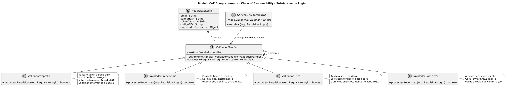
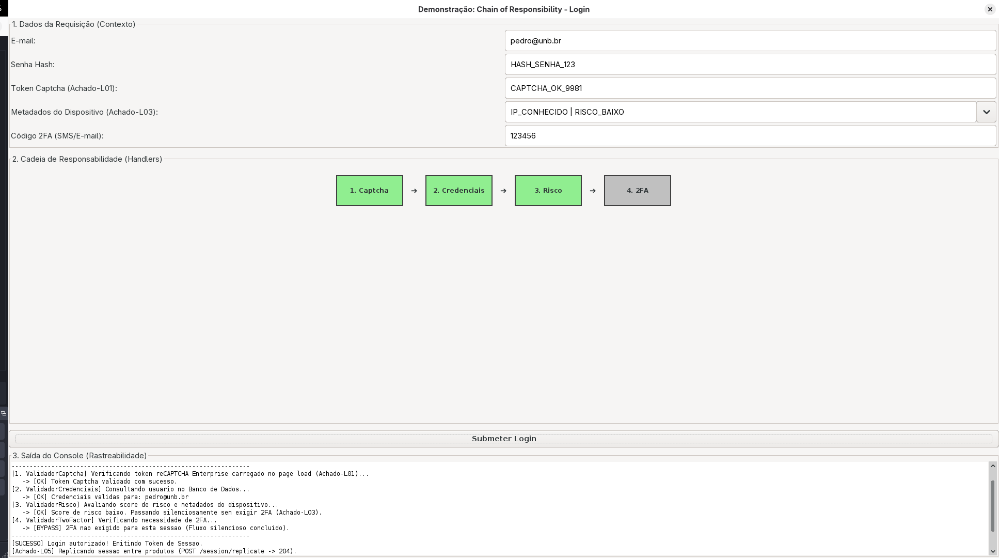
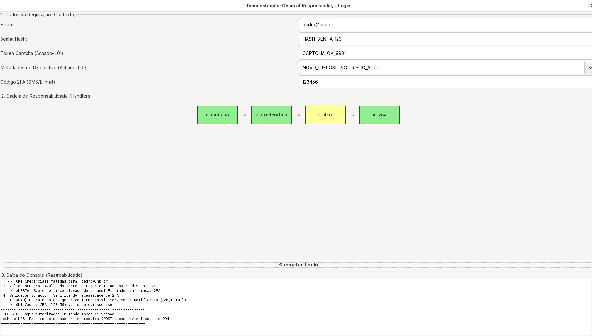
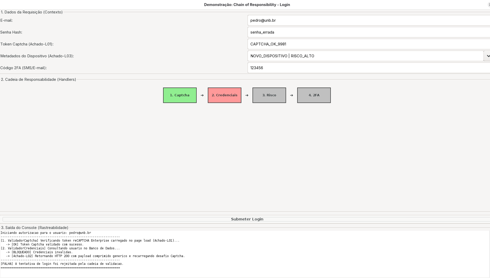
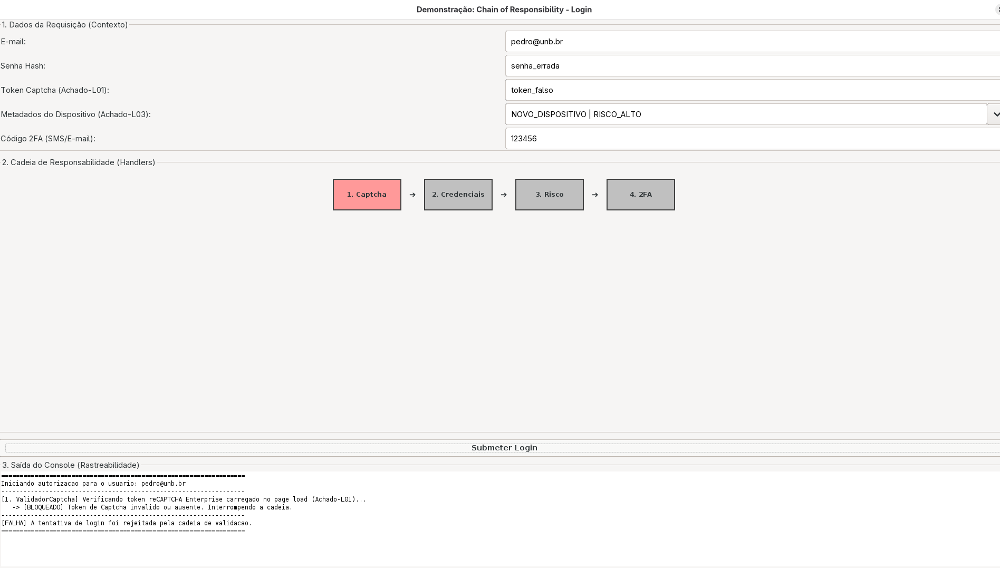

# Chain of Responsibility no Login

> Sistema em Java que modela o subsistema de **Login e Autenticação** do G1_ProjetoComercioEletronico usando o padrão de projeto comportamental **Chain of Responsibility**: quando uma requisição de login é recebida, ela percorre uma cadeia sequencial de validadores independentes (Captcha $\rightarrow$ Credenciais $\rightarrow$ Risco $\rightarrow$ 2FA Condicional), onde cada elo decide autonomamente se interrompe o fluxo em curto-circuito ou se repassa a verificação adiante, refletindo os achados de Engenharia Reversa (**Achados L01 a L05**).

## Sumário

1. [Introdução](#1-introdução)
2. [Visão geral do sistema](#2-visão-geral-do-sistema)
3. [O modelo de validação em cadeia](#3-o-modelo-de-validação-em-cadeia)
4. [Fundamentação: o padrão Chain of Responsibility](#4-fundamentação-o-padrão-chain-of-responsibility)
5. [Implementação, classe por classe](#5-implementação-classe-por-classe)
6. [Rastreabilidade com a Engenharia Reversa](#6-rastreabilidade-com-a-engenharia-reversa)
7. [Demonstração e Saída no Terminal](#7-demonstração-e-saída-no-terminal)
8. [Como compilar e executar](#8-como-compilar-e-executar)
9. [Decisões de projeto](#9-decisões-de-projeto)
10. [Relação com a literatura](#10-relação-com-a-literatura)
11. [Visão crítica](#11-visão-crítica)
12. [Melhorias propostas](#12-melhorias-propostas)
13. [Limitações desta documentação](#13-limitações-desta-documentação)
14. [Referências](#14-referências)

---

## 1. Introdução

### 1.1 Problema

No processo de autenticação de um comércio eletrônico de grande porte, uma tentativa de login não consiste apenas em comparar e-mail e senha no banco de dados. A partir da Engenharia Reversa realizada nas entregas anteriores (Diagramas de Sequência e de Comunicação), verificou-se que a requisição de login atravessa múltiplas barreiras defensivas sequencias:

- **Validação de script de risco (Captcha):** um token gerado já no carregamento da página (_page load_) precisa ser validado antes de qualquer consulta de usuário (**Achado-L01**).
- **Conferência de credenciais:** o identificador e a senha são verificados no Banco de Dados de Usuários; caso falhem, o fluxo é abortado imediatamente com um erro de payload comprimido sob status HTTP 200 (**Achado-L02**).
- **Avaliação de score de risco:** mesmo com senha correta, o sistema avalia metadados do dispositivo e comportamento para decidir se a sessão é confiável.
- **Desafio condicional de Segundo Fator (2FA):** se o risco for baixo, o login é aprovado silenciosamente (**Achado-L03**); se o risco for elevado, o sistema exige a validação de um código enviado por SMS ou E-mail antes de emitir e replicar o token de sessão (**Achado-L05**).

Se a classe `ServicoDeAutenticacao` implementasse todas essas checagens diretamente por meio de blocos `if/else` aninhados, ela ficaria fortemente acoplada a serviços de Captcha, banco de dados, motores antifraude e mensageria SMS/E-mail, violando os princípios de Responsabilidade Única (SRP) e Aberto/Fechado (OCP).

### 1.2 Abordagem

O sistema adota o padrão comportamental **Chain of Responsibility** (Gamma, Helm, Johnson e Vlissides, 1995): cada etapa de segurança é isolada em um objeto validador (`ValidadorHandler`) que possui uma referência para o próximo validador da fila. O `ServicoDeAutenticacao` apenas entrega o objeto `RequisicaoLogin` ao primeiro elo da cadeia (`ValidadorCaptcha`), sem acoplamento com a lógica interna de cada etapa.

### 1.3 Objetivos deste documento

- Descrever a arquitetura e o funcionamento da cadeia de validação no Subsistema de Login.
- Evidenciar a rastreabilidade direta entre a implementação do padrão GoF e os achados da Engenharia Reversa (**L01, L02, L03 e L05**).
- Registrar as decisões arquiteturais tomadas e as alternativas descartadas.
- Relacionar o código desenvolvido com o catálogo GoF e a literatura da área.
- Avaliar criticamente os pontos fortes, fragilidades e oportunidades de evolução da solução.

### 1.4 Escopo

O sistema cobre **exclusivamente o mecanismo de encadeamento e tomada de decisão da validação de login**. As integrações externas (banco de dados real, API do Google reCAPTCHA Enterprise e provedor de envio de SMS/E-mail) são simuladas em memória para exercitar todos os ramos da cadeia e comprovar o padrão em execução.

### 1.5 Enquadramento na disciplina

Este trabalho segue as diretrizes da disciplina _Arquitetura e Desenho de Software — Módulo Padrões de Projeto (GoFs Comportamentais)_ (Profa. Milene Serrano, UnB/FGA):

- **Padrão GoF:** solução consolidada na literatura para resolver problemas recorrentes de projeto orientado a objetos com baixo acoplamento e alta coesão.
- **Categoria comportamental:** padrões voltados à distribuição de responsabilidades e comunicação algorítmica entre objetos em tempo de execução.
- **Objetivo do Chain of Responsibility:** evitar o acoplamento entre o remetente de uma requisição e seu receptor, dando a mais de um objeto a oportunidade de tratar a requisição ao passá-la ao longo de uma cadeia de objetos.

**Correspondência com a estrutura usada na disciplina**

| Estrutura de referência                  | Onde está nesta documentação                     |
| ---------------------------------------- | ------------------------------------------------ |
| Objetivo                                 | Seções 1.1 a 1.3 e 4.1                           |
| Modelagem genérica                       | Seção 2.4                                        |
| Participantes                            | Seções 2.3 e 2.5                                 |
| Modelagem aplicada/instanciada           | Seções 2.2 e 2.5                                 |
| Motivação                                | Seção 1.1                                        |
| Solução                                  | Seções 4 e 5                                     |
| Possível implementação                   | Seção 5 (código-fonte em pacotes)                |
| Teste e saída                            | Seção 7 (demonstração dos 4 cenários no console) |
| Rastreabilidade com artefatos anteriores | Seção 6                                          |
| Considerações finais e visão crítica     | Seções 11 e 13                                   |
| Referências                              | Seção 14                                         |

As seções 6 (rastreabilidade detalhada), 9 (decisões de projeto), 10 (relação com a literatura), 11 (visão crítica) e 12 (melhorias propostas) **vão além** da estrutura básica para aprofundamento qualitativo do artefatos.

---

## 2. Visão geral do sistema

### 2.1 Estrutura de pastas

Respeitando a organização do repositório da **SubEquipe 03** em `docs/Base/Relatórios/Subequipe03/src/comportamentais/`, os códigos do subsistema de Login são divididos em três pacotes semânticos (`context`, `handler` e `service`):

```text
FluxoDeLogin(ChainOfResponsibility)/
├── context/
│   └── RequisicaoLogin.java          # Objeto de Contexto / Request que transita na cadeia
├── handler/
│   ├── ValidadorHandler.java         # Handler Abstrato (define proximo e processarRequisicao)
│   ├── ValidadorCaptcha.java         # ConcreteHandler 1 (Achado-L01: reCAPTCHA Enterprise)
│   ├── ValidadorCredenciais.java     # ConcreteHandler 2 (Achado-L02: Banco de Dados / HTTP 200)
│   ├── ValidadorRisco.java           # ConcreteHandler 3 (Achado-L03: Score de risco silencioso)
│   └── ValidadorTwoFactor.java       # ConcreteHandler 4 (Desafio condicional 2FA via SMS/E-mail)
└── service/
    ├── ServicoDeAutenticacao.java    # Client / Orquestrador que monta e aciona a cadeia
    └── MainLogin.java                # Demonstração no terminal com 4 cenários de teste
```

### 2.2 Diagrama de classes (modelagem aplicada/instanciada)

<div style="text-align:center;">



<p><strong>Chain of Responsibility no Login</strong>: diagrama de classes da modelagem aplicada em PlantUML. <em>Autor: Pedro Henrique Gomes</em></p>

</div>

**Notação seguida:** setas contínuas com triângulo vazio representando **generalização/herança** entre os validadores concretos (`ValidadorCaptcha`, `ValidadorCredenciais`, `ValidadorRisco`, `ValidadorTwoFactor`) e a classe abstrata `ValidadorHandler`; **autoagregação** (losango vazio) `proximo` com multiplicidade `1` em `ValidadorHandler` para encadeamento recursivo dos elos; seta de **associação/delegação** de `ServicoDeAutenticacao` para `ValidadorHandler`; e seta tracejada de **dependência** (`analisa`) de `ValidadorHandler` para `RequisicaoLogin`.

### 2.3 Papéis no padrão

| Papel (GoF)           | Classe no Projeto                                                                  | Responsabilidade                                                                                                                         |
| --------------------- | ---------------------------------------------------------------------------------- | ---------------------------------------------------------------------------------------------------------------------------------------- |
| **Handler**           | `ValidadorHandler`                                                                 | Define o contrato de validação (`processarRequisicao`), armazena a referência para o sucessor (`proximo`) e implementa o repasse padrão. |
| **ConcreteHandler**   | `ValidadorCaptcha`, `ValidadorCredenciais`, `ValidadorRisco`, `ValidadorTwoFactor` | Executam uma regra específica de segurança; interrompem a cadeia em caso de falha ou delegam para o próximo elo se aprovada.             |
| **Client**            | `ServicoDeAutenticacao`                                                            | Constrói a topologia da cadeia e inicia o processamento enviando a requisição ao primeiro elo (`ValidadorCaptcha`).                      |
| **Request / Context** | `RequisicaoLogin`                                                                  | Encapsula todos os dados necessários ao longo da cadeia (credenciais, tokens, metadados e flags de estado).                              |

### 2.4 Comparação entre Modelagem Genérica (GoF) e Modelagem Aplicada

| Elemento na Modelagem Genérica (GoF)      | Elemento na Modelagem Aplicada (Login)                                             |
| ----------------------------------------- | ---------------------------------------------------------------------------------- |
| `Client`                                  | `ServicoDeAutenticacao`                                                            |
| `Handler`                                 | `ValidadorHandler`                                                                 |
| `successor` (ponteiro para o próximo)     | Atributo `proximo: ValidadorHandler` + método `setProximo()`                       |
| `handleRequest()`                         | `processarRequisicao(req: RequisicaoLogin): boolean`                               |
| `ConcreteHandler1`, `ConcreteHandler2`... | `ValidadorCaptcha`, `ValidadorCredenciais`, `ValidadorRisco`, `ValidadorTwoFactor` |
| Parâmetro implícito da requisição         | Objeto explícito `RequisicaoLogin`                                                 |

### 2.5 Detalhamento dos Participantes e Colaboração

#### 2.5.1 Objetivo do padrão no domínio de Login

O **Chain of Responsibility** permite que múltiplos objetos tenham a chance de processar uma tentativa de autenticação sem que o `ServicoDeAutenticacao` precise conhecer as regras internas de cada etapa ou manter acoplamento explícito com todas elas. Na variante implementada (conhecida na literatura como _ Intercepting Filter_ ou cadeia de validação booleana), a requisição percorre a fila até que um validador a rejeite (curto-circuito) ou até que todos os elos a aprovem.

#### 2.5.2 Colaboração passo a passo entre os participantes

1. Na inicialização, o `ServicoDeAutenticacao` instancia os quatro validadores e os encadeia via `captcha.setProximo(credenciais).setProximo(risco).setProximo(twoFactor)`.
2. Quando um usuário tenta logar, `MainLogin` cria um objeto `RequisicaoLogin` e chama `servico.autorizar(req)`.
3. `ServicoDeAutenticacao` invoca `cadeiaValidacao.processarRequisicao(req)` apontando unicamente para a cabeça da fila (`ValidadorCaptcha`).
4. Cada `ConcreteHandler` analisa os dados da `RequisicaoLogin`:
   - Se a regra de segurança for violada, retorna `false` imediatamente, abortando os elos seguintes.
   - Se a regra for cumprida, chama `passarParaOProximo(req)`, transferindo o controle ao sucessor.
5. Se o último elo (`ValidadorTwoFactor`) aprovar a requisição e invocar `passarParaOProximo(req)` (onde `proximo == null`), a classe base retorna `true`, autorizando a emissão e replicação do token de sessão.

---

## 3. O modelo de validação em cadeia

### 3.1 Matriz de decisão por Elo

A tabela abaixo sintetiza o comportamento de cada elo concreto diante dos diferentes cenários de entrada:

| Cenário de Entrada                  | Elo 1: `ValidadorCaptcha`            | Elo 2: `ValidadorCredenciais`                | Elo 3: `ValidadorRisco`             | Elo 4: `ValidadorTwoFactor`                | Resultado Final         |
| ----------------------------------- | ------------------------------------ | -------------------------------------------- | ----------------------------------- | ------------------------------------------ | ----------------------- |
| **1. Risco Baixo (Caminho Feliz)**  | Aprova e repassa                     | Aprova e repassa                             | Define `exige2FA = false` e repassa | Faz _bypass_ silencioso e aprova           | **Autorizado (`true`)** |
| **2. Risco Alto + 2FA Correto**     | Aprova e repassa                     | Aprova e repassa                             | Define `exige2FA = true` e repassa  | Dispara SMS/E-mail, valida código e aprova | **Autorizado (`true`)** |
| **3. Risco Alto + 2FA Incorreto**   | Aprova e repassa                     | Aprova e repassa                             | Define `exige2FA = true` e repassa  | **Bloqueia (`false`)** e ativa cooldown    | **Rejeitado (`false`)** |
| **4. Senha ou E-mail Inválido**     | Aprova e repassa                     | **Bloqueia (`false`)** com HTTP 200 genérico | _Não executado (curto-circuito)_    | _Não executado (curto-circuito)_           | **Rejeitado (`false`)** |
| **5. Token Captcha Inválido (Bot)** | **Bloqueia (`false`)** imediatamente | _Não executado (curto-circuito)_             | _Não executado (curto-circuito)_    | _Não executado (curto-circuito)_           | **Rejeitado (`false`)** |

### 3.2 Observações sobre o modelo

- **Economia de recursos por curto-circuito:** se o `ValidadorCaptcha` barrar um ataque automatizado no Elo 1, o Banco de Dados (`ValidadorCredenciais`), o motor de análise de risco (`ValidadorRisco`) e o gateway pago de SMS (`ValidadorTwoFactor`) **sequer são acionados**.
- **Comunicação de estado entre elos via Contexto:** o `ValidadorRisco` (Elo 3) não executa o 2FA diretamente; ele apenas enriquece o objeto `RequisicaoLogin` marcando `req.setExige2FA(true)` ou `false`, permitindo que o `ValidadorTwoFactor` (Elo 4) saiba se deve exigir o código ou agir de forma transparente (**Achado-L03**).

---

## 4. Fundamentação: o padrão Chain of Responsibility

### 4.1 Intenção

Segundo o catálogo GoF (Gamma _et al._, 1995), a intenção do padrão Chain of Responsibility é:

> _"Evitar o acoplamento do remetente de uma solicitação ao seu receptor, dando a mais de um objeto a oportunidade de tratar a solicitação. Encadear os objetos receptores, passando a solicitação ao longo da cadeia até que um objeto a trate."_

### 4.2 Quando usar

A literatura recomenda o padrão quando:

1. Mais de um objeto pode tratar uma requisição e o handler específico não é conhecido _a priori_ ou deve ser determinado automaticamente;
2. Deseja-se emitir uma requisição para um dentre vários objetos sem especificar explicitamente os receptores;
3. O conjunto de objetos que podem tratar ou validar uma requisição deve ser especificado dinamicamente em tempo de execução.

### 4.3 Consequências descritas pelo GoF

| Consequência no catálogo GoF                                   | Como se manifesta neste sistema                                                                                                                                                                             |
| -------------------------------------------------------------- | ----------------------------------------------------------------------------------------------------------------------------------------------------------------------------------------------------------- |
| **Redução do acoplamento**                                     | `ServicoDeAutenticacao` conhece apenas a superclasse `ValidadorHandler`, ignorando quantos e quais validadores concretos compõem a fila.                                                                    |
| **Flexibilidade adicional na atribuição de responsabilidades** | É possível reordenar, remover ou adicionar novos validadores (ex: `ValidadorBiometria` ou `ValidadorBloqueioIP`) alterando apenas a montagem em `setProximo`.                                               |
| **Recepção não é garantida**                                   | Se nenhum elo tratasse a requisição ou se a cadeia fosse mal configurada, a requisição poderia chegar ao fim sem validação adequada — mitigado aqui pelo retorno padrão controlado em `passarParaOProximo`. |

### 4.4 Relação com os outros padrões comportamentais da SubEquipe 03

| Padrão na SubEquipe 03      | Subsistema Aplicado    | Pergunta que responde                                                            | Papel no E-Commerce                                                                                               |
| --------------------------- | ---------------------- | -------------------------------------------------------------------------------- | ----------------------------------------------------------------------------------------------------------------- |
| **Chain of Responsibility** | **Fluxo de Login**     | _Quais filtros sequenciais_ aprovam ou barram esta requisição?                   | Valida Captcha $\rightarrow$ Credenciais $\rightarrow$ Risco $\rightarrow$ 2FA antes de criar a sessão.           |
| **State**                   | **Fluxo de Compra**    | _O que o objeto pode fazer agora_, dado o seu estado atual?                      | Controla transições do Pedido (`AguardandoPagamento`, `Pago`, `EmSeparacao`, `Enviado`, `Entregue`, `Cancelado`). |
| **Strategy / Observer**     | **Fluxo de Pagamento** | _Como_ processar o pagamento e _quem_ deve ser notificado quando o status mudar? | Calcula modalidade de pagamento e notifica comprador, pedido, nota fiscal e estoque.                              |

---

## 5. Implementação, classe por classe

> **Diretório do código-fonte no GitHub:** [`docs/Base/Relatórios/Subequipe03/src/comportamentais/FluxoDeLogin(ChainOfResponsibility)/`](<https://github.com/UnBArqDsw2026-2-Turma01/2026.2-T01-_G1_ProjetoComercioEletronico_Entrega_03/tree/main/docs/Base/Relatórios/Subequipe03/src/comportamentais/FluxoDeLogin(ChainOfResponsibility)>)

### 5.1 `RequisicaoLogin` (Contexto / Request — pacote `context`)

```java
package context;

public class RequisicaoLogin {
    private String email;
    private String senhaHash;
    private String tokenCaptcha;
    private String codigo2FA;
    private Object metadadosDispositivo;
    private boolean exige2FA;

    public RequisicaoLogin(String email, String senhaHash, String tokenCaptcha,
                           String codigo2FA, Object metadadosDispositivo) {
        this.email = email;
        this.senhaHash = senhaHash;
        this.tokenCaptcha = tokenCaptcha;
        this.codigo2FA = codigo2FA;
        this.metadadosDispositivo = metadadosDispositivo;
        this.exige2FA = false;
    }

    public String getEmail() { return email; }
    public String getSenhaHash() { return senhaHash; }
    public String getTokenCaptcha() { return tokenCaptcha; }
    public String getCodigo2FA() { return codigo2FA; }
    public Object getMetadadosDispositivo() { return metadadosDispositivo; }
    public boolean isExige2FA() { return exige2FA; }
    public void setExige2FA(boolean exige2FA) { this.exige2FA = exige2FA; }
}
```

Encapsula todas as informações da tentativa de login em um único objeto de transporte (DTO/Context), evitando que o método `processarRequisicao` precise receber dezenas de argumentos soltos.

### 5.2 `ValidadorHandler` (Handler Abstrato — pacote `handler`)

```java
package handler;

import context.RequisicaoLogin;

public abstract class ValidadorHandler {
    private ValidadorHandler proximo;

    public ValidadorHandler setProximo(ValidadorHandler handler) {
        this.proximo = handler;
        return handler;
    }

    public abstract boolean processarRequisicao(RequisicaoLogin req);

    protected boolean passarParaOProximo(RequisicaoLogin req) {
        if (this.proximo == null) {
            return true;
        }
        return this.proximo.processarRequisicao(req);
    }
}
```

Pontos técnicos de destaque:

- **Encadeamento fluido (_Method Chaining_):** `setProximo` retorna o próprio `handler` passado como argumento, permitindo construir a cadeia de forma legível: `a.setProximo(b).setProximo(c)`.
- **Método auxiliar protegido (`passarParaOProximo`):** centraliza a verificação de fim de fila (`this.proximo == null`), evitando repetição de `if (proximo != null)` em todas as subclasses concretas.

### 5.3 `ValidadorCaptcha` (ConcreteHandler 1 — pacote `handler`)

```java
package handler;

import context.RequisicaoLogin;

public class ValidadorCaptcha extends ValidadorHandler {

    @Override
    public boolean processarRequisicao(RequisicaoLogin req) {
        System.out.println("[1. ValidadorCaptcha] Verificando token reCAPTCHA Enterprise carregado no page load (Achado-L01)...");

        if (req.getTokenCaptcha() == null || !req.getTokenCaptcha().startsWith("CAPTCHA_OK")) {
            System.out.println("   -> [BLOQUEADO] Token de Captcha invalido ou ausente. Interrompendo a cadeia.");
            return false;
        }

        System.out.println("   -> [OK] Token Captcha validado com sucesso.");
        return passarParaOProximo(req);
    }
}
```

### 5.4 `ValidadorCredenciais` (ConcreteHandler 2 — pacote `handler`)

```java
package handler;

import context.RequisicaoLogin;

public class ValidadorCredenciais extends ValidadorHandler {

    @Override
    public boolean processarRequisicao(RequisicaoLogin req) {
        System.out.println("[2. ValidadorCredenciais] Consultando usuario no Banco de Dados...");

        boolean usuarioExiste = "pedro@unb.br".equalsIgnoreCase(req.getEmail());
        boolean senhaCorreta = "HASH_SENHA_123".equals(req.getSenhaHash());

        if (!usuarioExiste || !senhaCorreta) {
            System.out.println("   -> [BLOQUEADO] Credenciais invalidas.");
            System.out.println("   -> [Achado-L02] Retornando HTTP 200 com payload comprimido generico e recarregando desafio Captcha.");
            return false;
        }

        System.out.println("   -> [OK] Credenciais validas para: " + req.getEmail());
        return passarParaOProximo(req);
    }
}
```

### 5.5 `ValidadorRisco` (ConcreteHandler 3 — pacote `handler`)

```java
package handler;

import context.RequisicaoLogin;

public class ValidadorRisco extends ValidadorHandler {

    @Override
    public boolean processarRequisicao(RequisicaoLogin req) {
        System.out.println("[3. ValidadorRisco] Avaliando score de risco e metadados do dispositivo...");

        String metadados = String.valueOf(req.getMetadadosDispositivo());

        if (metadados.contains("RISCO_ALTO")) {
            System.out.println("   -> [ALERTA] Score de risco elevado detectado! Exigindo confirmacao 2FA.");
            req.setExige2FA(true);
        } else {
            System.out.println("   -> [OK] Score de risco baixo. Passando silenciosamente sem exigir 2FA (Achado-L03).");
            req.setExige2FA(false);
        }

        return passarParaOProximo(req);
    }
}
```

### 5.6 `ValidadorTwoFactor` (ConcreteHandler 4 — pacote `handler`)

```java
package handler;

import context.RequisicaoLogin;

public class ValidadorTwoFactor extends ValidadorHandler {

    @Override
    public boolean processarRequisicao(RequisicaoLogin req) {
        System.out.println("[4. ValidadorTwoFactor] Verificando necessidade de 2FA...");

        if (!req.isExige2FA()) {
            System.out.println("   -> [BYPASS] 2FA nao exigido para esta sessao (Fluxo silencioso concluido).");
            return passarParaOProximo(req);
        }

        System.out.println("   -> [ACAO] Disparando codigo de confirmacao via Servico de Notificacao (SMS/E-mail)...");

        if ("123456".equals(req.getCodigo2FA())) {
            System.out.println("   -> [OK] Codigo 2FA (" + req.getCodigo2FA() + ") validado com sucesso!");
            return passarParaOProximo(req);
        } else {
            System.out.println("   -> [BLOQUEADO] Codigo 2FA invalido ou expirado. Habilitando cooldown de reenvio.");
            return false;
        }
    }
}
```

### 5.7 `ServicoDeAutenticacao` e `MainLogin` (Client — pacote `service`)

```java
package service;

import context.RequisicaoLogin;
import handler.ValidadorCaptcha;
import handler.ValidadorCredenciais;
import handler.ValidadorHandler;
import handler.ValidadorRisco;
import handler.ValidadorTwoFactor;

public class ServicoDeAutenticacao {
    private ValidadorHandler cadeiaValidacao;

    public ServicoDeAutenticacao() {
        construirCadeia();
    }

    private void construirCadeia() {
        ValidadorHandler captcha = new ValidadorCaptcha();
        ValidadorHandler credenciais = new ValidadorCredenciais();
        ValidadorHandler risco = new ValidadorRisco();
        ValidadorHandler twoFactor = new ValidadorTwoFactor();

        captcha.setProximo(credenciais)
               .setProximo(risco)
               .setProximo(twoFactor);

        this.cadeiaValidacao = captcha;
    }

    public boolean autorizar(RequisicaoLogin req) {
        System.out.println("==================================================================");
        System.out.println("Iniciando autorizacao para o usuario: " + req.getEmail());
        System.out.println("------------------------------------------------------------------");

        boolean autorizado = cadeiaValidacao.processarRequisicao(req);

        System.out.println("------------------------------------------------------------------");
        if (autorizado) {
            System.out.println("[SUCESSO] Login autorizado! Emitindo Token de Sessao.");
            System.out.println("[Achado-L05] Replicando sessao entre produtos (POST /session/replicate -> 204).");
        } else {
            System.out.println("[FALHA] A tentativa de login foi rejeitada pela cadeia de validacao.");
        }
        System.out.println("==================================================================\n");
        return autorizado;
    }
}
```

---

## 6. Rastreabilidade com a Engenharia Reversa

A modelagem e o código deste padrão foram diretamente derivados das evidências empíricas obtidas na etapa de [Engenharia Reversa](https://unbarqdsw2026-2-turma01.github.io/2026.2-T01-_G1_ProjetoComercioEletronico_Entrega_01/#/Base/Relat%C3%B3rios/SubEquipe03/EngenhariaReversa) e nos [Diagramas de Sequência](https://unbarqdsw2026-2-turma01.github.io/2026.2-T01-_G1_ProjetoComercioEletronico_Entrega_02/#/Base/Relat%C3%B3rios/Subequipe03/ModelagemDinamica/DiagramaDeSequencia) e [Diagrama de Comunicação](https://unbarqdsw2026-2-turma01.github.io/2026.2-T01-_G1_ProjetoComercioEletronico_Entrega_02/#/Base/Relat%C3%B3rios/Subequipe03/ModelagemDinamica/DiagramaDeComunicacao) do Subsistema de Login:

| Código do Achado | Evidência na Engenharia Reversa (Entregas 1 e 2)                                                                                                                                                 | Como foi materializado no Chain of Responsibility (Entrega 3)                                                                                                                                      |
| ---------------- | ------------------------------------------------------------------------------------------------------------------------------------------------------------------------------------------------ | -------------------------------------------------------------------------------------------------------------------------------------------------------------------------------------------------- |
| **Achado-L01**   | O script `enterprise.js` (reCAPTCHA Enterprise) é carregado preventivamente já no _page load_ (passo 1.1/2), emitindo um token de sessão de risco antes da submissão das credenciais.            | Posicionado como o **Elo 1 (`ValidadorCaptcha`)**, garantindo que nenhuma consulta ao banco de dados ocorra caso o token inicial seja inválido.                                                    |
| **Achado-L02**   | Em caso de credenciais inválidas (ramo 4a / passo 8), a resposta não é um JSON aberto de erro 401, mas um payload comprimido genérico mantendo status HTTP 200 e recarregando o desafio Captcha. | Implementado no **Elo 2 (`ValidadorCredenciais`)**, que interrompe a cadeia imediatamente em caso de falha e registra o retorno ofuscado HTTP 200.                                                 |
| **Achado-L03**   | Quando o score de risco é avaliado como baixo, nenhuma etapa explícita de 2FA ocorre; o login resolve silenciosamente priorizando a usabilidade do usuário legítimo.                             | Dividido entre o **Elo 3 (`ValidadorRisco`)** e o **Elo 4 (`ValidadorTwoFactor`)**: o terceiro elo avalia o risco e sinaliza `exige2FA = false`, permitindo o _bypass_ transparente no quarto elo. |
| **Achado-L05**   | Logo após a emissão do token de sessão no login principal, observa-se a requisição `POST /session/replicate` (status 204) replicando a sessão para o ecossistema integrado (ex: Mercado Pago).   | Executado em `ServicoDeAutenticacao.autorizar()` imediatamente após a cadeia inteira retornar `true`.                                                                                              |

---

## 7. Demonstração e Saída no Terminal

A classe `MainLogin` executa quatro cenários de teste que exercitam todos os caminhos da cadeia:

| Cenário       | Entrada Simulada                                              | Elo onde o fluxo termina           | Resultado Esperado                                                                    |
| ------------- | ------------------------------------------------------------- | ---------------------------------- | ------------------------------------------------------------------------------------- |
| **Cenário 1** | Token válido + Senha correta + `RISCO_BAIXO`                  | Elo 4 (Bypass do 2FA)              | Login autorizado silenciosamente (**Achado-L03**) + Sessão replicada (**Achado-L05**) |
| **Cenário 2** | Token válido + Senha correta + `RISCO_ALTO` + Código `123456` | Elo 4 (Validação 2FA)              | Desafio SMS/E-mail enviado e validado + Login autorizado                              |
| **Cenário 3** | Token válido + `SENHA_ERRADA`                                 | **Elo 2 (`ValidadorCredenciais`)** | Curto-circuito no Elo 2 + Retorno HTTP 200 genérico (**Achado-L02**)                  |
| **Cenário 4** | `TOKEN_FALSO` + `BOT_DETECTED`                                | **Elo 1 (`ValidadorCaptcha`)**     | Curto-circuito imediato no Elo 1 (**Achado-L01**)                                     |

A classe `InterfaceGraficaLogin` utilizando Java Swing foi criada para provar o encadeamento e o curto-circuito em tempo real. Os painéis coloridos representam os elos da cadeia:

- 🟢 **Verde:** Elo processado e requisição aprovada para o próximo.
- 🔴 **Vermelho:** Elo processou, identificou falha e interrompeu a cadeia.
- 🟡 **Amarelo:** Elo processado emitindo estado de alerta (mudança de contexto).
- ⚪ **Cinza:** Elo não alcançado (curto-circuito anterior) ou evitado (_bypass_ silencioso).

### 7.1 Cenário 1: Caminho Feliz (Bypass de 2FA - Achado L03)

<div style="text-align:center;">



<p><strong>O que está acontecendo:</strong> Os dados fornecidos são válidos e o dispositivo foi classificado como "IP Conhecido | Risco Baixo". Os 3 primeiros elos processam a informação (ficando verdes). O quarto elo (2FA) percebe a flag de segurança baixa e libera a sessão sem exigir o código.</p>
<p><strong>O que significa:</strong> Comprova o <strong>Achado L03</strong>, demonstrando que o 2FA atua com <em>bypass</em> silencioso visando melhor usabilidade para usuários de baixo risco, mantendo o elo na cadeia mas sem bloqueá-la.</p>

</div>

---

### 7.2 Cenário 2: Risco Alto Exigindo 2FA

<div style="text-align:center;">



<p><strong>O que está acontecendo:</strong> O usuário mudou a seleção para "Novo Dispositivo | Risco Alto". A requisição é aprovada nos dois primeiros elos. O Elo 3 (Risco) fica amarelo (alerta) e altera o objeto de requisição exigindo 2FA. O Elo 4 intercepta a exigência, checa o código e, estando correto, finaliza verde.</p>
<p><strong>O que significa:</strong> Demonstra a comunicação de estado através do objeto Contexto (`RequisicaoLogin`). Um elo pode não barrar o acesso diretamente, mas pode alterar as condições para que o elo seguinte tome a providência necessária (ativar o 2FA).</p>

</div>

---

### 7.3 Cenário 3: Curto-circuito no Banco de Dados (Achado L02)

<div style="text-align:center;">



<p><strong>O que está acontecendo:</strong> Foi inserida uma senha errada. O Elo 1 (Captcha) aprova. O Elo 2 (Credenciais) identifica a falha, barra a requisição (vermelho) e interrompe o fluxo imediatamente. Os elos de Risco e 2FA permanecem inativos (cinza).</p>
<p><strong>O que significa:</strong> Comprova o comportamento de curto-circuito modelado no <strong>Achado L02</strong>. Como a cadeia foi quebrada no segundo estágio, o sistema economiza processamento analítico de metadados e custos operacionais de envio de SMS, provando a eficiência do padrão.</p>

</div>

---

### 7.4 Cenário 4: Bloqueio Imediato por Bot (Achado L01)

<div style="text-align:center;">



<p><strong>O que está acontecendo:</strong> Um token Captcha inválido/falso foi enviado na requisição. O primeiro elo na cadeia reprova a tentativa imediatamente (vermelho) e encerra o fluxo.</p>
<p><strong>O que significa:</strong> É a materialização do <strong>Achado L01</strong>. O banco de dados (Elo 2) não sofre carga com consultas de e-mail maliciosas porque a requisição não sobreviveu à primeira barreira da arquitetura.</p>

</div>

---

### 7.5 Vídeo de Demonstração (Padrão em Execução)

Abaixo, a demonstração gravada da interface reativa exercitando todos os caminhos do padrão _Chain of Responsibility_:

<div style="text-align:center;">

[Vídeo: Execução do Chain of Responsibility no Login](../assets/login_chain_responsability.mp4 ":include :type=video controls width=80%")

<p><strong>Vídeo Demonstrativo:</strong> Apresentação dinâmica provando a autonomia de cada validador (Elo) durante a autenticação. <em>Autor: Pedro Henrique Gomes</em></p>

</div>

---

## 8. Como compilar e executar

### 8.1 Clonar o repositório e acessar a pasta do módulo

```bash
git clone [https://github.com/UnBArqDsw2026-2-Turma01/2026.2-T01-_G1_ProjetoComercioEletronico_Entrega_03.git](https://github.com/UnBArqDsw2026-2-Turma01/2026.2-T01-_G1_ProjetoComercioEletronico_Entrega_03.git)
cd "2026.2-T01-_G1_ProjetoComercioEletronico_Entrega_03/docs/Base/Relatórios/Subequipe03/src/comportamentais/FluxoDeLogin(ChainOfResponsibility)"
```

### 8.2 Compilar e executar

```
# Compila todos os pacotes
javac context/*.java handler/*.java service/*.java

# Roda a interface UI nativa (Swing)
java -cp . service.InterfaceGraficaLogin

# Roda a versão de texto em terminal (Opcional)
java -cp . service.MainLogin
```

---

## 9. Decisões de projeto

| Decisão Arquitetural                                                    | Alternativa Considerada                                                      | Motivo da Escolha                                                                                                                                                           |
| ----------------------------------------------------------------------- | ---------------------------------------------------------------------------- | --------------------------------------------------------------------------------------------------------------------------------------------------------------------------- |
| Classe abstrata `ValidadorHandler` em vez de interface pura             | Interface `Validador` sem estado                                             | Permite compartilhar o atributo `proximo` e a lógica padrão de travessia (`setProximo` e `passarParaOProximo`) na classe base, evitando código duplicado nos 4 validadores. |
| Retorno fluido em `setProximo(ValidadorHandler)`                        | Retorno `void`                                                               | Permite encadear a configuração da fila em uma única expressão (`captcha.setProximo(credenciais).setProximo(risco)...`).                                                    |
| Objeto de contexto único (`RequisicaoLogin`)                            | Passar múltiplos parâmetros primitivos (`email`, `senha`, `token`, `codigo`) | Garante que a assinatura do método `processarRequisicao` nunca precise mudar caso um novo elo exija novos atributos (ex: biometria ou geolocalização).                      |
| Separação entre `ValidadorRisco` (Elo 3) e `ValidadorTwoFactor` (Elo 4) | Fazer o `ValidadorRisco` disparar e validar o código 2FA diretamente         | Respeita o Princípio da Responsabilidade Única (SRP): um elo calcula a heurística de risco, enquanto o outro cuida exclusivamente do protocolo de segundo fator.            |
| Compilação com Java puro (sem Maven/Gradle)                             | Estrutura Maven com `pom.xml`                                                | Mantém compatibilidade direta com a árvore de pastas da Wiki/GitPages da SubEquipe 03 e elimina complexidade de _build_ desnecessária para demonstrar o padrão GoF.         |

---

## 10. Relação com a literatura

O catálogo do GoF (Gamma _et al._, 1995) discute questões clássicas de implementação do Chain of Responsibility. A tabela abaixo demonstra como cada uma foi endereçada no projeto:

| Questão de Implementação (GoF)                          | Tratamento neste sistema                                                                                                                                                                                                                                                                                                                                        |
| ------------------------------------------------------- | --------------------------------------------------------------------------------------------------------------------------------------------------------------------------------------------------------------------------------------------------------------------------------------------------------------------------------------------------------------- |
| **Implementando a cadeia de sucessores**                | A classe abstrata `ValidadorHandler` define explicitamente o campo `proximo` para manter a referência da fila, em vez de reutilizar referências de composição pré-existentes.                                                                                                                                                                                   |
| **Conectando os sucessores**                            | O `ServicoDeAutenticacao` (_Client_) atua na montagem da cadeia dentro do método privado `construirCadeia()`.                                                                                                                                                                                                                                                   |
| **Representando as requisições**                        | Em vez de códigos numéricos de requisição ou parâmetros soltos, optou-se por um objeto empacotador fortemente tipado (`RequisicaoLogin`).                                                                                                                                                                                                                       |
| **Variante de execução (Pure CoR vs. Filter Pipeline)** | No CoR clássico puro, apenas _um_ objeto trata a requisição e encerra a busca. Em sistemas de segurança e _middlewares_ web (como `javax.servlet.Filter` no Jakarta EE ou _Spring Security Filter Chain_), aplica-se a variante de **pipeline de interceptação**: todos os elos validam sua parte e repassam ao próximo, interrompendo apenas em caso de falha. |

---

## 11. Visão crítica

**Pontos fortes**

- **Aderência ao Princípio Aberto/Fechado (OCP):** adicionar uma nova barreira de segurança (como um `ValidadorRateLimit` contra ataques de força bruta) exige apenas criar uma nova subclasse de `ValidadorHandler` e encaixá-la no `construirCadeia()`, sem alterar uma linha dos validadores existentes.
- **Isolamento e Testabilidade (SRP):** cada validador pode ser testado unitariamente de forma isolada, sem precisar instanciar toda a cadeia.
- **Eficiência por curto-circuito:** requisições maliciosas são descartadas nos elos mais baratos (memória/token) antes de atingirem operações caras de I/O (banco de dados e envio de SMS).

**Fragilidades**

1. **Sensibilidade à ordem de montagem da cadeia:** se o desenvolvedor inverter acidentalmente a ordem em `construirCadeia()` — colocando `ValidadorTwoFactor` antes de `ValidadorRisco` —, a flag `exige2FA` ainda estará `false` e o sistema pulará o 2FA mesmo para acessos de alto risco. Há um **acoplamento temporal implícito** entre os elos 3 e 4.
2. **Retorno booleano simplificado:** o método `processarRequisicao` retorna apenas `true` ou `false`. O `ServicoDeAutenticacao` sabe que o login falhou, mas não recebe um objeto estruturado informando _qual_ elo barrou e _qual_ código de erro específico deve ser retornado à UI.
3. **Mutabilidade do objeto `RequisicaoLogin`:** como o contexto é mutável (`setExige2FA`), qualquer elo da cadeia pode alterar o estado da requisição em trânsito, o que pode dificultar a depuração em cadeias muito longas.
4. **Execução síncrona e bloqueante:** no fluxo de 2FA real, o usuário leva segundos ou minutos para digitar o código recebido por SMS. Uma cadeia puramente síncrona em memória manteria a _thread_ presa se aguardasse interação humana direta.

---

## 12. Melhorias propostas

| Fragilidade Identificada (Seção 11) | Melhoria Arquitetural Proposta                                                                                                                                                                                                                                                                                                                                                                                                                                                                                                                              |
| ----------------------------------- | ----------------------------------------------------------------------------------------------------------------------------------------------------------------------------------------------------------------------------------------------------------------------------------------------------------------------------------------------------------------------------------------------------------------------------------------------------------------------------------------------------------------------------------------------------------- |
| 1. Ordem sensível entre elos        | Utilizar um **Builder** (GoF Criacional) dedicado para validar regras de precedência na montagem da cadeia de segurança.                                                                                                                                                                                                                                                                                                                                                                                                                                    |
| 2. Retorno booleano simples         | Substituir o retorno `boolean` por um objeto rico `ResultadoAutenticacao` contendo status (`AUTORIZADO`, `DESAFIO_2FA_PENDENTE`, `NEGADO`), mensagem e código de erro.                                                                                                                                                                                                                                                                                                                                                                                      |
| 4. Fluxo de 2FA assíncrono          | Combinar o _Chain of Responsibility_ com o padrão **State**: quando o `ValidadorRisco` detectar risco alto, a sessão entra no estado `AguardandoConfirmacao2FA` e libera a _thread_ até a chegada da segunda requisição com o código.                                                                                                                                                                                                                                                                                                                       |
| Integração entre subsistemas        | Conectar a saída autorizada do `ServicoDeAutenticacao` diretamente à abertura do `Pedido` no [Fluxo de Compra (State)](<https://unbarqdsw2026-2-turma01.github.io/2026.2-T01-_G1_ProjetoComercioEletronico_Entrega_03/#/Base/Relat%C3%B3rios/Subequipe03/GofsComportamentais/FluxoDeCompra(State)>) e subsequente notificação no [Fluxo de Pagamento (Observer)](<https://unbarqdsw2026-2-turma01.github.io/2026.2-T01-_G1_ProjetoComercioEletronico_Entrega_03/#/Base/Relat%C3%B3rios/Subequipe03/GofsComportamentais/FluxoDePagamento(StrategyObserver)>) |

---

## 13. Limitações desta documentação

- A verificação de banco de dados em `ValidadorCredenciais`, a validação do token em `ValidadorCaptcha` e o envio de SMS em `ValidadorTwoFactor` são **simulados em memória** para fins de demonstração do padrão comportamental.
- A análise de metadados do dispositivo em `ValidadorRisco` utiliza verificação textual simples sobre o atributo `metadadosDispositivo` em vez de um motor real de _machine learning_ antifraude.

---

## 14. Referências

GAMMA, Erich; HELM, Richard; JOHNSON, Ralph; VLISSIDES, John. **Padrões de projeto: soluções reutilizáveis de software orientado a objetos**. Porto Alegre: Bookman, 2000.

GAMMA, Erich; HELM, Richard; JOHNSON, Ralph; VLISSIDES, John. **Design patterns: elements of reusable object-oriented software**. Reading: Addison-Wesley, 1995.

SERRANO, Milene. **Arquitetura e Desenho de Software: aula GoFs comportamentais**. Brasília: Universidade de Brasília, 2026. Material de aula.

REFACTORING GURU. **Chain of Responsibility in Java**. Disponível em: <https://refactoring.guru/pt-br/design-patterns/chain-of-responsibility/java/example>. Acesso em: 15 out. 2026.

ORACLE. **Interface Filter (Jakarta Servlet API)**. Disponível em: <https://jakarta.ee/specifications/servlet/5.0/apidocs/jakarta/servlet/filter>. Acesso em: 15 out. 2026.

---

## Histórico de Versões

| Versão |    Data    | Descrição                                                                                                                                                                        | Autor(es)            | Revisor(es)                                                                         |
| :----: | :--------: | :------------------------------------------------------------------------------------------------------------------------------------------------------------------------------- | :------------------- | :---------------------------------------------------------------------------------- |
| `1.0`  | 15/10/2026 | Elaboração da modelagem PlantUML e implementação em Java do padrão Chain of Responsibility no Login                                                                              | Pedro Henrique Gomes | SubEquipe 03                                                                        |
| `1.1`  | 17/10/2026 | Expansão completa da documentação (fundamentação GoF, matriz de decisão, rastreabilidade L01-L05, decisões de projeto, visão crítica e melhorias) padronizada com a SubEquipe 03 | Pedro Henrique Gomes | João Paulo Barbosa Pereira Nunes, José Joaquim da Silva Neto e Júlia Santana Campos |

```

```
