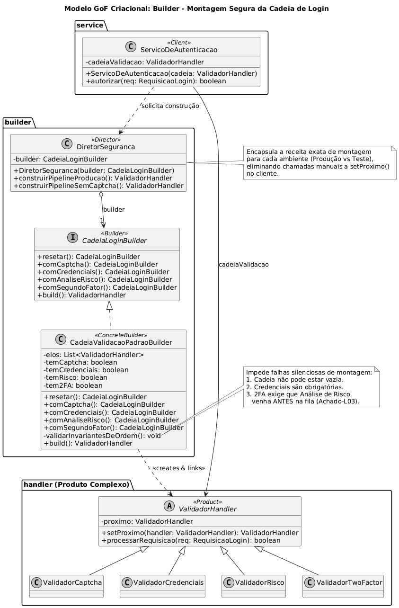
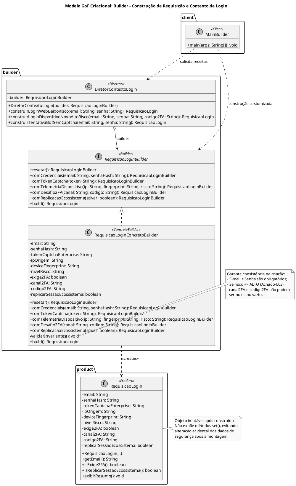

# Builder no Contexto de Login

> Sistema em Java que modela a construção segura do contexto de **Login e Autenticação** do G1_ProjetoComercioEletronico usando o padrão de projeto criacional **Builder**: permite construir passo a passo objetos imutáveis e complexos de requisição de login (`RequisicaoLogin`) — contendo credenciais, tokens de risco preventivos, telemetria de dispositivo, desafios de segundo fator (2FA) e políticas de replicação de sessão — garantindo invariantes de domínio e refletindo os achados de Engenharia Reversa (**Achados L01 a L05**).

## Sumário

1. [Introdução](#1-introdução)
2. [Visão geral do sistema](#2-visão-geral-do-sistema)
3. [O modelo de construção passo a passo](#3-o-modelo-de-construção-passo-a-passo)
4. [Fundamentação: o padrão Builder](#4-fundamentação-o-padrão-builder)
5. [Implementação, classe por classe](#5-implementação-classe-por-classe)
6. [Rastreabilidade com a Engenharia Reversa](#6-rastreabilidade-com-a-engenharia-reversa)
7. [Demonstração e Saída no Terminal](#7-demonstração-e-saída-no-terminal)
8. [Como compilar e executar](#8-como-compilar-e-executar)
9. [Decisões de projeto](#9-decisões-de-projeto)
10. [Relação com a literatura](#10-relação-com-a-literatura)
11. [Visão crítica](#11-visão-crítica)
12. [Melhorias propostas](#12-melhorias-propostas)
13. [Limitações desta documentação](#13-limitações-desta-documentação)
14. [Referências](#14-referências)

---

## 1. Introdução

### 1.1 Problema

No processo de autenticação de um comércio eletrônico de grande porte, uma tentativa de login não é representada apenas por um par de strings (`email` e `senha`). A partir da Engenharia Reversa realizada nas entregas anteriores (Diagramas de Sequência, Comunicação e Classes), verificou-se que o payload e o contexto de uma tentativa de login constituem um **objeto complexo e heterogêneo**, composto por múltiplos atributos obrigatórios, opcionais e condicionais:

- **Token de script de risco preventivo (Captcha):** gerado no carregamento da página (_page load_) pelo script `enterprise.js` antes mesmo do envio das credenciais (**Achado-L01**).
- **Credenciais primárias:** identificador do usuário (e-mail/CPF) e hash criptográfico da senha (**Achado-L02**).
- **Telemetria e metadados do dispositivo:** endereço IP de origem, _fingerprint_ do navegador/sistema operacional e classificação do score de risco (**Achado-L03**).
- **Parâmetros condicionais de Segundo Fator (2FA):** canal de entrega (`SMS` ou `EMAIL`) e código de verificação, exigidos somente quando o risco é classificado como alto (**Achado-L03**).
- **Política de replicação de sessão (SSO):** flag e escopo que determinam se a sessão autenticada deve ser propagada via `POST /session/replicate` para produtos integrados do ecossistema, como o Mercado Pago (**Achado-L05**).

Se a classe `RequisicaoLogin` fosse instanciada diretamente pelos clientes por meio de construtores tradicionais, o código sofreria com o antipadrão **Construtor Telescópico** (_Telescoping Constructor_): construtores com 9 ou 10 parâmetros em sequência (muitos deles passados como `null` dependendo do cenário), onde a simples inversão acidental de dois argumentos do tipo `String` (como trocar `deviceFingerprint` por `tokenCaptcha`) compilaria sem erros e causaria falhas graves de segurança em tempo de execução. Por outro lado, permitir um construtor vazio seguido de vários métodos `set()` tornaria o objeto de segurança mutável e vulnerável a estados inconsistentes (ex: sessão de risco alto criada sem dados de 2FA).

### 1.2 Abordagem

O sistema adota o padrão criacional **Builder** (Gamma, Helm, Johnson e Vlissides, 1995): a construção do objeto complexo `RequisicaoLogin` é separada de sua representação final. Um construtor passo a passo (`RequisicaoLoginBuilder`) acumula as partes necessárias por meio de uma interface fluente, valida as invariantes de negócio antes da instanciação e entrega um produto final **100% imutável**, enquanto a classe `DiretorContextoLogin` encapsula as receitas prontas para os perfis recorrentes mapeados na plataforma.

### 1.3 Objetivos deste documento

- Descrever a arquitetura e o funcionamento da construção de contextos no Subsistema de Login usando o padrão **Builder**.
- Evidenciar a rastreabilidade direta entre as etapas de montagem do padrão GoF Criacional e os achados da Engenharia Reversa (**L01, L02, L03 e L05**).
- Registrar as decisões arquiteturais tomadas e as alternativas descartadas.
- Relacionar o código desenvolvido com o catálogo GoF e a literatura de Engenharia de Software.
- Avaliar criticamente os pontos fortes, fragilidades e oportunidades de evolução da solução.

### 1.4 Escopo

O sistema cobre **exclusivamente o mecanismo criacional de montagem, parametrização e validação de consistência do objeto `RequisicaoLogin`**. A avaliação sequencial posterior desse objeto pelos filtros de segurança pertence ao escopo do padrão comportamental [Chain of Responsibility no Login](<./FluxoDeLogin(ChainOfResponsibility).md>).

### 1.5 Enquadramento na disciplina

Este trabalho segue as diretrizes da disciplina _Arquitetura e Desenho de Software — Módulo Padrões de Projeto (GoFs Criacionais)_ (Profa. Milene Serrano, UnB/FGA):

- **Padrão GoF:** solução consolidada na literatura para resolver problemas recorrentes de projeto orientado a objetos com baixo acoplamento e alta coesão.
- **Categoria criacional:** padrões que abstraem o processo de instanciação de objetos, tornando o sistema independente de como seus objetos são criados, compostos e representados.
- **Objetivo do Builder:** separar a construção de um objeto complexo da sua representação, de modo que o mesmo processo de construção possa criar diferentes representações.

**Correspondência com a estrutura usada na disciplina**

| Estrutura de referência                  | Onde está nesta documentação                     |
| ---------------------------------------- | ------------------------------------------------ |
| Objetivo                                 | Seções 1.1 a 1.3 e 4.1                           |
| Modelagem genérica                       | Seção 2.4                                        |
| Participantes                            | Seções 2.3 e 2.5                                 |
| Modelagem aplicada/instanciada           | Seções 2.2 e 2.5                                 |
| Motivação                                | Seção 1.1                                        |
| Solução                                  | Seções 4 e 5                                     |
| Possível implementação                   | Seção 5 (código-fonte em pacotes)                |
| Teste e saída                            | Seção 7 (demonstração dos 4 cenários no console) |
| Rastreabilidade com artefatos anteriores | Seção 6                                          |
| Considerações finais e visão crítica     | Seções 11 e 13                                   |
| Referências                              | Seção 14                                         |

As seções 6 (rastreabilidade detalhada), 9 (decisões de projeto), 10 (relação com a literatura), 11 (visão crítica) e 12 (melhorias propostas) **vão além** da estrutura básica para aprofundamento qualitativo do artefato.

---

## 2. Visão geral do sistema

### 2.1 Estrutura de pastas

Respeitando a organização do repositório da **SubEquipe 03** em `docs/Base/Relatórios/Subequipe03/src/criacionais/`, os códigos do padrão Builder são divididos em três pacotes semânticos (`product`, `builder` e `client`):

```text
ContextoDeLogin(Builder)/
├── product/
│   └── RequisicaoLogin.java                 # Product (Objeto complexo e imutável de autenticação)
├── builder/
│   ├── RequisicaoLoginBuilder.java          # Interface Builder (Contrato das etapas de montagem)
│   ├── RequisicaoLoginConcretoBuilder.java  # ConcreteBuilder (Acumula estado e valida invariantes)
│   └── DiretorContextoLogin.java            # Director (Receitas prontas para cenários de Login)
└── client/
    └── MainBuilder.java                     # Client (Demonstração no terminal com 4 cenários)
```

### 2.2 Diagrama de classes (modelagem aplicada/instanciada)

<div style="text-align:center;">



<p><strong>Builder no Contexto de Login</strong>: diagrama de classes da modelagem aplicada em PlantUML. <em>Autor: Pedro Henrique Gomes</em></p>

</div>

**Notação seguida:** seta tracejada com triângulo vazio representando **realização** (`RequisicaoLoginConcretoBuilder` implementa a interface `RequisicaoLoginBuilder`); **agregação** (losango vazio) entre `DiretorContextoLogin` e `RequisicaoLoginBuilder`, indicando que o diretor utiliza o construtor abstrato sem conhecer a classe concreta; seta tracejada de **dependência/criação** (`<<creates>>`) do `RequisicaoLoginConcretoBuilder` para o produto `RequisicaoLogin`; e dependências do `MainBuilder` (_Client_) para o Diretor e o Builder.

#### Código-fonte PlantUML do diagrama



### 2.3 Papéis no padrão

| Papel (GoF)         | Classe no Projeto                | Responsabilidade                                                                                                                                      |
| ------------------- | -------------------------------- | ----------------------------------------------------------------------------------------------------------------------------------------------------- |
| **Builder**         | `RequisicaoLoginBuilder`         | Especifica uma interface abstrata para criação das diferentes partes que compõem o objeto-produto (`RequisicaoLogin`).                                |
| **ConcreteBuilder** | `RequisicaoLoginConcretoBuilder` | Constrói e reúne as partes do produto implementando a interface `Builder`, mantém o estado intermediário de montagem e valida invariantes de domínio. |
| **Director**        | `DiretorContextoLogin`           | Constrói um objeto utilizando a interface `Builder`, encapsulando a ordem e a combinação exata de passos para cada perfil de acesso.                  |
| **Product**         | `RequisicaoLogin`                | Representa o objeto complexo imutável em construção, contendo os atributos de autenticação, risco, 2FA e sessão.                                      |
| **Client**          | `MainBuilder`                    | Instancia o `ConcreteBuilder`, aciona o `Director` para configurações padronizadas ou invoca o `Builder` diretamente para montagens customizadas.     |

### 2.4 Comparação entre Modelagem Genérica (GoF) e Modelagem Aplicada

| Elemento na Modelagem Genérica (GoF)           | Elemento na Modelagem Aplicada (Login)                                                                                 |
| ---------------------------------------------- | ---------------------------------------------------------------------------------------------------------------------- |
| `Director`                                     | `DiretorContextoLogin`                                                                                                 |
| `construct()`                                  | `construirLoginWebBaixoRisco()`, `construirLoginDispositivoNovoAltoRisco()`, `construirTentativaBotSemCaptcha()`       |
| `Builder`                                      | `RequisicaoLoginBuilder`                                                                                               |
| `buildPartA()`, `buildPartB()`, `buildPartC()` | `comCredenciais()`, `comTokenCaptcha()`, `comTelemetriaDispositivo()`, `comDesafio2FA()`, `comReplicacaoEcossistema()` |
| `ConcreteBuilder`                              | `RequisicaoLoginConcretoBuilder`                                                                                       |
| `getResult()`                                  | `build(): RequisicaoLogin`                                                                                             |
| `Product`                                      | `RequisicaoLogin`                                                                                                      |

### 2.5 Detalhamento dos Participantes e Colaboração

#### 2.5.1 Objetivo do padrão no domínio de Login

O **Builder** isola o código de construção e validação de parâmetros de uma tentativa de login da representação final do objeto `RequisicaoLogin`. Em vez de obrigar o cliente a conhecer quais dos 10 atributos internos devem ser preenchidos ou deixados como `null` em um login silencioso versus um login com desafio 2FA, o padrão oferece passos nomeados e expressivos, garantindo que nenhum objeto construído pelo Builder nasça em estado inválido.

#### 2.5.2 Colaboração passo a passo entre os participantes

1. O cliente (`MainBuilder`) instancia um `RequisicaoLoginConcretoBuilder` e o injeta no `DiretorContextoLogin`.
2. Quando o cliente solicita uma receita pronta (ex: `diretor.construirLoginWebBaixoRisco(...)`), o `DiretorContextoLogin` invoca `builder.resetar()` para limpar qualquer estado residual.
3. O Diretor chama sequencialmente apenas os métodos de construção pertinentes àquela representação (`comCredenciais`, `comTokenCaptcha`, `comTelemetriaDispositivo` e `comReplicacaoEcossistema`), omitindo a etapa `comDesafio2FA`.
4. Ao final, invoca-se `builder.build()`, que aciona internamente `validarInvariantes()`.
5. Se todas as regras de integridade forem satisfeitas, o `RequisicaoLoginConcretoBuilder` instancia o `RequisicaoLogin` imutável, reseta seu estado interno e devolve o produto pronto ao cliente.

---

## 3. O modelo de construção passo a passo

### 3.1 Matriz de configuração de representações

A tabela abaixo demonstra como o **mesmo processo de construção** (`RequisicaoLoginBuilder`) produz representações distintas de `RequisicaoLogin` conforme os passos acionados:

| Representação Construída                          | Passo 1: `comCredenciais` | Passo 2: `comTokenCaptcha` | Passo 3: `comTelemetriaDispositivo` | Passo 4: `comDesafio2FA` | Passo 5: `comReplicacaoEcossistema` | Estado Final do Produto                              |
| ------------------------------------------------- | ------------------------- | -------------------------- | ----------------------------------- | ------------------------ | ----------------------------------- | ---------------------------------------------------- |
| **1. Login Web Baixo Risco (Director)**           | Preenchido                | Token `CAPTCHA_ENTERPRISE` | IP conhecido, `risco = BAIXO`       | _Omitido (Bypass)_       | `true` (`POST /session/replicate`)  | **Válido** (`exige2FA = false`, SSO ativo)           |
| **2. Dispositivo Novo Alto Risco (Director)**     | Preenchido                | Token `CAPTCHA_ENTERPRISE` | Novo IP, `risco = ALTO`             | Canal `SMS` + Código     | `true` (`POST /session/replicate`)  | **Válido** (`exige2FA = true`, 2FA preenchido)       |
| **3. Tentativa de Bot (Director)**                | Preenchido                | _Omitido (`null`)_         | Script Headless, `risco = BAIXO`    | _Omitido_                | `false`                             | **Válido para teste de bloqueio** (Sem token L01)    |
| **4. Login Mobile Customizado (Builder Fluente)** | Preenchido                | Token `CAPTCHA_MOBILE_SDK` | App Android 14, `risco = BAIXO`     | _Omitido (Bypass)_       | `false` (Sessão restrita ao App)    | **Válido** (Configuração sob medida sem Director)    |
| **5. Risco Alto sem 2FA (Inconsistente)**         | Preenchido                | Token `CAPTCHA_ENTERPRISE` | Tor Browser, `risco = ALTO`         | _Esquecido pelo cliente_ | `false`                             | **Rejeitado no `build()`** (`IllegalStateException`) |

### 3.2 Observações sobre o modelo

- **Imutabilidade pós-construção:** a classe `RequisicaoLogin` possui todos os seus campos marcados como `private final` e não oferece nenhum método `set`. Uma vez que `build()` entrega o objeto, nenhuma camada subsequente pode adulterar o e-mail, o hash da senha ou o token Captcha.
- **Dedução automática de estado coerente:** quando o passo `comTelemetriaDispositivo` recebe o nível de risco `"ALTO"`, o próprio `ConcreteBuilder` já ajusta automaticamente a flag interna `exige2FA = true` (**Achado-L03**), obrigando que o passo `comDesafio2FA` seja chamado antes do `build()`.

- **Dependência de ordem entre `comTelemetriaDispositivo` e `comDesafio2FA`.** Os dois métodos escrevem na mesma flag `exige2FA` por **atribuição** (`=`), de modo que vale a última chamada. O primeiro calcula `exige2FA = "ALTO".equalsIgnoreCase(risco)`; o segundo fixa `exige2FA = true`.

  | Ordem das chamadas                          | `exige2FA` final | Observação                                                  |
  | ------------------------------------------- | :--------------: | ----------------------------------------------------------- |
  | Telemetria (`ALTO`) → `comDesafio2FA`       | `true`           | Caso previsto                                               |
  | `comDesafio2FA` → Telemetria (`ALTO`)       | `true`           | Equivalente ao anterior                                     |
  | Telemetria (`BAIXO`) → `comDesafio2FA`      | `true`           | 2FA voluntário em risco baixo                               |
  | `comDesafio2FA` → Telemetria (`BAIXO`)      | `false`          | O 2FA solicitado é descartado sem erro                      |

  Na última combinação, `canal2FA` e `codigo2FA` permanecem preenchidos, mas `validarInvariantes()` só os confere quando `exige2FA` é `true`; o `build()` conclui sem exceção e o produto não exige o desafio. As receitas do `DiretorContextoLogin` chamam a telemetria primeiro e por isso não são afetadas, mas um cliente que use o Builder diretamente pode cair no caso problemático. O resultado depende de uma convenção de uso, não de uma garantia do código.

---

## 4. Fundamentação: o padrão Builder

### 4.1 Intenção

Segundo o catálogo GoF (Gamma _et al._, 1995), a intenção do padrão Builder é:

> _"Separar a construção de um objeto complexo de sua representação de modo que o mesmo processo de construção possa criar diferentes representações."_

### 4.2 Quando usar

A literatura recomenda o padrão quando:

1. O algoritmo para criação de um objeto complexo deve ser independente das partes que compõem o objeto e de como elas são montadas;
2. O processo de construção deve permitir diferentes representações para o objeto que está sendo construído;
3. Deseja-se evitar um "construtor telescópico" com múltiplos parâmetros opcionais ou de mesmo tipo que prejudicam a legibilidade e a segurança de tipos.

### 4.3 Consequências descritas pelo GoF

| Consequência no catálogo GoF                     | Como se manifesta neste sistema                                                                                                                                     |
| ------------------------------------------------ | ------------------------------------------------------------------------------------------------------------------------------------------------------------------- |
| **Permite variar a representação interna**       | O `DiretorContextoLogin` esconde como o `RequisicaoLogin` é montado; adicionar um novo campo interno não quebra os clientes que usam o Diretor.                     |
| **Isola o código de construção e representação** | Toda a lógica de valores padrão (ex: `ipOrigem = "0.0.0.0"`, `exige2FA = false`) e validação de pré-condições fica encapsulada em `RequisicaoLoginConcretoBuilder`. |
| **Oferece controle mais fino sobre o processo**  | Diferente de fábricas que criam o objeto de uma só vez, o Builder monta o contexto passo a passo e só instancia o produto no método `build()`.                      |

### 4.4 Diferença para os outros padrões Criacionais (Factory Method e Abstract Factory)

| Padrão Criacional    | Foco Principal                                                         | Exemplo no E-Commerce                                                                                       |
| -------------------- | ---------------------------------------------------------------------- | ----------------------------------------------------------------------------------------------------------- |
| **Factory Method**   | Criar **um único produto** por meio de herança e polimorfismo          | Instanciar um validador ou meio de notificação específico (`NotificadorSMS` vs. `NotificadorEmail`).        |
| **Abstract Factory** | Criar **famílias de produtos relacionados** garantindo compatibilidade | Família Pix (`AutorizadorPix`, `ComprovantePix`, `EstornoPix`) vs. Família Cartão.                          |
| **Builder**          | Construir **um único objeto complexo passo a passo**                   | Montar a `RequisicaoLogin` combinando credenciais, token reCAPTCHA, telemetria, 2FA condicional e flag SSO. |

---

## 5. Implementação, classe por classe

> **Diretório do código-fonte no GitHub:** [`docs/Base/Relatórios/Subequipe03/src/criacionais/ContextoDeLogin(Builder)/`](<https://github.com/UnBArqDsw2026-2-Turma01/2026.2-T01-_G1_ProjetoComercioEletronico_Entrega_03/tree/main/docs/Base/Relatórios/Subequipe03/src/criacionais/ContextoDeLogin(Builder)>)

### 5.1 `RequisicaoLogin` (Product — pacote `product`)

```java
package product;

public class RequisicaoLogin {
    private final String email;
    private final String senhaHash;
    private final String tokenCaptchaEnterprise;
    private final String ipOrigem;
    private final String deviceFingerprint;
    private final String nivelRisco;
    private final boolean exige2FA;
    private final String canal2FA;
    private final String codigo2FA;
    private final boolean replicarSessaoEcossistema;

    public RequisicaoLogin(String email, String senhaHash, String tokenCaptchaEnterprise,
                           String ipOrigem, String deviceFingerprint, String nivelRisco,
                           boolean exige2FA, String canal2FA, String codigo2FA,
                           boolean replicarSessaoEcossistema) {
        this.email = email;
        this.senhaHash = senhaHash;
        this.tokenCaptchaEnterprise = tokenCaptchaEnterprise;
        this.ipOrigem = ipOrigem;
        this.deviceFingerprint = deviceFingerprint;
        this.nivelRisco = nivelRisco;
        this.exige2FA = exige2FA;
        this.canal2FA = canal2FA;
        this.codigo2FA = codigo2FA;
        this.replicarSessaoEcossistema = replicarSessaoEcossistema;
    }

    public String getEmail() { return email; }
    public String getSenhaHash() { return senhaHash; }
    public String getTokenCaptchaEnterprise() { return tokenCaptchaEnterprise; }
    public String getIpOrigem() { return ipOrigem; }
    public String getDeviceFingerprint() { return deviceFingerprint; }
    public String getNivelRisco() { return nivelRisco; }
    public boolean isExige2FA() { return exige2FA; }
    public String getCanal2FA() { return canal2FA; }
    public String getCodigo2FA() { return codigo2FA; }
    public boolean isReplicarSessaoEcossistema() { return replicarSessaoEcossistema; }

    public void exibirResumo() {
        System.out.println("------------------------------------------------------------------");
        System.out.println("[Produto Construido: RequisicaoLogin]");
        System.out.println("  * E-mail / Senha Hash    : " + email + " / " + senhaHash);
        System.out.println("  * Token Captcha (L01)    : " + (tokenCaptchaEnterprise != null ? tokenCaptchaEnterprise : "[AUSENTE]"));
        System.out.println("  * Telemetria Dispositivo : IP=" + ipOrigem + " | Fingerprint=" + deviceFingerprint);
        System.out.println("  * Nivel de Risco (L03)   : " + nivelRisco + " (Exige 2FA? " + (exige2FA ? "SIM" : "NAO - Bypass Silencioso") + ")");
        if (exige2FA) {
            System.out.println("  * Desafio 2FA            : Canal=" + canal2FA + " | Codigo=" + codigo2FA);
        }
        System.out.println("  * Replicar Sessao (L05)  : " + (replicarSessaoEcossistema ? "ATIVO (POST /session/replicate -> 204)" : "INATIVO"));
        System.out.println("------------------------------------------------------------------\n");
    }
}
```

### 5.2 `RequisicaoLoginBuilder` (Interface Builder — pacote `builder`)

```java
package builder;

import product.RequisicaoLogin;

public interface RequisicaoLoginBuilder {
    RequisicaoLoginBuilder resetar();
    RequisicaoLoginBuilder comCredenciais(String email, String senhaHash);
    RequisicaoLoginBuilder comTokenCaptcha(String token);
    RequisicaoLoginBuilder comTelemetriaDispositivo(String ip, String fingerprint, String risco);
    RequisicaoLoginBuilder comDesafio2FA(String canal, String codigo);
    RequisicaoLoginBuilder comReplicacaoEcossistema(boolean ativar);
    RequisicaoLogin build();
}
```

Define o contrato abstrato de montagem com retorno fluido (`RequisicaoLoginBuilder`), permitindo encadear chamadas de configuração de maneira declarativa.

### 5.3 `RequisicaoLoginConcretoBuilder` (ConcreteBuilder — pacote `builder`)

```java
package builder;

import product.RequisicaoLogin;

public class RequisicaoLoginConcretoBuilder implements RequisicaoLoginBuilder {
    private String email;
    private String senhaHash;
    private String tokenCaptchaEnterprise;
    private String ipOrigem;
    private String deviceFingerprint;
    private String nivelRisco;
    private boolean exige2FA;
    private String canal2FA;
    private String codigo2FA;
    private boolean replicarSessaoEcossistema;

    public RequisicaoLoginConcretoBuilder() {
        resetar();
    }

    @Override
    public RequisicaoLoginBuilder resetar() {
        this.email = null;
        this.senhaHash = null;
        this.tokenCaptchaEnterprise = null;
        this.ipOrigem = "0.0.0.0";
        this.deviceFingerprint = "DESCONHECIDO";
        this.nivelRisco = "BAIXO";
        this.exige2FA = false;
        this.canal2FA = null;
        this.codigo2FA = null;
        this.replicarSessaoEcossistema = false;
        return this;
    }

    @Override
    public RequisicaoLoginBuilder comCredenciais(String email, String senhaHash) {
        this.email = email;
        this.senhaHash = senhaHash;
        return this;
    }

    @Override
    public RequisicaoLoginBuilder comTokenCaptcha(String token) {
        this.tokenCaptchaEnterprise = token;
        return this;
    }

    @Override
    public RequisicaoLoginBuilder comTelemetriaDispositivo(String ip, String fingerprint, String risco) {
        this.ipOrigem = ip;
        this.deviceFingerprint = fingerprint;
        this.nivelRisco = risco;
        this.exige2FA = "ALTO".equalsIgnoreCase(risco);
        return this;
    }

    @Override
    public RequisicaoLoginBuilder comDesafio2FA(String canal, String codigo) {
        this.exige2FA = true;
        this.canal2FA = canal;
        this.codigo2FA = codigo;
        return this;
    }

    @Override
    public RequisicaoLoginBuilder comReplicacaoEcossistema(boolean ativar) {
        this.replicarSessaoEcossistema = ativar;
        return this;
    }

    private void validarInvariantes() {
        if (email == null || email.isBlank() || senhaHash == null || senhaHash.isBlank()) {
            throw new IllegalStateException(
                "[Erro do Builder] Nao e possivel construir uma RequisicaoLogin sem e-mail e senhaHash."
            );
        }
        if (exige2FA && (canal2FA == null || codigo2FA == null || codigo2FA.isBlank())) {
            throw new IllegalStateException(
                "[Erro do Builder] Sessao classificada como RISCO ALTO exige que o canal e o codigo 2FA sejam preenchidos."
            );
        }
    }

    @Override
    public RequisicaoLogin build() {
        validarInvariantes();

        RequisicaoLogin produtoPronto = new RequisicaoLogin(
            email, senhaHash, tokenCaptchaEnterprise,
            ipOrigem, deviceFingerprint, nivelRisco,
            exige2FA, canal2FA, codigo2FA,
            replicarSessaoEcossistema
        );

        resetar();
        return produtoPronto;
    }
}
```

### 5.4 `DiretorContextoLogin` (Director — pacote `builder`)

```java
package builder;

import product.RequisicaoLogin;

public class DiretorContextoLogin {
    private final RequisicaoLoginBuilder builder;

    public DiretorContextoLogin(RequisicaoLoginBuilder builder) {
        this.builder = builder;
    }

    public RequisicaoLogin construirLoginWebBaixoRisco(String email, String senhaHash) {
        return builder.resetar()
                .comCredenciais(email, senhaHash)
                .comTokenCaptcha("CAPTCHA_ENTERPRISE_OK_9981")
                .comTelemetriaDispositivo("192.168.1.10", "CHROME_LINUX_CONHECIDO", "BAIXO")
                .comReplicacaoEcossistema(true)
                .build();
    }

    public RequisicaoLogin construirLoginDispositivoNovoAltoRisco(String email, String senhaHash, String codigo2FA) {
        return builder.resetar()
                .comCredenciais(email, senhaHash)
                .comTokenCaptcha("CAPTCHA_ENTERPRISE_OK_7742")
                .comTelemetriaDispositivo("177.45.22.11", "DISPOSITIVO_NAO_RECONHECIDO", "ALTO")
                .comDesafio2FA("SMS", codigo2FA)
                .comReplicacaoEcossistema(true)
                .build();
    }

    public RequisicaoLogin construirTentativaBotSemCaptcha(String email, String senhaHash) {
        return builder.resetar()
                .comCredenciais(email, senhaHash)
                .comTelemetriaDispositivo("45.22.19.01", "HEADLESS_SCRIPT", "BAIXO")
                .comReplicacaoEcossistema(false)
                .build();
    }
}
```

### 5.5 `MainBuilder` (Client — pacote `client`)

```java
package client;

import builder.DiretorContextoLogin;
import builder.RequisicaoLoginBuilder;
import builder.RequisicaoLoginConcretoBuilder;
import product.RequisicaoLogin;

public class MainBuilder {
    public static void main(String[] args) {
        RequisicaoLoginBuilder builder = new RequisicaoLoginConcretoBuilder();
        DiretorContextoLogin diretor = new DiretorContextoLogin(builder);

        System.out.println(">>> CENARIO 1: Receita do Director - Login Web de Baixo Risco (Achado-L03 e L05)");
        RequisicaoLogin loginBaixoRisco = diretor.construirLoginWebBaixoRisco("pedro@unb.br", "HASH_SENHA_123");
        loginBaixoRisco.exibirResumo();

        System.out.println(">>> CENARIO 2: Receita do Director - Login em Dispositivo Novo com 2FA");
        RequisicaoLogin loginAltoRisco = diretor.construirLoginDispositivoNovoAltoRisco("pedro@unb.br", "HASH_SENHA_123", "849201");
        loginAltoRisco.exibirResumo();

        System.out.println(">>> CENARIO 3: Uso Direto do Builder (Fluente) - Login Mobile Customizado");
        RequisicaoLogin loginCustomizado = builder.resetar()
                .comCredenciais("julia@unb.br", "HASH_9988")
                .comTokenCaptcha("CAPTCHA_MOBILE_SDK_551")
                .comTelemetriaDispositivo("10.0.0.5", "APP_ANDROID_14", "BAIXO")
                .comReplicacaoEcossistema(false)
                .build();
        loginCustomizado.exibirResumo();

        System.out.println(">>> CENARIO 4: Validacao de Invariante do Builder (Risco Alto sem informar 2FA)");
        try {
            builder.resetar()
                   .comCredenciais("joao@unb.br", "HASH_1122")
                   .comTelemetriaDispositivo("200.10.1.9", "TOR_BROWSER", "ALTO")
                   .build();
        } catch (IllegalStateException e) {
            System.out.println("   -> [SUCESSO NA PREVENCAO] O Builder impediu a criacao de um objeto inconsistente:");
            System.out.println("      " + e.getMessage());
        }
    }
}
```

---

## 6. Rastreabilidade com a Engenharia Reversa

A modelagem e o código deste padrão foram diretamente derivados das evidências empíricas obtidas na etapa de [Engenharia Reversa](https://unbarqdsw2026-2-turma01.github.io/2026.2-T01-_G1_ProjetoComercioEletronico_Entrega_01/#/Base/Relat%C3%B3rios/SubEquipe03/EngenhariaReversa) e nos [Diagramas de Sequência](https://unbarqdsw2026-2-turma01.github.io/2026.2-T01-_G1_ProjetoComercioEletronico_Entrega_02/#/Base/Relat%C3%B3rios/Subequipe03/ModelagemDinamica/DiagramaDeSequencia) e [Diagrama de Comunicação](https://unbarqdsw2026-2-turma01.github.io/2026.2-T01-_G1_ProjetoComercioEletronico_Entrega_02/#/Base/Relat%C3%B3rios/Subequipe03/ModelagemDinamica/DiagramaDeComunicacao) do Subsistema de Login:

| Código do Achado | Evidência na Engenharia Reversa (Entregas 1 e 2)                                                                                                                               | Como foi materializado no Builder (Entrega 3)                                                                                                                                                                |
| ---------------- | ------------------------------------------------------------------------------------------------------------------------------------------------------------------------------ | ------------------------------------------------------------------------------------------------------------------------------------------------------------------------------------------------------------ |
| **Achado-L01**   | O script `enterprise.js` (reCAPTCHA Enterprise) é carregado preventivamente já no _page load_ (passo 1.1/2), emitindo um token de sessão de risco antes da submissão do login. | Materializado na etapa dedicada `comTokenCaptcha(token)`, permitindo distinguir construções legítimas (Web/Mobile) de tentativas automatizadas sem token (`construirTentativaBotSemCaptcha`).                |
| **Achado-L02**   | A submissão das credenciais exige o empacotamento obrigatório de identificador e senha antes da validação no banco de dados.                                                   | Garantido como invariante obrigatória no método `validarInvariantes()` do `ConcreteBuilder`, que impede o `build()` caso e-mail ou senhaHash estejam ausentes.                                               |
| **Achado-L03**   | Quando o score de risco do dispositivo é baixo, o 2FA é omitido silenciosamente; quando o risco é alto, o desafio 2FA torna-se obrigatório.                                    | Materializado na interação entre `comTelemetriaDispositivo()` e `comDesafio2FA()`: o risco `"ALTO"` ativa automaticamente `exige2FA = true` e obriga o preenchimento do canal/código 2FA antes do `build()`. |
| **Achado-L05**   | Após a autenticação no domínio principal, ocorre a requisição `POST /session/replicate` (status 204) replicando a sessão para o ecossistema integrado.                         | Materializado no passo `comReplicacaoEcossistema(boolean)`, permitindo configurar se aquela requisição de login deverá disparar a replicação multi-produto.                                                  |

---

## 7. Demonstração e Saída no Terminal

A classe `MainBuilder` executa quatro cenários de teste que exercitam tanto o uso do `DiretorContextoLogin` quanto o uso fluente direto do `RequisicaoLoginBuilder` e sua barreira de validação:

| Cenário       | Modo de Construção                                     | Partes Acionadas                                                       | Resultado Esperado                                                                               |
| ------------- | ------------------------------------------------------ | ---------------------------------------------------------------------- | ------------------------------------------------------------------------------------------------ |
| **Cenário 1** | `DiretorContextoLogin.construirLoginWebBaixoRisco()`   | Credenciais + Captcha + Telemetria (`BAIXO`) + Replicação (`true`)     | Objeto `RequisicaoLogin` criado com _bypass_ silencioso de 2FA (**Achado-L03**) e SSO ativo      |
| **Cenário 2** | `DiretorContextoLogin.construirLoginDispositivoNovo()` | Credenciais + Captcha + Telemetria (`ALTO`) + 2FA (`SMS`) + Replicação | Objeto `RequisicaoLogin` completo contendo canal e código de confirmação 2FA                     |
| **Cenário 3** | Uso direto fluente do `RequisicaoLoginBuilder`         | Credenciais + Captcha SDK Mobile + Telemetria Android (`BAIXO`)        | Objeto customizado sem necessitar de receita prévia no `Director`                                |
| **Cenário 4** | Tentativa inválida via `RequisicaoLoginBuilder`        | Credenciais + Telemetria (`ALTO`), mas **sem** chamar `comDesafio2FA`  | Bloqueio imediato no `build()` lançando `IllegalStateException` (prevenção de objeto incoerente) |

### 7.1 Saída real da execução no terminal

```text
>>> CENARIO 1: Receita do Director - Login Web de Baixo Risco (Achado-L03 e L05)
------------------------------------------------------------------
[Produto Construido: RequisicaoLogin]
  * E-mail / Senha Hash    : pedro@unb.br / HASH_SENHA_123
  * Token Captcha (L01)    : CAPTCHA_ENTERPRISE_OK_9981
  * Telemetria Dispositivo : IP=192.168.1.10 | Fingerprint=CHROME_LINUX_CONHECIDO
  * Nivel de Risco (L03)   : BAIXO (Exige 2FA? NAO - Bypass Silencioso)
  * Replicar Sessao (L05)  : ATIVO (POST /session/replicate -> 204)
------------------------------------------------------------------

>>> CENARIO 2: Receita do Director - Login em Dispositivo Novo com 2FA
------------------------------------------------------------------
[Produto Construido: RequisicaoLogin]
  * E-mail / Senha Hash    : pedro@unb.br / HASH_SENHA_123
  * Token Captcha (L01)    : CAPTCHA_ENTERPRISE_OK_7742
  * Telemetria Dispositivo : IP=177.45.22.11 | Fingerprint=DISPOSITIVO_NAO_RECONHECIDO
  * Nivel de Risco (L03)   : ALTO (Exige 2FA? SIM)
  * Desafio 2FA            : Canal=SMS | Codigo=849201
  * Replicar Sessao (L05)  : ATIVO (POST /session/replicate -> 204)
------------------------------------------------------------------

>>> CENARIO 3: Uso Direto do Builder (Fluente) - Login Mobile Customizado
------------------------------------------------------------------
[Produto Construido: RequisicaoLogin]
  * E-mail / Senha Hash    : julia@unb.br / HASH_9988
  * Token Captcha (L01)    : CAPTCHA_MOBILE_SDK_551
  * Telemetria Dispositivo : IP=10.0.0.5 | Fingerprint=APP_ANDROID_14
  * Nivel de Risco (L03)   : BAIXO (Exige 2FA? NAO - Bypass Silencioso)
  * Replicar Sessao (L05)  : INATIVO
------------------------------------------------------------------

>>> CENARIO 4: Validacao de Invariante do Builder (Risco Alto sem informar 2FA)
   -> [SUCESSO NA PREVENCAO] O Builder impediu a criacao de um objeto inconsistente:
      [Erro do Builder] Sessao classificada como RISCO ALTO exige que o canal e o codigo 2FA sejam preenchidos.
```

---

## 8. Como compilar e executar

### 8.1 Clonar o repositório e acessar a pasta do módulo

```bash
git clone [https://github.com/UnBArqDsw2026-2-Turma01/2026.2-T01-_G1_ProjetoComercioEletronico_Entrega_03.git](https://github.com/UnBArqDsw2026-2-Turma01/2026.2-T01-_G1_ProjetoComercioEletronico_Entrega_03.git)

cd "2026.2-T01-_G1_ProjetoComercioEletronico_Entrega_03/docs/Base/Relatórios/Subequipe03/src/criacionais/ContextoDeLogin(Builder)"
```

### 8.2 Compilar e executar

**Linux / macOS / Windows (PowerShell):**

```bash

# Compila todos os pacotes (product, builder e client)
javac product/*.java builder/*.java client/*.java

# Executa a demonstracao no terminal
java -cp . client.MainBuilder
```

---

## 9. Decisões de projeto

| Decisão Arquitetural                                                  | Alternativa Considerada                                                  | Motivo da Escolha                                                                                                                                                     |
| --------------------------------------------------------------------- | ------------------------------------------------------------------------ | --------------------------------------------------------------------------------------------------------------------------------------------------------------------- |
| Separação explícita entre `Builder` (interface) e `Director`          | Inner class estática estilo Joshua Bloch (_Effective Java_) sem Director | Segue fielmente a estrutura canônica do catálogo GoF apresentada em aula, permitindo catalogar receitas de domínio no `DiretorContextoLogin`.                         |
| Imutabilidade total em `RequisicaoLogin` (`final` sem _setters_)      | Objeto JavaBean com construtor vazio e métodos `set()`                   | Garante que o contexto de segurança não possa ser modificado após a validação das invariantes no método `build()`.                                                    |
| Reinicialização automática (`resetar()`) ao final do método `build()` | Exigir que o cliente instancie um novo `Builder` a cada uso              | Permite reutilizar a mesma instância de `RequisicaoLoginConcretoBuilder` para construir múltiplos objetos em sequência sem vazamento de dados da requisição anterior. |
| Validação de invariantes cruzadas no `build()`                        | Validar apenas nos validadores posteriores da regra de negócio           | Antecipa a detecção de erros (_Fail-Fast_): impede que um objeto `RequisicaoLogin` de risco alto sequer exista na memória sem os dados obrigatórios de 2FA.           |

### 9.1 Quem garante as invariantes? O construtor público e a alternativa de Bloch

A tabela acima cita a alternativa "inner class estática estilo Joshua Bloch" sem explicá-la. Ela importa por causa de uma limitação do código atual.

**O problema.** `RequisicaoLogin` está no pacote `product` e declara um construtor `public` com 10 parâmetros (seção 5.1). As invariantes ficam em `validarInvariantes()`, no `RequisicaoLoginConcretoBuilder` (pacote `builder`). Como o construtor é público, nada impede este código:

```java
// Compila e executa: o Builder e suas invariantes nunca são consultados
RequisicaoLogin invalida = new RequisicaoLogin(
    null, null, null, "0.0.0.0", "X", "ALTO",
    true, null, null, false);
```

O objeto resultante tem e-mail nulo e `exige2FA = true` sem canal nem código, exatamente os dois estados que o `build()` rejeita. Portanto, a garantia de que nenhum `RequisicaoLogin` nasça inválido vale **para quem usa o Builder**, e não é imposta pela linguagem.

**Por que o Java não ajuda aqui.** Um construtor _package-private_ (sem modificador) seria a solução natural, mas só é visível dentro do mesmo pacote. Como `product` e `builder` são pacotes distintos, o `ConcreteBuilder` também não conseguiria chamá-lo. Por isso o construtor precisou ser público.

**Três caminhos, com seus custos**

| Alternativa                                                                      | Como funciona                                                                                                    | Custo                                                                                                         |
| -------------------------------------------------------------------------------- | ---------------------------------------------------------------------------------------------------------------- | ------------------------------------------------------------------------------------------------------------- |
| **A. Builder como classe estática aninhada** (Bloch, _Effective Java_, Item 2)    | `RequisicaoLogin.Builder` fica dentro do produto; o construtor do produto é `private` e recebe o Builder.        | Perde a interface `RequisicaoLoginBuilder` e a troca de `ConcreteBuilder`; o `Director` passa a depender da classe aninhada. |
| **B. Unir `product` e `builder` no mesmo pacote** e usar construtor _package-private_ | Mantém a estrutura GoF (interface, ConcreteBuilder, Director) e fecha o acesso externo.                          | Abandona a separação por pacotes `product`/`builder`/`client` adotada na Seção 2.1.                          |
| **C. Validar também no construtor do produto**                                   | O construtor repete as checagens e lança `IllegalStateException`; o `ConcreteBuilder` continua como está.        | Duplica regras em dois lugares; qualquer mudança de invariante precisa ser feita duas vezes.                  |

**Por que o projeto manteve a estrutura atual.** A decisão da tabela da Seção 9 foi seguir a estrutura canônica do GoF apresentada em aula. Mas o benefício que justifica a interface `Builder` (trocar o `ConcreteBuilder` para produzir representações diferentes) não é exercitado aqui: existe um único `ConcreteBuilder` e um único produto (ver Seção 10, linha "Por que não classes abstratas para produtos?"). A Alternativa A teria, neste sistema, o mesmo efeito prático com garantia mais forte.

**Como ler a Seção 2.5.1.** Onde se lê "nenhum objeto `RequisicaoLogin` nasça em estado inválido", entenda: nenhum objeto construído **por meio do Builder**. A imutabilidade, por sua vez, é real: todos os campos são `final`, os tipos são `String` ou primitivos, e não há _setters_. Um reforço barato é declarar a classe como `final`, para impedir que uma subclasse adicione estado mutável.

---

## 10. Relação com a literatura

O catálogo do GoF (Gamma _et al._, 1995) e a literatura complementar (Bloch, 2018) destacam pontos fundamentais de implementação do Builder. A tabela abaixo mostra como cada ponto foi aplicado:

| Questão de Implementação (GoF / Literatura)      | Tratamento neste sistema                                                                                                                                                                    |
| ------------------------------------------------ | ------------------------------------------------------------------------------------------------------------------------------------------------------------------------------------------- |
| **Interface de montagem e construção**           | Os métodos da interface `RequisicaoLoginBuilder` são granulares por coesão funcional (`comCredenciais`, `comTelemetriaDispositivo`, `comDesafio2FA`) e retornam `this` (interface fluente). |
| **Por que não classes abstratas para produtos?** | Como todas as variações produzem configurações distintas da mesma classe fortemente tipada (`RequisicaoLogin`), o método `build()` pôde ser declarado diretamente na interface `Builder`.   |
| **Métodos vazios como padrão no Builder**        | Em vez de obrigar o cliente a chamar todos os métodos, o `resetar()` pré-carrega valores neutros seguros (`exige2FA = false`, `nivelRisco = "BAIXO"`), tornando opcionais os passos extras. |
| **Invariantes em objetos imutáveis (Bloch)**     | Conforme recomendado em _Effective Java_ (Item 2), os parâmetros são copiados do Builder para o produto imutável e as invariantes cruzadas são verificadas antes de entregar a instância.   |

---

## 11. Visão crítica

**Pontos fortes**

- **Eliminação do Construtor Telescópico:** substitui chamadas obscuras com múltiplos parâmetros `String` e `boolean` por passos autoexplicativos (`comTokenCaptcha`, `comDesafio2FA`).
- **Garantia de Imutabilidade e Consistência (_Fail-Fast_):** o objeto `RequisicaoLogin` já nasce validado e imutável, evitando efeitos colaterais durante o tráfego pelas camadas de autenticação.
- **Reuso de receitas complexas no `Director`:** os cenários mapeados na Engenharia Reversa ficam documentados como métodos de alto nível em `DiretorContextoLogin`.

**Fragilidades**

1. **Duplicação estrutural de atributos:** todos os 10 atributos de `RequisicaoLogin` precisam ser declarados de forma espelhada dentro de `RequisicaoLoginConcretoBuilder`, aumentando a verbosidade do código.
2. **Estado mutável interno no Builder (Não _Thread-Safe_):** como `RequisicaoLoginConcretoBuilder` acumula os atributos em variáveis de instância antes do `build()`, compartilhar a mesma instância do Builder entre múltiplas _threads_ simultâneas causaria condição de corrida (_race condition_).
3. **Tipagem textual em campos de domínio:** atributos como `nivelRisco` (`"BAIXO"`, `"ALTO"`) e `canal2FA` (`"SMS"`, `"EMAIL"`) estão tipados como `String`, permitindo erros de digitação fora das receitas do `Director`.
4. **Resultado dependente da ordem das chamadas:** `comTelemetriaDispositivo` sobrescreve `exige2FA`, podendo descartar um 2FA já solicitado por `comDesafio2FA` (ver 3.2).

---

## 12. Melhorias propostas

| Fragilidade Identificada (Seção 11)        | Melhoria Arquitetural Proposta                                                                                                                                                                      |
| ------------------------------------------ | --------------------------------------------------------------------------------------------------------------------------------------------------------------------------------------------------- |
| 1. Duplicação de atributos                 | Adotar geração de código em tempo de compilação ou _Records_ do Java 17+ combinados com construtores compactos de validação.                                                                        |
| 2. Concorrência no `ConcreteBuilder`       | Instanciar um novo `Builder` por requisição HTTP (_Request Scoped_) ou utilizar _Step Builders_ imutáveis.                                                                                          |
| 3. Tipagem textual (`String`)              | Substituir `nivelRisco` e `canal2FA` por enumerações fortemente tipadas (`enum NivelRisco { BAIXO, ALTO }`, `enum Canal2FA { SMS, EMAIL, WHATSAPP }`).                                              |
| Integração direta com os GoFs da Subequipe | Entregar o `RequisicaoLogin` construído pelo **Builder** diretamente como entrada para o método `autorizar(req)` do [Chain of Responsibility no Login](<./FluxoDeLogin(ChainOfResponsibility).md>). |
| 4. Dependência de ordem | Separar o que o cliente informou do que é derivado: guardar `desafio2FAInformado` (definido por `comDesafio2FA`) e calcular `exige2FA = "ALTO".equalsIgnoreCase(nivelRisco) \|\| desafio2FAInformado` dentro do `build()`. Assim a ordem das chamadas deixa de importar. |

---

## 13. Limitações desta documentação

- Os tokens de Captcha (`CAPTCHA_ENTERPRISE_OK_9981`), endereços IP e _fingerprints_ de dispositivo utilizados pelo `DiretorContextoLogin` são valores estáticos de demonstração em memória.
- Este módulo encerra sua responsabilidade na entrega da instância válida de `RequisicaoLogin`; o processamento das regras de bloqueio ou aprovação pertence ao módulo comportamental.

---

## 14. Referências

GAMMA, Erich; HELM, Richard; JOHNSON, Ralph; VLISSIDES, John. **Padrões de projeto: soluções reutilizáveis de software orientado a objetos**. Porto Alegre: Bookman, 2000.

GAMMA, Erich; HELM, Richard; JOHNSON, Ralph; VLISSIDES, John. **Design patterns: elements of reusable object-oriented software**. Reading: Addison-Wesley, 1995.

BLOCH, Joshua. **Effective Java**. 3. ed. Boston: Addison-Wesley, 2018. (Item 2: _Consider a builder when faced with many constructor parameters_).

SERRANO, Milene. **Arquitetura e Desenho de Software: aula GoFs criacionais**. Brasília: Universidade de Brasília, 2026. Material de aula.

REFACTORING GURU. **Builder in Java**. Disponível em: <https://refactoring.guru/pt-br/design-patterns/builder/java/example>. Acesso em: 18 out. 2026.

---

## Histórico de Versões

| Versão |    Data    | Descrição                                                                                                                                      | Autor(es)            | Revisor(es)                                                                         |
| :----: | :--------: | :--------------------------------------------------------------------------------------------------------------------------------------------- | :------------------- | :---------------------------------------------------------------------------------- |
| `1.0`  | 19/10/2026 | Elaboração da modelagem PlantUML, implementação em Java e documentação completa do padrão GoF Criacional Builder aplicado ao Contexto de Login | Pedro Henrique Gomes | João Paulo Barbosa Pereira Nunes, José Joaquim da Silva Neto e Júlia Santana Campos |
| `1.1`  | 19/10/2026 | Adição da subseção 9.1 (invariantes e construtor público; alternativa de Bloch) e ajuste da Seção 2.5.1 | José Joaquim da Silva Neto | João Paulo Barbosa Pereira Nunes, José Joaquim da Silva Neto e Júlia Santana Campos |
| `1.2`  | 19/10/2026 | Explicação da dependência de ordem entre comTelemetriaDispositivo e comDesafio2FA (3.2), com fragilidade 4 (11) e melhoria correspondente (12) | José Joaquim da Silva Neto | João Paulo Barbosa Pereira Nunes, José Joaquim da Silva Neto e Júlia Santana Campos |