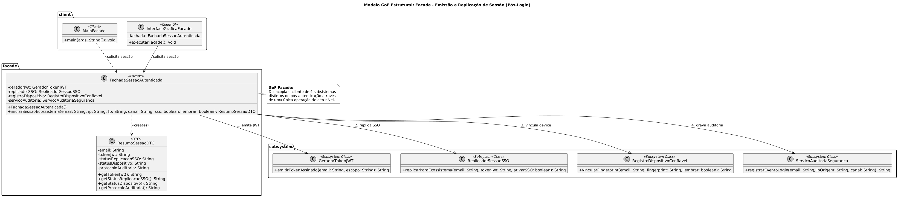
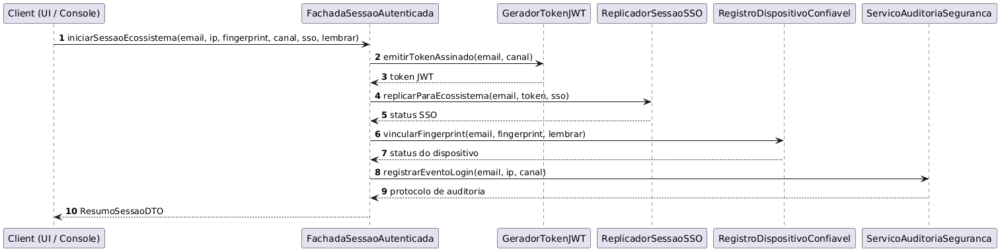

# Facade na Emissão e Replicação de Sessão

> Sistema em Java que modela o provisionamento de sessão pós-autenticação no subsistema de **Login e Autenticação** do G1_ProjetoComercioEletronico usando o padrão de projeto estrutural **Facade (Fachada)**: fornece uma interface unificada e de alto nível (`FachadaSessaoAutenticada`) para um conjunto de interfaces em um subsistema complexo — composto por geração de token criptográfico JWT (**Achado-L04**), replicação de sessão Single Sign-On para o ecossistema Mercado Pago via `POST /session/replicate` (**Achado-L05**), vinculação de dispositivo confiável (**Achado-L03**) e auditoria antifraude — reduzindo o acoplamento entre o cliente e os serviços internos de infraestrutura.

## Sumário

1. [Introdução](#1-introdução)
2. [Visão geral do sistema](#2-visão-geral-do-sistema)
3. [O modelo de orquestração simplificada](#3-o-modelo-de-orquestração-simplificada)
4. [Fundamentação: o padrão Facade](#4-fundamentação-o-padrão-facade)
5. [Implementação, classe por classe](#5-implementação-classe-por-classe)
6. [Rastreabilidade com a Engenharia Reversa](#6-rastreabilidade-com-a-engenharia-reversa)
7. [Demonstração Visual](#7-demonstração-visual-e-terminal)
8. [Como compilar e executar](#8-como-compilar-e-executar)
9. [Decisões de projeto](#9-decisões-de-projeto)
10. [Relação com a literatura e com outros padrões](#10-relação-com-a-literatura-e-com-outros-padrões)
11. [Visão crítica](#11-visão-crítica)
12. [Melhorias propostas](#12-melhorias-propostas)
13. [Limitações desta documentação](#13-limitações-desta-documentação)
14. [Referências](#14-referências)

---

## 1. Introdução

### 1.1 Problema

Em plataformas de comércio eletrônico que operam em ecossistema multi-produto (como a integração entre Mercado Livre, Mercado Pago e Mercado Envios), a etapa que sucede a validação das credenciais do usuário envolve uma série de operações críticas de infraestrutura. Conforme evidenciado na Engenharia Reversa da Entrega 01 (**Achados L03, L04 e L05**), autorizar o usuário exige coordenar imediatamente pelo menos quatro subsistemas independentes:

1. **Emissão de Credencial de Sessão (`GeradorTokenJWT`):** geração e assinatura criptográfica do token de sessão e cookies `orgnickp` (**Achado-L04**).
2. **Replicação de Sessão Cross-Domain (`ReplicadorSessaoSSO`):** disparo da chamada `POST /session/replicate` (HTTP 204) para sincronizar o estado autenticado com o Mercado Pago (**Achado-L05**).
3. **Gestão de Confiança do Dispositivo (`RegistroDispositivoConfiavel`):** catalogação do _device fingerprint_ para permitir _bypass_ silencioso de 2FA em acessos futuros (**Achado-L03**).
4. **Trilha de Auditoria (`ServicoAuditoriaSeguranca`):** gravação de logs de conformidade contendo carimbo de tempo, IP de origem e canal de acesso.

Se a camada cliente (seja uma interface gráfica ou um controlador de borda) precisasse instanciar, configurar e invocar diretamente cada um desses quatro subsistemas na ordem correta, haveria um **forte acoplamento estrutural**. Qualquer alteração na assinatura do serviço de SSO ou na biblioteca de tokens JWT quebraria todos os clientes do sistema.

#### 1.1.1 Sintomas concretos do problema sem o padrão

Sem uma fachada, o código do cliente tende a apresentar os seguintes sintomas, todos recorrentes em sistemas que crescem sem uma camada de orquestração:

- **Duplicação de lógica de orquestração:** cada tela (login web, login mobile, login por link mágico, reautenticação após 2FA) reescreve a mesma sequência de quatro chamadas. Uma correção na ordem das chamadas precisa ser replicada em todos os pontos.
- **Dependência de ordem implícita:** o `ReplicadorSessaoSSO` precisa do token emitido pelo `GeradorTokenJWT`; se um desenvolvedor inverter a ordem ou esquecer uma etapa, o erro só aparece em tempo de execução e, em geral, longe do ponto de origem.
- **Esquecimento de etapas obrigatórias:** a auditoria é uma exigência de conformidade, não uma funcionalidade opcional. Deixá-la a cargo de cada cliente significa que, mais cedo ou mais tarde, algum fluxo deixará de registrar o evento.
- **Vazamento de detalhes de infraestrutura:** o cliente passa a conhecer nomes de endpoints, formato de tokens e políticas de fingerprint, informações que não fazem parte da sua responsabilidade.
- **Testabilidade reduzida:** testar uma tela de login exigiria simular quatro serviços distintos em vez de um único ponto de entrada.

### 1.2 Abordagem

O sistema adota o padrão estrutural **Facade** (Gamma, Helm, Johnson e Vlissides, 1995): introduz-se a classe `FachadaSessaoAutenticada`, que expõe um único método de alto nível (`iniciarSessaoEcossistema`). A fachada encapsula o conhecimento sobre quais subsistemas acionar, em que ordem executá-los e como consolidar suas respostas em um único objeto de retorno (`ResumoSessaoDTO`), mantendo o cliente completamente desacoplado das classes internas do pacote `subsystem`.

A abordagem se apoia em três ideias centrais:

1. **Simplificar sem remover:** a fachada oferece um caminho curto para o caso de uso mais comum (provisionar uma sessão completa), mas não esconde nem proíbe o acesso direto aos subsistemas quando um caso de uso específico exigir.
2. **Centralizar a ordem de execução:** a sequência emitir token → replicar SSO → vincular dispositivo → auditar passa a existir em um único lugar do código.
3. **Devolver um resultado consolidado:** em vez de quatro retornos soltos, o cliente recebe um `ResumoSessaoDTO` imutável, que pode ser exibido, registrado ou serializado sem que o cliente conheça a origem de cada campo.

### 1.3 Objetivos deste documento

- Descrever a arquitetura e a implementação do padrão GoF Estrutural **Facade** aplicado ao pós-login do e-commerce.
- Demonstrar a redução de acoplamento entre o `Client` e os quatro subsistemas internos de sessão e segurança.
- Evidenciar a rastreabilidade direta com os achados da Engenharia Reversa (**L03, L04 e L05**).
- Avaliar criticamente os benefícios, fragilidades (como o risco de se tornar uma _God Class_) e melhorias possíveis.
- Posicionar o Facade em relação a outros padrões que poderiam ser confundidos com ele (Adapter, Mediator, Abstract Factory e Singleton).

### 1.4 Escopo

Este módulo é **totalmente independente** e cobre exclusivamente o agrupamento estrutural das operações de provisionamento de sessão após a aprovação do usuário.

**Dentro do escopo:**

- Orquestração das quatro operações pós-autenticação (JWT, SSO, dispositivo confiável e auditoria).
- Parametrização das políticas de sessão por meio de flags booleanas (`replicarSSO` e `lembrarDispositivo`).
- Consolidação do resultado em um DTO imutável.
- Dois clientes de demonstração: um visual (Swing) e um de terminal.

**Fora do escopo:**

- Validação de credenciais (senha, 2FA, link mágico), tratada em outros módulos do subsistema de Login e Autenticação.
- Criptografia real, chamadas HTTP reais e persistência, simuladas em memória (ver [seção 13](#13-limitações-desta-documentação)).
- Revogação, expiração e renovação de sessões.

### 1.5 Enquadramento na disciplina

Este trabalho integra as iniciativas extras da Subequipe 03 na disciplina _Arquitetura e Desenho de Software_ (Profa. Milene Serrano, UnB/FGA), contemplando a família de **Padrões GoF Estruturais**:

- **Categoria estrutural:** padrões que tratam da composição de classes e objetos para formar estruturas maiores e mais flexíveis.
- **Objetivo do Facade:** fornecer uma interface unificada para um conjunto de interfaces em um subsistema, definindo uma interface de nível mais alto que torna o subsistema mais fácil de usar.

**Correspondência com a estrutura usada na disciplina**

| Estrutura de referência                  | Onde está nesta documentação               |
| ---------------------------------------- | ------------------------------------------ |
| Objetivo                                 | Seções 1.1 a 1.3 e 4.1                     |
| Modelagem genérica                       | Seção 2.4                                  |
| Participantes                            | Seções 2.3 e 2.5                           |
| Modelagem aplicada/instanciada           | Seções 2.2 e 2.5                           |
| Motivação                                | Seção 1.1                                  |
| Solução                                  | Seções 4 e 5                               |
| Possível implementação                   | Seção 5 (código-fonte em pacotes)          |
| Teste e saída                            | Seção 7 (demonstração visual e no console) |
| Rastreabilidade com artefatos anteriores | Seção 6                                    |
| Considerações finais e visão crítica     | Seções 11 e 13                             |
| Referências                              | Seção 14                                   |

---

## 2. Visão geral do sistema

### 2.1 Estrutura de pastas

O código-fonte é autossuficiente e está organizado em três pacotes semânticos (`subsystem`, `facade` e `client`):

```text
EmissaoDeSessao(Facade)/
├── subsystem/
│   ├── GeradorTokenJWT.java                 # Subsistema 1: Assinatura de tokens (Achado-L04)
│   ├── ReplicadorSessaoSSO.java             # Subsistema 2: POST /session/replicate (Achado-L05)
│   ├── RegistroDispositivoConfiavel.java    # Subsistema 3: Vínculo de fingerprint (Achado-L03)
│   └── ServicoAuditoriaSeguranca.java       # Subsistema 4: Registro de logs antifraude
├── facade/
│   ├── FachadaSessaoAutenticada.java        # Facade: Ponto único de entrada para o cliente
│   └── ResumoSessaoDTO.java                 # DTO imutável consolidando o resultado da sessão
└── client/
    ├── InterfaceGraficaFacade.java          # Client Visual (Swing)
    └── MainFacade.java                      # Client de Console (Terminal)
```

A divisão em pacotes não é apenas organizacional: ela materializa a fronteira do padrão. O pacote `client` **não deve** importar nada de `subsystem`; essa regra pode ser verificada automaticamente (por exemplo, com uma checagem de imports no CI ou com uma ferramenta de arquitetura como ArchUnit).

### 2.2 Diagrama de classes (modelagem aplicada/instanciada)

**Notação seguida:** os clientes (`MainFacade` e `InterfaceGraficaFacade`) possuem seta de dependência/associação **exclusivamente** para `FachadaSessaoAutenticada` e `ResumoSessaoDTO`. A fachada, por sua vez, mantém associações diretas com as quatro classes do pacote `subsystem`, blindando o cliente do conhecimento dessas classes.

<div style="text-align:center;">



<p><strong>Facade no Contexto de Login</strong>: diagrama de classes da modelagem aplicada em PlantUML. <em>Autor: Pedro Henrique Gomes</em></p>

</div>

Para facilitar a leitura e a revisão do diagrama sem depender da imagem, segue uma representação textual equivalente:

### 2.3 Papéis no padrão

| Papel (GoF)           | Classe no Projeto                                                                                     | Responsabilidade                                                                                                                              |
| --------------------- | ----------------------------------------------------------------------------------------------------- | --------------------------------------------------------------------------------------------------------------------------------------------- |
| **Facade**            | `FachadaSessaoAutenticada`                                                                            | Conhece quais classes do subsistema são responsáveis por uma solicitação e delega as solicitações do cliente aos objetos apropriados.         |
| **Subsystem Classes** | `GeradorTokenJWT`, `ReplicadorSessaoSSO`, `RegistroDispositivoConfiavel`, `ServicoAuditoriaSeguranca` | Implementam a funcionalidade real do subsistema de sessão, tratando o trabalho atribuído pela `Facade` sem manter referência alguma para ela. |
| **Client**            | `MainFacade`, `InterfaceGraficaFacade`                                                                | Comunicam-se com o subsistema exclusivamente por intermédio da `FachadaSessaoAutenticada`.                                                    |

### 2.4 Comparação entre Modelagem Genérica (GoF) e Modelagem Aplicada

| Elemento na Modelagem Genérica (GoF)      | Elemento na Modelagem Aplicada (Login)                                                       |
| ----------------------------------------- | -------------------------------------------------------------------------------------------- |
| `Facade`                                  | `FachadaSessaoAutenticada`                                                                   |
| `operation()`                             | `iniciarSessaoEcossistema(...) : ResumoSessaoDTO`                                            |
| `SubsystemClassA`, `SubsystemClassB`, ... | `GeradorTokenJWT`, `ReplicadorSessaoSSO`, `RegistroDispositivoConfiavel`, `ServicoAuditoria` |
| `Client`                                  | `MainFacade` e `InterfaceGraficaFacade`                                                      |

### 2.5 Colaborações entre os participantes

O GoF descreve as colaborações do Facade da seguinte forma: os clientes se comunicam com o subsistema enviando requisições à fachada, que as repassa aos objetos apropriados; embora os objetos do subsistema realizem o trabalho, a fachada pode ter de fazer a tradução entre a sua interface e as interfaces do subsistema. Aplicado a este projeto:

1. O **cliente** coleta os dados da sessão (e-mail, IP, fingerprint, canal e as duas preferências) e chama `iniciarSessaoEcossistema(...)`.
2. A **fachada** solicita o token ao `GeradorTokenJWT`, passando o e-mail e o canal como escopo.
3. De posse do token, a fachada aciona o `ReplicadorSessaoSSO`, informando se a replicação foi solicitada.
4. A fachada aciona o `RegistroDispositivoConfiavel`, informando se o dispositivo deve ser lembrado.
5. A fachada aciona o `ServicoAuditoriaSeguranca`, que devolve um protocolo de auditoria com carimbo de tempo.
6. A fachada **traduz** os quatro retornos (strings de natureza distinta) para um único `ResumoSessaoDTO` e o devolve ao cliente.

#### Diagrama de sequência

<div style="text-align:center;">



<p><strong>Facade no Contexto de Login</strong>: diagrama de sequência da modelagem. <em>Autor: Pedro Henrique Gomes</em></p>

</div>

---

## 3. O modelo de orquestração simplificada

### 3.1 Comparativo de acoplamento: Sem Facade vs. Com Facade

| Critério                         | Sem o padrão Facade                                                          | Com o padrão Facade (`FachadaSessaoAutenticada`)                  |
| -------------------------------- | ---------------------------------------------------------------------------- | ----------------------------------------------------------------- |
| **Imports exigidos no Cliente**  | 4 classes de `subsystem` + tratamento individual de strings                  | Apenas `FachadaSessaoAutenticada` e `ResumoSessaoDTO`             |
| **Chamadas feitas pelo Cliente** | 4 chamadas sequenciais manuais (risco de esquecer a auditoria ou o SSO)      | **1 única chamada:** `fachada.iniciarSessaoEcossistema(...)`      |
| **Impacto de mudança interna**   | Alterar o `ReplicadorSessaoSSO` obriga a refatorar todas as telas e clientes | Alteração fica restrita ao interior da `FachadaSessaoAutenticada` |

### 3.2 Como seria o cliente sem a fachada

O trecho abaixo ilustra o que cada cliente precisaria escrever caso o padrão não fosse aplicado. Note a quantidade de conhecimento interno exigido (classes, ordem, parâmetros e tratamento de cada retorno):

```java
// ANTI-EXEMPLO: cliente acoplado a todos os subsistemas
GeradorTokenJWT gerador = new GeradorTokenJWT();
ReplicadorSessaoSSO replicador = new ReplicadorSessaoSSO();
RegistroDispositivoConfiavel registro = new RegistroDispositivoConfiavel();
ServicoAuditoriaSeguranca auditoria = new ServicoAuditoriaSeguranca();

String token = gerador.emitirTokenAssinado(email, canal);
String sso = replicador.replicarParaEcossistema(email, token, true);
String disp = registro.vincularFingerprint(email, fingerprint, true);
String protocolo = auditoria.registrarEventoLogin(email, ip, canal);
// ...e ainda é preciso lembrar de exibir/guardar os quatro retornos
```

### 3.3 Como fica o cliente com a fachada

```java
// Cliente desacoplado: um import, uma chamada, um resultado
FachadaSessaoAutenticada fachada = new FachadaSessaoAutenticada();
ResumoSessaoDTO resumo = fachada.iniciarSessaoEcossistema(
        email, ip, fingerprint, canal, true, true);
```

### 3.4 Métricas qualitativas de simplificação

| Métrica                                   | Sem Facade         | Com Facade            |
| ----------------------------------------- | ------------------ | --------------------- |
| Classes de infraestrutura conhecidas      | 4                  | 0                     |
| Linhas de orquestração por cliente        | ~8                 | 1 chamada (~3 linhas) |
| Locais onde a ordem das etapas é definida | N (um por cliente) | 1 (a fachada)         |
| Pontos a alterar ao trocar o SSO          | N clientes         | 1 (a fachada)         |

> Os valores são estimativas qualitativas do ponto de vista de manutenção, e não medições automatizadas.

### 3.5 Política parametrizada de sessão

A fachada recebe duas flags que determinam variações do provisionamento. A combinação delas gera quatro perfis possíveis de sessão:

| `replicarSSO` | `lembrarDispositivo` | Perfil resultante                                                                                 |
| ------------- | -------------------- | ------------------------------------------------------------------------------------------------- |
| `true`        | `true`               | **Sessão completa:** SSO propagado ao ecossistema e dispositivo confiável (bypass futuro de 2FA). |
| `true`        | `false`              | **Sessão integrada, dispositivo temporário:** SSO ativo, mas 2FA será exigido em acessos futuros. |
| `false`       | `true`               | **Sessão restrita ao domínio, dispositivo confiável:** sem propagação ao Mercado Pago/Envios.     |
| `false`       | `false`              | **Sessão restrita:** domínio principal apenas e dispositivo temporário (perfil mais conservador). |

O JWT e a auditoria são executados **sempre**, independentemente das flags: são as etapas obrigatórias do provisionamento.

---

## 4. Fundamentação: o padrão Facade

### 4.1 Intenção

Segundo o catálogo GoF (Gamma _et al._, 1995), a intenção do padrão Facade é:

> _"Fornecer uma interface unificada para um conjunto de interfaces em um subsistema. Facade define uma interface de nível mais alto que torna o subsistema mais fácil de ser usado."_

### 4.2 Motivação (segundo o GoF)

Estruturar um sistema em subsistemas ajuda a reduzir a complexidade. Um objetivo comum de projeto é minimizar a comunicação e as dependências entre subsistemas. Uma forma de atingir esse objetivo é introduzir um objeto **fachada**, que fornece uma interface única e simplificada para os recursos mais gerais do subsistema. No contexto deste projeto, o "subsistema de sessão" reúne quatro serviços com responsabilidades distintas, e a maior parte dos clientes só precisa do resultado final: _uma sessão válida, propagada e auditada_.

### 4.3 Aplicabilidade

O padrão é indicado quando:

- se deseja fornecer uma interface simples para um subsistema complexo. Os subsistemas costumam ficar mais complexos à medida que evoluem, e a fachada oferece uma visão padrão boa o bastante para a maioria dos clientes;
- existem muitas dependências entre os clientes e as classes de implementação de uma abstração. A fachada desacopla o subsistema dos clientes e de outros subsistemas, promovendo independência e portabilidade;
- se quer estruturar os subsistemas em camadas, usando a fachada como ponto de entrada de cada nível.

Todos os três critérios são atendidos aqui: o pós-login envolve quatro serviços (complexidade), há risco de dependência direta de cada cliente em cada serviço (acoplamento) e o subsistema de sessão representa naturalmente uma camada de infraestrutura de segurança (camadas).

### 4.4 Participantes e responsabilidades

- **Facade (`FachadaSessaoAutenticada`):** sabe quais classes do subsistema atendem a cada requisição e delega o trabalho. Não implementa a lógica de negócio dos subsistemas.
- **Subsystem classes:** implementam a funcionalidade do subsistema, tratam o trabalho recebido da fachada e **não conhecem** a fachada.
- **Client:** usa a fachada em vez de chamar diretamente os objetos do subsistema.

### 4.5 Consequências descritas pelo GoF

| Consequência no catálogo GoF                               | Como se manifesta neste sistema                                                                                                                |
| ---------------------------------------------------------- | ---------------------------------------------------------------------------------------------------------------------------------------------- |
| **Isola os clientes dos componentes do subsistema**        | A interface gráfica em Swing (`InterfaceGraficaFacade`) não possui nenhum `import subsystem.*`, reduzindo o número de objetos com que lida.    |
| **Promove o acoplamento fraco entre subsistema e cliente** | Os 4 serviços internos podem evoluir suas assinaturas sem afetar os clientes, desde que o contrato de `iniciarSessaoEcossistema` seja mantido. |
| **Não impede o acesso direto às classes internas**         | Caso um serviço administrativo específico precise chamar apenas `GeradorTokenJWT`, as classes de `subsystem` continuam públicas e acessíveis.  |

### 4.6 Implementação: pontos de atenção do GoF

O catálogo GoF destaca algumas questões de implementação, avaliadas abaixo para este projeto:

| Questão levantada pelo GoF                 | Situação neste projeto                                                                                                                                                                               |
| ------------------------------------------ | ---------------------------------------------------------------------------------------------------------------------------------------------------------------------------------------------------- |
| Reduzir o acoplamento cliente-subsistema   | Possível tornar a fachada uma classe abstrata/interface com implementações concretas; hoje ela é concreta, com a evolução proposta na [seção 12](#12-melhorias-propostas).                           |
| Classes do subsistema públicas ou privadas | Mantidas **públicas** de propósito, permitindo acesso direto por casos de uso administrativos (ver consequência 3). Em Java, poderiam ser restringidas ao pacote com visibilidade _package-private_. |
| Quantidade de fachadas                     | Uma única fachada, pois há um único caso de uso de provisionamento. Se surgirem fluxos distintos (ex.: renovação de sessão), vale criar fachadas separadas para evitar a _God Class_.                |

---

## 5. Implementação, classe por classe

### 5.1 Classes do Subsistema (pacote `subsystem`)

#### 5.1.1 `GeradorTokenJWT` (Achado-L04)

Responsável por emitir o token de sessão. Recebe o e-mail e o escopo (aqui, o canal de acesso) e devolve uma string no formato `cabeçalho.payload.assinatura`. A implementação usa o `hashCode` de `email + escopo` apenas como _stand-in_ do payload, sem qualquer garantia criptográfica.

```java
package subsystem;

public class GeradorTokenJWT {
    public String emitirTokenAssinado(String email, String escopo) {
        String hashSimulado = Integer.toHexString((email + escopo).hashCode()).toUpperCase();
        String jwt = "eyJhbGciOiJSUzI1NiJ9." + hashSimulado + ".SESSAO_ASSINADA";
        System.out.println("[Subsistema 1 - GeradorTokenJWT] Emitindo token criptografico (Achado-L04): " + jwt);
        return jwt;
    }
}
```

O prefixo `eyJhbGciOiJSUzI1NiJ9` corresponde à codificação Base64URL do cabeçalho `{"alg":"RS256"}`, evidenciando a intenção de modelar um token assinado com RSA-SHA256.

#### 5.1.2 `ReplicadorSessaoSSO` (Achado-L05)

Simula a propagação da sessão para outros domínios do ecossistema. Quando a replicação é desativada, a sessão fica restrita ao domínio principal.

```java
package subsystem;

public class ReplicadorSessaoSSO {
    public String replicarParaEcossistema(String email, String tokenJwt, boolean ativarSSO) {
        if (!ativarSSO) {
            System.out.println("[Subsistema 2 - ReplicadorSessaoSSO] Replicacao SSO desativada para esta sessao.");
            return "SSO Inativo (Sessao restrita ao dominio principal)";
        }
        System.out.println("[Subsistema 2 - ReplicadorSessaoSSO] POST /session/replicate -> HTTP 204 No Content (Achado-L05).");
        System.out.println("   -> Sessao propagada para Mercado Pago e Mercado Envios.");
        return "POST /session/replicate -> 204 (Mercado Pago Sincronizado)";
    }
}
```

Observe que o método **depende do token** produzido pelo subsistema 1. Essa dependência de dados é a razão pela qual a ordem das chamadas importa, e é exatamente o tipo de conhecimento que a fachada encapsula.

#### 5.1.3 `RegistroDispositivoConfiavel` (Achado-L03)

Controla se o _device fingerprint_ será vinculado como confiável (habilitando _bypass_ de 2FA nas sessões seguintes) ou mantido como temporário.

```java
package subsystem;

public class RegistroDispositivoConfiavel {
    public String vincularFingerprint(String email, String fingerprint, boolean lembrarDispositivo) {
        if (!lembrarDispositivo) {
            System.out.println("[Subsistema 3 - RegistroDispositivo] Dispositivo mantido como temporario: " + fingerprint);
            return "Temporario (Exigira revalidacao futura)";
        }
        System.out.println("[Subsistema 3 - RegistroDispositivo] Vinculando fingerprint confiavel para bypass futuro (Achado-L03): " + fingerprint);
        return "Vinculado como Confiavel (" + fingerprint + ")";
    }
}
```

#### 5.1.4 `ServicoAuditoriaSeguranca`

Grava o evento de login gerando um protocolo (`AUD-nnnnn`) e um carimbo de tempo. É a trilha de conformidade e deve ocorrer em toda sessão provisionada.

```java
package subsystem;

import java.time.LocalDateTime;
import java.time.format.DateTimeFormatter;

public class ServicoAuditoriaSeguranca {
    public String registrarEventoLogin(String email, String ipOrigem, String canal) {
        String timestamp = LocalDateTime.now().format(DateTimeFormatter.ofPattern("yyyy-MM-dd HH:mm:ss"));
        String protocolo = "AUD-" + Math.abs((email + ipOrigem).hashCode() % 90000 + 10000);
        System.out.println("[Subsistema 4 - AuditoriaSeguranca] Log gravado [" + protocolo + "] em " + timestamp + " | IP: " + ipOrigem + " | Canal: " + canal);
        return protocolo + " (" + timestamp + ")";
    }
}
```

#### 5.1.5 Resumo dos subsistemas

| Subsistema                     | Entrada                              | Saída                                | Obrigatório? | Achado |
| ------------------------------ | ------------------------------------ | ------------------------------------ | ------------ | ------ |
| `GeradorTokenJWT`              | e-mail, escopo (canal)               | token JWT assinado                   | Sim          | L04    |
| `ReplicadorSessaoSSO`          | e-mail, token, flag de SSO           | status da replicação                 | Condicional  | L05    |
| `RegistroDispositivoConfiavel` | e-mail, fingerprint, flag de lembrar | status do vínculo do dispositivo     | Condicional  | L03    |
| `ServicoAuditoriaSeguranca`    | e-mail, IP de origem, canal          | protocolo de auditoria com timestamp | Sim          | —      |

### 5.2 `FachadaSessaoAutenticada` e `ResumoSessaoDTO` (pacote `facade`)

```java
package facade;

import subsystem.GeradorTokenJWT;
import subsystem.RegistroDispositivoConfiavel;
import subsystem.ReplicadorSessaoSSO;
import subsystem.ServicoAuditoriaSeguranca;

public class FachadaSessaoAutenticada {

    private final GeradorTokenJWT geradorJwt;
    private final ReplicadorSessaoSSO replicadorSSO;
    private final RegistroDispositivoConfiavel registroDispositivo;
    private final ServicoAuditoriaSeguranca servicoAuditoria;

    public FachadaSessaoAutenticada() {
        this.geradorJwt = new GeradorTokenJWT();
        this.replicadorSSO = new ReplicadorSessaoSSO();
        this.registroDispositivo = new RegistroDispositivoConfiavel();
        this.servicoAuditoria = new ServicoAuditoriaSeguranca();
    }

    public ResumoSessaoDTO iniciarSessaoEcossistema(
            String email, String ipOrigem, String fingerprint, String canal,
            boolean replicarSSO, boolean lembrarDispositivo) {

        System.out.println("==================================================================");
        System.out.println(">>> [Facade] Iniciando provisionamento de sessao para: " + email);

        String token = geradorJwt.emitirTokenAssinado(email, canal);
        String statusSSO = replicadorSSO.replicarParaEcossistema(email, token, replicarSSO);
        String statusDisp = registroDispositivo.vincularFingerprint(email, fingerprint, lembrarDispositivo);
        String protocolo = servicoAuditoria.registrarEventoLogin(email, ipOrigem, canal);

        System.out.println(">>> [Facade] Sessao provisionada com sucesso em todos os subsistemas!");
        System.out.println("==================================================================\n");

        return new ResumoSessaoDTO(email, token, statusSSO, statusDisp, protocolo);
    }
}
```

#### 5.2.1 Análise do método `iniciarSessaoEcossistema`

- **Construção dos subsistemas no construtor:** a fachada cria suas dependências internamente. Isso simplifica o uso (o cliente faz `new FachadaSessaoAutenticada()`), mas dificulta a substituição por _mocks_ em testes; a evolução proposta na [seção 12](#12-melhorias-propostas) resolve esse ponto.
- **Campos `final`:** garantem que as referências aos subsistemas não mudem após a construção, tornando a fachada segura para reuso (a fachada não guarda estado de sessão).
- **Ordem fixa das chamadas:** o token é emitido primeiro porque o SSO depende dele; a auditoria é a última porque registra um evento já concluído.
- **Sem lógica de negócio:** a fachada apenas repassa parâmetros e coleta resultados. As decisões de política (`if (!ativarSSO)`) permanecem nos subsistemas, o que mantém a fachada fina e evita o antipadrão _God Object_.

#### 5.2.2 `ResumoSessaoDTO`

DTO imutável que consolida os quatro resultados. Por ser composto apenas de campos `final` e getters, pode ser compartilhado entre camadas sem risco de alteração acidental.

```java
package facade;

public final class ResumoSessaoDTO {

    private final String email;
    private final String tokenJwt;
    private final String statusSSO;
    private final String statusDispositivo;
    private final String protocoloAuditoria;

    public ResumoSessaoDTO(String email, String tokenJwt, String statusSSO,
                           String statusDispositivo, String protocoloAuditoria) {
        this.email = email;
        this.tokenJwt = tokenJwt;
        this.statusSSO = statusSSO;
        this.statusDispositivo = statusDispositivo;
        this.protocoloAuditoria = protocoloAuditoria;
    }

    public String getEmail() { return email; }
    public String getTokenJwt() { return tokenJwt; }
    public String getStatusSSO() { return statusSSO; }
    public String getStatusDispositivo() { return statusDispositivo; }
    public String getProtocoloAuditoria() { return protocoloAuditoria; }
}
```

### 5.3 Clientes (pacote `client`)

#### 5.3.1 `MainFacade` (terminal)

O cliente de console executa os dois cenários da demonstração e exibe o `ResumoSessaoDTO`. Repare que há **um único import de `facade`** e nenhum de `subsystem`:

```java
package client;

import facade.FachadaSessaoAutenticada;
import facade.ResumoSessaoDTO;

public class MainFacade {
    public static void main(String[] args) {
        FachadaSessaoAutenticada fachada = new FachadaSessaoAutenticada();

        System.out.println("### CENARIO 1: Sessao completa (SSO + dispositivo confiavel)");
        ResumoSessaoDTO completa = fachada.iniciarSessaoEcossistema(
                "usuario@exemplo.com", "200.100.50.25", "FP-DEVICE-A1B2", "WEB",
                true, true);
        imprimir(completa);

        System.out.println("### CENARIO 2: Sessao restrita (sem SSO, dispositivo temporario)");
        ResumoSessaoDTO restrita = fachada.iniciarSessaoEcossistema(
                "usuario@exemplo.com", "200.100.50.25", "FP-DEVICE-A1B2", "WEB",
                false, false);
        imprimir(restrita);
    }

    private static void imprimir(ResumoSessaoDTO r) {
        System.out.println("Resumo da sessao:");
        System.out.println("  Usuario    : " + r.getEmail());
        System.out.println("  Token      : " + r.getTokenJwt());
        System.out.println("  SSO        : " + r.getStatusSSO());
        System.out.println("  Dispositivo: " + r.getStatusDispositivo());
        System.out.println("  Auditoria  : " + r.getProtocoloAuditoria());
        System.out.println();
    }
}
```

> Os valores de e-mail, IP e fingerprint acima são fictícios e servem apenas à demonstração.

#### 5.3.2 `InterfaceGraficaFacade` (Swing)

A interface gráfica apresenta:

- campos para os dados da sessão;
- duas caixas de seleção (_Replicar SSO_ e _Lembrar dispositivo_);
- um **único botão** que aciona a fachada;
- quatro cartões, um por subsistema, que mudam de cor conforme o `ResumoSessaoDTO` recebido (verde para ativo/concluído e amarelo para modo restrito/temporário).

O ponto de projeto relevante é que a UI **não sabe** que existem quatro subsistemas por trás do botão: ela apenas interpreta os campos do DTO para colorir os cartões.

---

## 6. Rastreabilidade com a Engenharia Reversa

| Código do Achado | Evidência na Engenharia Reversa (Entregas 1 e 2)                                                                             | Subsistema Orquestrado pela Facade (Entrega 3)       |
| ---------------- | ---------------------------------------------------------------------------------------------------------------------------- | ---------------------------------------------------- |
| **Achado-L03**   | Dispositivos reconhecidos recebem _bypass_ silencioso de 2FA nas sessões subsequentes.                                       | `RegistroDispositivoConfiavel.vincularFingerprint()` |
| **Achado-L04**   | Redirecionamento autenticado acompanhado da emissão de cookies e tokens de sessão (`orgnickp`).                              | `GeradorTokenJWT.emitirTokenAssinado()`              |
| **Achado-L05**   | Propagação silenciosa da sessão para produtos do ecossistema via `POST /session/replicate` retornando HTTP `204 No Content`. | `ReplicadorSessaoSSO.replicarParaEcossistema()`      |

### 6.1 Como cada achado se reflete no comportamento observável

| Achado | Comportamento no código                                                                                   | Onde observar na demonstração                        |
| ------ | --------------------------------------------------------------------------------------------------------- | ---------------------------------------------------- |
| L03    | Mensagem de vínculo confiável quando `lembrarDispositivo = true`; "temporário" quando `false`.            | Cartão 3 (verde no Cenário 1, amarelo no Cenário 2). |
| L04    | Token no formato `cabeçalho.payload.assinatura` emitido em toda sessão.                                   | Cartão 1 (verde em ambos os cenários).               |
| L05    | Mensagem `POST /session/replicate -> HTTP 204` quando `replicarSSO = true`; "SSO Inativo" quando `false`. | Cartão 2 (verde no Cenário 1, amarelo no Cenário 2). |

### 6.2 Cobertura dos achados

A fachada cobre os três achados de Login mapeados para o fluxo pós-autenticação (L03, L04 e L05) e acrescenta a auditoria como requisito transversal de conformidade. Achados anteriores ao momento de aprovação do usuário (como a validação de credenciais e o desafio de 2FA) permanecem fora do escopo desta fachada, pois pertencem à etapa de **autenticação**, e não de **provisionamento**.

---

## 7 Demonstração Visual e Passo a Passo

A classe `InterfaceGraficaFacade` demonstra visualmente como **1 único clique na Fachada** aciona simultaneamente os 4 cartões dos subsistemas internos.

[Vídeo: Padrão GoF Estrutural: Facade - Subsistema de Sessão](../assets/facade_login.mp4 ":include :type=video controls width=80%")

| Trecho do Vídeo                 | O que acontece na tela                                                                                                                                                                        | O que isso prova sobre o padrão GoF Facade                                                                                                                                                                                           |
| ------------------------------- | --------------------------------------------------------------------------------------------------------------------------------------------------------------------------------------------- | ------------------------------------------------------------------------------------------------------------------------------------------------------------------------------------------------------------------------------------ |
| **Cenário 1 (Sessão Completa)** | O usuário mantém as caixas de SSO e Dispositivo Confiável marcadas e clica no botão da Fachada. Os 4 cartões dos subsistemas ficam verdes simultaneamente.                                    | Uma única chamada à `FachadaSessaoAutenticada` coordenou a emissão do JWT (**L04**), a replicação `POST /session/replicate` (**L05**), o vínculo do dispositivo (**L03**) e a auditoria sem que a UI conhecesse as classes internas. |
| **Cenário 2 (Sessão Restrita)** | O usuário desmarca a replicação SSO e o vínculo de dispositivo e clica novamente. Os cartões 2 e 3 ficam amarelos indicando modo restrito/temporário, enquanto JWT e Auditoria seguem verdes. | A Fachada parametriza e distribui corretamente as políticas de negócio para cada subsistema interno, devolvendo um `ResumoSessaoDTO` consolidado para a camada cliente.                                                              |

### 7.3 Casos de teste sugeridos

A tabela abaixo relaciona cenários de teste com o resultado esperado. Eles podem ser executados manualmente (via terminal ou interface) ou automatizados com JUnit após a introdução de injeção de dependência ([seção 12](#12-melhorias-propostas)).

| #   | Cenário                            | Entradas relevantes                             | Resultado esperado                                                                                         |
| --- | ---------------------------------- | ----------------------------------------------- | ---------------------------------------------------------------------------------------------------------- |
| T1  | Sessão completa                    | `replicarSSO=true`, `lembrarDispositivo=true`   | Status SSO indica `204`; dispositivo "Vinculado como Confiável"; token e protocolo de auditoria presentes. |
| T2  | Sessão restrita                    | `replicarSSO=false`, `lembrarDispositivo=false` | Status SSO "Inativo"; dispositivo "Temporário"; token e protocolo ainda presentes.                         |
| T3  | SSO ativo, dispositivo temporário  | `true` / `false`                                | Apenas o subsistema 3 responde em modo temporário.                                                         |
| T4  | SSO inativo, dispositivo confiável | `false` / `true`                                | Apenas o subsistema 2 responde em modo restrito.                                                           |
| T5  | Ordem de execução                  | qualquer                                        | Logs na ordem 1 → 2 → 3 → 4 (token antes do SSO; auditoria por último).                                    |
| T6  | Isolamento do cliente              | inspeção do código                              | Nenhum arquivo de `client/` contém `import subsystem`.                                                     |
| T7  | Imutabilidade do DTO               | inspeção/reflexão                               | `ResumoSessaoDTO` não expõe setters e todos os campos são `final`.                                         |

---

## 8. Como compilar e executar

O módulo é 100% independente e não requer `-sourcepath` externo. A partir da pasta `EmissaoDeSessao(Facade)/`:

```bash
# Compila todos os pacotes (subsystem, facade e client)
javac -encoding UTF-8 subsystem/*.java facade/*.java client/*.java

# Executa a interface visual Swing
java -cp . client.InterfaceGraficaFacade

# Executa a demonstracao no terminal
java -Dstdout.encoding=UTF-8 -cp . client.MainFacade
```

### 8.1 Pré-requisitos

| Requisito             | Detalhe                                                                                                 |
| --------------------- | ------------------------------------------------------------------------------------------------------- |
| JDK                   | Java 8 ou superior (o código usa apenas `java.time`, `System.out` e Swing da biblioteca padrão).        |
| Dependências externas | Nenhuma.                                                                                                |
| Ambiente gráfico      | Necessário apenas para `InterfaceGraficaFacade`; o cliente de terminal funciona em ambiente _headless_. |

### 8.2 Problemas comuns

| Sintoma                                       | Causa provável                                         | Solução                                                                         |
| --------------------------------------------- | ------------------------------------------------------ | ------------------------------------------------------------------------------- |
| Acentos ilegíveis no terminal                 | Codificação padrão do console diferente de UTF-8       | Executar com `-Dstdout.encoding=UTF-8` e usar um terminal configurado em UTF-8. |
| `Could not find or load main class client...` | Execução fora da pasta raiz do módulo ou sem `-cp .`   | Rodar os comandos a partir de `EmissaoDeSessao(Facade)/` e manter `-cp .`.      |
| `HeadlessException` ao abrir a interface      | Ambiente sem display (ex.: SSH sem encaminhamento X11) | Usar o cliente de terminal (`MainFacade`) ou um ambiente com interface gráfica. |
| Erro de compilação por parênteses no caminho  | O nome da pasta contém `(` e `)`                       | Colocar o caminho entre aspas no shell: `cd "EmissaoDeSessao(Facade)"`.         |

---

## 9. Decisões de projeto

| Decisão Arquitetural                         | Alternativa Considerada                                              | Motivo da Escolha                                                                                                                |
| -------------------------------------------- | -------------------------------------------------------------------- | -------------------------------------------------------------------------------------------------------------------------------- |
| Consolidação do retorno em `ResumoSessaoDTO` | Retornar apenas `void` ou obrigar o cliente a consultar cada serviço | Permite que a UI exiba o resultado consolidado dos 4 subsistemas mantendo desacoplamento total de `subsystem`.                   |
| Subsistemas sem referência para a `Fachada`  | Passar `this` (a própria Facade) para dentro dos subsistemas         | Segue a regra canônica do GoF: os subsistemas não devem conhecer a fachada para poderem ser reutilizados isoladamente.           |
| Fachada sem estado de sessão                 | Guardar o último resumo/token em atributos da fachada                | Torna a fachada reutilizável e segura entre chamadas e evita misturar sessões de usuários distintos.                             |
| Políticas decididas nos subsistemas          | Decidir `if (sso)` / `if (lembrar)` dentro da fachada                | Mantém a fachada como mera orquestradora, evitando que ela acumule regra de negócio (risco de _God Object_).                     |
| Classes de `subsystem` mantidas públicas     | Torná-las _package-private_ para forçar o uso da fachada             | Preserva a terceira consequência do GoF (acesso direto quando necessário), ao custo de depender de disciplina de equipe.         |
| Parâmetros posicionais no método da fachada  | Objeto de requisição (_parameter object_) ou _Builder_               | Mantém o exemplo didático e curto; a evolução para um objeto de requisição está prevista na [seção 12](#12-melhorias-propostas). |
| Simulação em memória (sem I/O real)          | Integração real com biblioteca JWT e cliente HTTP                    | O objetivo é demonstrar a estrutura do padrão, sem acoplar o exemplo a bibliotecas ou a serviços externos.                       |

---

## 10. Relação com a literatura e com outros padrões

### 10.1 Literatura

GAMMA, Erich; HELM, Richard; JOHNSON, Ralph; VLISSIDES, John. **Padrões de projeto: soluções reutilizáveis de software orientado a objetos**. Porto Alegre: Bookman, 2000. (Capítulo 4: _Padrões Estruturais — Facade_).

### 10.2 Facade em relação a padrões semelhantes

| Padrão               | Semelhança com o Facade                                         | Diferença principal                                                                                                                                    | Aplicaria aqui?                                                                      |
| -------------------- | --------------------------------------------------------------- | ------------------------------------------------------------------------------------------------------------------------------------------------------ | ------------------------------------------------------------------------------------ |
| **Adapter**          | Ambos envolvem objetos existentes e expõem outra interface.     | O Adapter converte **uma** interface em outra esperada pelo cliente; o Facade **define uma interface nova e mais simples** para **vários** objetos.    | Não: não há incompatibilidade de interfaces a adaptar, e sim complexidade a ocultar. |
| **Mediator**         | Ambos centralizam a coordenação entre objetos.                  | No Mediator, os colegas **conhecem** o mediador e se comunicam por ele (comunicação multidirecional); no Facade, os subsistemas **ignoram** a fachada. | Não: os subsistemas não precisam conversar entre si por meio de um intermediário.    |
| **Abstract Factory** | Pode ser usado como alternativa ao Facade para ocultar criação. | A Abstract Factory oculta **como os objetos são criados**; o Facade oculta **como são usados/orquestrados**.                                           | Complementar: poderia criar a família de subsistemas injetada na fachada.            |
| **Singleton**        | Fachadas costumam ser únicas.                                   | O Singleton restringe a instanciação; o Facade apenas simplifica o acesso. Fachadas podem ser Singleton, mas isso não é requisito.                     | Opcional: seria útil se a fachada fosse compartilhada globalmente.                   |
| **Proxy**            | Ambos intermediam o acesso a outros objetos.                    | O Proxy tem a **mesma interface** do objeto real e controla o acesso a **um** objeto; o Facade tem interface própria e agrega **vários**.              | Não.                                                                                 |

### 10.3 Princípios de projeto relacionados

- **Princípio do Menor Conhecimento (Lei de Demeter):** o cliente "fala" apenas com a fachada, e não com os "amigos dos seus amigos" (os subsistemas).
- **Responsabilidade Única (SRP):** cada subsistema cuida de uma única preocupação (token, SSO, dispositivo, auditoria); a fachada cuida somente da orquestração.
- **Aberto/Fechado (OCP):** novos subsistemas podem ser adicionados à orquestração sem alterar os clientes (que continuam chamando o mesmo método).
- **Inversão de Dependência (DIP):** atendida de forma parcial hoje (a fachada instancia classes concretas) e de forma plena após a evolução proposta na [seção 12](#12-melhorias-propostas).

---

## 11. Visão crítica

- **Pontos fortes:** reduz drasticamente a complexidade percebida pelo cliente (de 4 dependências para apenas 1) e traduz de maneira fiel o fluxo pós-login mapeado na Engenharia Reversa.
- **Fragilidades:** em sistemas reais de grande porte, há o risco de a fachada acumular responsabilidades demais ao longo do tempo e se transformar em um antipadrão _God Object_ se novas regras de negócio passarem a ser escritas dentro dela em vez de delegadas aos subsistemas.

### 11.1 Análise detalhada de benefícios

| Benefício                          | Evidência neste projeto                                                                                      |
| ---------------------------------- | ------------------------------------------------------------------------------------------------------------ |
| Redução de dependências do cliente | Cliente passa de 4 imports de `subsystem` para 0 (apenas `facade`).                                          |
| Centralização da ordem de execução | A sequência token → SSO → dispositivo → auditoria existe em um único método.                                 |
| Garantia de etapas obrigatórias    | Auditoria e emissão do JWT não podem ser "esquecidas" por um cliente, pois são executadas dentro da fachada. |
| Facilidade de evolução             | Trocar a implementação do SSO exige alterar o subsistema (e, no máximo, a fachada), nunca as telas.          |
| Legibilidade do cliente            | O código do cliente expressa a intenção ("iniciar sessão no ecossistema") e não o "como".                    |

### 11.2 Fragilidades e riscos

| Risco                                  | Descrição                                                                                                                            | Mitigação possível                                                                   |
| -------------------------------------- | ------------------------------------------------------------------------------------------------------------------------------------ | ------------------------------------------------------------------------------------ |
| _God Object_                           | A fachada pode concentrar regras de negócio conforme o sistema cresce.                                                               | Manter a fachada fina; dividir em várias fachadas por caso de uso.                   |
| Ponto único de falha                   | Uma falha na fachada afeta todos os clientes.                                                                                        | Testes automatizados, tratamento de erros e _fallbacks_ bem definidos.               |
| Acoplamento da fachada aos subsistemas | A fachada conhece as quatro classes concretas, o que a torna difícil de testar isoladamente.                                         | Injeção de dependência com interfaces ([seção 12](#12-melhorias-propostas)).         |
| Falta de tratamento de falhas parciais | Se o SSO falhar após o token ser emitido, o estado pode ficar inconsistente (sessão válida no domínio principal, mas não replicada). | Política explícita de falha (_fail-fast_, _best-effort_ ou compensação).             |
| Acesso direto aos subsistemas          | Como as classes são públicas, um cliente pode contornar a fachada e pular a auditoria.                                               | Restringir visibilidade (_package-private_) ou verificar com ArchUnit no CI.         |
| Parâmetros demais no método            | Seis parâmetros posicionais facilitam erros de ordem (várias `String` seguidas).                                                     | Introduzir um objeto de requisição (_parameter object_) ou _Builder_.                |
| Latência cumulativa                    | A execução sequencial soma o tempo de cada subsistema; em um cenário real, o SSO (chamada HTTP) pode dominar o tempo de resposta.    | Executar etapas independentes em paralelo (ver [seção 12](#12-melhorias-propostas)). |

### 11.3 Considerações de segurança (visão crítica sobre o domínio)

Embora a implementação seja uma simulação, o domínio modelado levanta pontos que merecem atenção em um sistema real:

- **Bypass de 2FA por dispositivo confiável (L03):** é uma conveniência com custo de segurança. O _fingerprint_ deve ser tratado como um segredo de baixa entropia, vinculado a prazo de validade e revogável; caso contrário, o roubo desse identificador permite contornar o segundo fator.
- **Replicação silenciosa de sessão (L05):** propagar a sessão sem interação do usuário amplia a superfície de ataque. Um token comprometido em um domínio passa a valer em todo o ecossistema, o que reforça a necessidade de escopos mínimos e de expiração curta.
- **Auditoria como controle compensatório:** o registro de IP, canal e horário é essencial para detecção de fraude, e por isso é obrigatório na fachada e não opcional para os clientes.

---

## 12. Melhorias propostas

- Introduzir interfaces para cada subsistema (`IGeradorToken`, `IReplicadorSSO`) injetadas no construtor da `FachadaSessaoAutenticada`, combinando o padrão **Facade** com **Injeção de Dependência** para facilitar testes unitários.

### 12.1 Detalhamento da melhoria principal: DI com interfaces

```java
package subsystem;

public interface IGeradorToken {
    String emitirTokenAssinado(String email, String escopo);
}

public interface IReplicadorSSO {
    String replicarParaEcossistema(String email, String tokenJwt, boolean ativarSSO);
}

public interface IRegistroDispositivo {
    String vincularFingerprint(String email, String fingerprint, boolean lembrar);
}

public interface IServicoAuditoria {
    String registrarEventoLogin(String email, String ipOrigem, String canal);
}
```

```java
package facade;

public class FachadaSessaoAutenticada {

    private final IGeradorToken geradorJwt;
    private final IReplicadorSSO replicadorSSO;
    private final IRegistroDispositivo registroDispositivo;
    private final IServicoAuditoria servicoAuditoria;

    // Construtor com injeção: usado em testes (mocks) e em produção (implementações reais)
    public FachadaSessaoAutenticada(IGeradorToken geradorJwt,
                                    IReplicadorSSO replicadorSSO,
                                    IRegistroDispositivo registroDispositivo,
                                    IServicoAuditoria servicoAuditoria) {
        this.geradorJwt = geradorJwt;
        this.replicadorSSO = replicadorSSO;
        this.registroDispositivo = registroDispositivo;
        this.servicoAuditoria = servicoAuditoria;
    }

    // Construtor padrão mantém a compatibilidade com os clientes existentes
    public FachadaSessaoAutenticada() {
        this(new GeradorTokenJWT(), new ReplicadorSessaoSSO(),
             new RegistroDispositivoConfiavel(), new ServicoAuditoriaSeguranca());
    }
    // ...iniciarSessaoEcossistema permanece igual
}
```

Com isso, um teste unitário pode substituir cada subsistema por um _mock_ e verificar, por exemplo, que a auditoria é sempre chamada e que o SSO recebe o token emitido pelo gerador.

### 12.2 Demais melhorias

| #   | Melhoria                                             | Benefício                                                                                                              | Esforço |
| --- | ---------------------------------------------------- | ---------------------------------------------------------------------------------------------------------------------- | ------- |
| M1  | Interfaces + injeção de dependência                  | Testabilidade e atendimento pleno ao DIP.                                                                              | Baixo   |
| M2  | Objeto de requisição (`RequisicaoSessao`) ou Builder | Elimina a lista longa de parâmetros posicionais e reduz erros de ordem.                                                | Baixo   |
| M3  | Tratamento de falhas e compensação                   | Se uma etapa falhar, desfazer as anteriores (ex.: invalidar o token) ou registrar a falha parcial na auditoria.        | Médio   |
| M4  | Execução assíncrona/paralela de SSO e dispositivo    | Reduz a latência, já que as etapas 2 e 3 são independentes entre si (ambas dependem apenas do token/entradas).         | Médio   |
| M5  | Interface `ResultadoSessao` com tipos fortes         | Substituir strings de status por _enums_ (`StatusSSO`, `StatusDispositivo`), evitando que a UI interprete texto livre. | Baixo   |
| M6  | Restringir a visibilidade dos subsistemas            | Tornar as classes _package-private_ ou validar com ArchUnit que `client` não importa `subsystem`.                      | Baixo   |
| M7  | Testes automatizados (JUnit + Mockito)               | Automatizar os casos T1 a T7 da [seção 7.3](#73-casos-de-teste-sugeridos).                                             | Médio   |
| M8  | Substituir as simulações por implementações reais    | Biblioteca JWT (assinatura RS256), cliente HTTP para `/session/replicate` e persistência da auditoria.                 | Alto    |
| M9  | Fachadas adicionais por caso de uso                  | Ex.: `FachadaRenovacaoSessao` e `FachadaEncerramentoSessao`, evitando concentrar tudo em uma única classe.             | Médio   |

---

## 13. Limitações desta documentação

- As operações criptográficas JWT e a chamada HTTP `POST /session/replicate` são simuladas em memória para fins de demonstração arquitetural do padrão estrutural.

### 13.1 Limitações adicionais

- **Token sem valor criptográfico:** o payload do JWT é derivado de `hashCode()`, que não é seguro, não é uma assinatura e **não deve** ser reutilizado em produção.
- **Protocolo de auditoria não único:** o identificador `AUD-nnnnn` é calculado a partir do hash de e-mail e IP e pode colidir; um sistema real usaria um identificador único (por exemplo, UUID) e persistência.
- **Ausência de persistência e de rede:** nenhum dado é gravado e nenhuma chamada HTTP é realizada; a "replicação" é apenas uma mensagem de log.
- **Sem tratamento de erros:** o fluxo assume que todas as etapas têm sucesso (ver risco de falha parcial na [seção 11.2](#112-fragilidades-e-riscos)).
- **Sem testes automatizados:** a validação é feita pela demonstração visual e pelo terminal; os casos da [seção 7.3](#73-casos-de-teste-sugeridos) são propostas.
- **Cobertura restrita ao pós-login:** o módulo não trata expiração, renovação nem revogação de sessões.
- **Escopo didático:** a modelagem representa a Engenharia Reversa das Entregas 1 e 2 e não pretende refletir a implementação interna real do Mercado Livre ou do Mercado Pago.

---

## 14. Referências

GAMMA, Erich; HELM, Richard; JOHNSON, Ralph; VLISSIDES, John. **Design patterns: elements of reusable object-oriented software**. Reading: Addison-Wesley, 1995.

GAMMA, Erich; HELM, Richard; JOHNSON, Ralph; VLISSIDES, John. **Padrões de projeto: soluções reutilizáveis de software orientado a objetos**. Porto Alegre: Bookman, 2000.

SERRANO, Milene. **Arquitetura e Desenho de Software: aula GoFs estruturais**. Brasília: Universidade de Brasília, 2026. Material de aula.

---

## Histórico de Versões

| Versão | Data       | Descrição                                                                                                                        | Autor(es)            | Revisor(es)  |
| ------ | ---------- | -------------------------------------------------------------------------------------------------------------------------------- | -------------------- | ------------ |
| `1.0`  | 19/10/2026 | Elaboração da modelagem PlantUML, implementação independente em Java e documentação do padrão GoF Estrutural Facade no pós-login | Pedro Henrique Gomes | Subequipe 03 |
