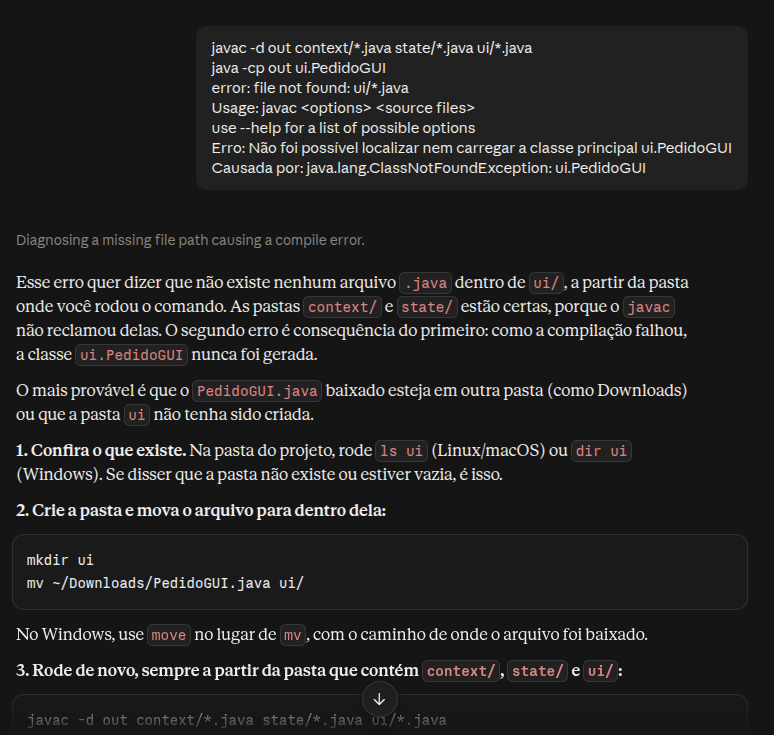
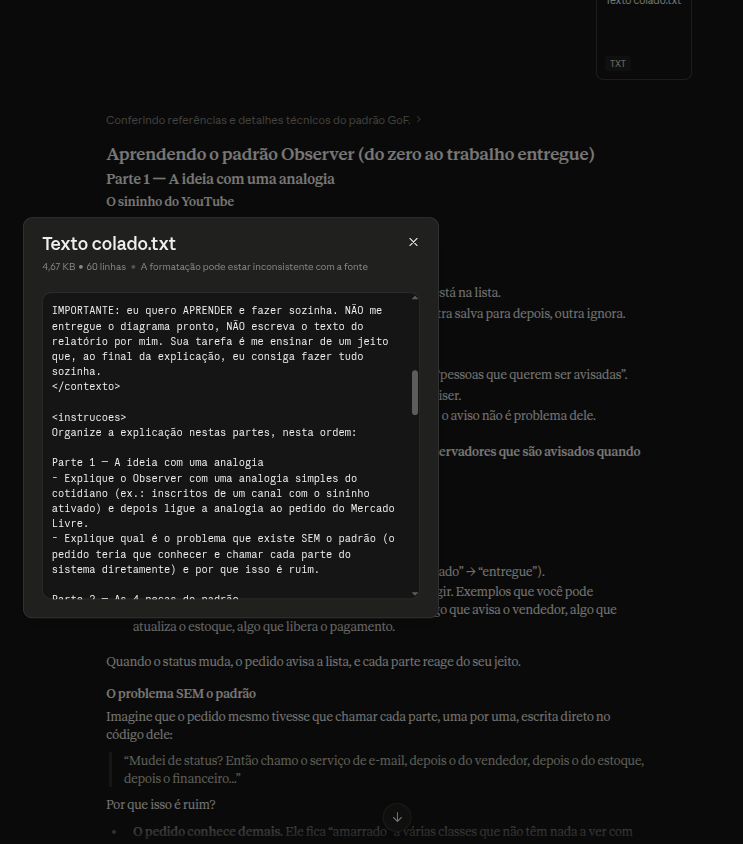
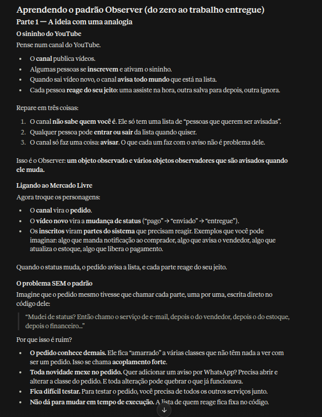
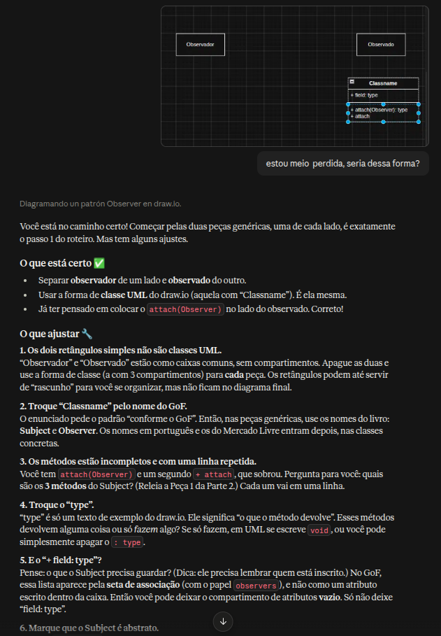

# Uso de IA Generativa e lições aprendidas

Este documento apresenta as **lições aprendidas** e o **uso de Inteligência Artificial Generativa** por cada membro da **Subequipe 3** ao longo do desenvolvimento do projeto.

---

## João Paulo Barbosa Pereira Nunes

### Lições aprendidas

* Diferença prática entre as setas de UML: realização (tracejada com triângulo vazio), agregação (losango vazio), associação e dependência.
* O Observer não elimina as decisões (os `if`), mas as distribui para quem é responsável por elas, deixando o Subject sem regra de negócio.
* Fluxo de Git em equipe: branches por tarefa, PRs, conflitos de nome e cuidado com o caminho dos arquivos no GitPages.

### Uso de IA Generativa

* Usei o Claude para discutir a escolha do subsistema, mapear os papéis do GoF nas classes, gerar e revisar o código, montar a interface de demonstração e estruturar a documentação.
* A IA errou em pontos que só percebi revisando: as pontas das setas no diagrama, a escolha da linguagem sem perguntar e os caminhos das imagens. Por isso, todo resultado foi conferido rodando o código e abrindo a página publicada.

---

## José Joaquim da Silva Neto

### Lições aprendidas

Neste trabalho aprendi que o padrão State resolve bem o problema de um objeto cujo comportamento depende da etapa do seu ciclo de vida. Ao dar a cada estado uma classe própria, o Pedido passou a apenas delegar, e a interface gráfica não precisou conhecer nenhuma regra de transição: ela só chama as operações e trata a exceção quando a ação é inválida. Também aprendi a enxergar os custos do padrão, como o aumento do número de classes, estados que conhecem seus sucessores, a dependência circular entre os pacotes context e state e um método público de troca de estado que enfraquece o encapsulamento. Entendi que, neste exemplo, o ganho é mais de organização do que de comportamento, e que escolher um padrão exige pesar essas contrapartidas. Na parte prática, aprendi que em Java o nome do pacote deve corresponder à estrutura de pastas, e que um Makefile simples já automatiza a compilação e a execução.

Na parte de documentação, aprendi que cada tipo de diagrama responde a uma pergunta diferente: o de classes mostra a estrutura, o de estados mostra o fluxo e o de sequência mostra a execução de uma chamada, e que só o conjunto conta a história completa. Aprendi também a seguir a notação do material da disciplina, apresentando a modelagem genérica antes da aplicada, e a separar o que a aula pede do que é visão crítica minha. Revisar o texto contra o código, os slides e as referências cruzadas mostrou que afirmações aparentemente seguras podiam estar imprecisas, como a ideia de que a agregação aparece em todos os padrões da aula. Por fim, manter os diagramas como código em PlantUML facilitou versioná-los e revisá-los junto com o restante do projeto.

Com o material da professora Milene Serrano aprendi a enquadrar o State como um padrão GoF comportamental, voltado a alterações no nível do comportamento dos objetos, cujo objetivo é mudar o comportamento de um objeto conforme o estado em que ele se encontra. Os slides mostraram uma forma de apresentar qualquer padrão que passei a usar no trabalho: primeiro a modelagem genérica (Client, Context, State e ConcreteStates) e depois a modelagem aplicada, trocando os nomes genéricos pelos do domínio, como o exemplo do Taxímetro e da Bandeira. Com isso, ficou claro que o Pedido é o Context, o EstadoPedido é o State e os seis estados são ConcreteStates, e que quem define a próxima transição é o próprio estado, como na nota context.setState(...) do slide.

O material também me ensinou uma notação que eu não conhecia bem: a seta tracejada <<usa>> do Client para o Context, o losango de agregação entre Context e State, o <<cria>> para criação de objetos e as cores que distinguem os papéis. Ao comparar os slides de Strategy e de State, entendi que a estrutura dos dois é quase idêntica e que a diferença está na intenção: no Strategy o cliente escolhe o algoritmo, no State o objeto muda de comportamento por conta própria. O recado final da aula, de que só se aprende praticando, e o pedido para implementar os padrões comportamentais justificaram o código Java, a interface gráfica e os testes de cada transição.

Nas referências externas, o catálogo do GoF (Gamma, Helm, Johnson e Vlissides) me deu o vocabulário para analisar o sistema: a intenção do padrão, quando usá-lo, as consequências (mais classes, transições explícitas) e a possibilidade de compartilhar objetos de estado que não têm atributos, o que o meu código não aproveita. Fowler e Kerievsky me mostraram que o State é uma refatoração de condicionais sobre status para polimorfismo, e Robert Martin e Bertrand Meyer deram base para falar do princípio aberto/fechado e da dependência circular entre os pacotes context e state. Fowler, em UML Distilled, me fez perceber que a agregação tem semântica fraca em UML e que um diagrama pode ser apenas um esboço didático, e Harel me mostrou a origem do diagrama de estados.

Com a documentação oficial aprendi detalhes que mudaram decisões concretas. A API do Java descreve IllegalStateException como o sinal de um método chamado em momento inadequado, o que justificou seu uso para operações inválidas, embora Bloch recomende reservar exceções para condições excepcionais e isso tenha virado uma crítica no documento. O tutorial da Oracle sobre Swing explicou por que a interface deve ser criada na Event Dispatch Thread, e os de enum e de pacotes explicaram por que as pastas precisam corresponder aos package. O manual do GNU Make, o guia do PlantUML e a ideia de Parnas sobre ocultação de informação completaram o aprendizado: documentar não é copiar a teoria, é conferir o que cada fonte realmente afirma contra o código e contra o próprio texto.

### Uso de IA Generativa

<strong>Uso de IA Generativa</strong> — Avaliação de erros. <em>Autor: José Joaquim da Silva Neto</em>

---

## Júlia Santana Campos

### Lições aprendidas

* O Observer separa quem **muda** de quem **reage**. O `Pagamento` só sabe que existe uma lista de `Observer` e chama `update()` em cada um. Ele não conhece `LiberacaoEnvio`, `ReposicaoEstoque` nem as notificações. Por isso, para adicionar uma nova reação, basta criar um novo observador e fazer `attach`, sem alterar o `Pagamento`.
* Os nomes do GoF confundem no começo. No meu primeiro rascunho, coloquei `attach`, `detach` e `notify` numa classe chamada `Observer`, quando eles pertencem ao `Subject` (o objeto observado). Fixei assim: o observ**ado** é o Subject e o observ**ador** é o Observer.
* A associação do `ConcreteObserver` para o `ConcreteSubject` é a mais fácil de esquecer e é essencial: é por ela que o `update()` chama `getState()` e descobre o novo status (modelo *pull*). No modelo *push*, ao contrário, o Subject já envia o dado como parâmetro.
* Na notação UML, aprendi a diferenciar classe abstrata (itálico e `{abstract}`), método abstrato, estereótipos como `«ConcreteSubject»`, herança (linha cheia com triângulo vazio), associação com papel e multiplicidade (`observers 0..*`, `subject 1`) e dependência tracejada para o enum `StatusPagamento`.
* Usar um enum em vez de `String` para o status deixa explícitos os valores possíveis (PENDENTE, APROVADO, RECUSADO, ESTORNADO) e evita estados inválidos.
* As notas no diagrama (`notify()`, `setState()`, `update()`) mostram o comportamento que o diagrama de classes sozinho não mostra. Isso ajuda a explicar o fluxo: `setState` → `notify` → `update` → `getState`.
* Aprendi a montar a referência do GoF na ABNT NBR 6023:2018, que aceita, para quatro ou mais autores, tanto a lista completa quanto o primeiro autor seguido de *et al.*

### Uso de IA Generativa

* Usei o Claude primeiro como **tutor**. Escrevi um prompt pedindo que ele me ensinasse o Observer passo a passo, com analogias, perguntas de reflexão e um gabarito, sem me entregar o diagrama nem o texto prontos. Com isso, entendi os quatro participantes, as setas UML e a referência ABNT.
* Depois, desenhei o diagrama no draw.io por partes e enviei prints para a IA revisar. Foi nessa revisão que percebi que tinha trocado `Subject` e `Observer`, além de corrigir um erro de digitação e a forma de marcar as classes abstratas.
* Para acelerar a versão final do subsistema de pagamento, pedi o código PlantUML completo e uma explicação de cada bloco. Não usei o resultado diretamente: estudei a explicação e redesenhei o diagrama na ferramenta da equipe, ajustando o layout.
* A IA funcionou como apoio para tirar dúvidas e revisar. As decisões de modelagem e a conferência final do diagrama com o GoF ficaram comigo.

<strong>Uso de IA Generativa</strong> — Prompt de aprendizagem do padrão Observer. <em>Autora: Júlia Santana Campos</em>

<strong>Uso de IA Generativa</strong> — Revisão do rascunho do diagrama no draw.io. <em>Autora: Júlia Santana Campos</em>

---

## Pedro Henrique Gomes

### Lições aprendidas

### Uso de IA Generativa

---

## Histórico de Versões

| Versão | Data | Descrição | Autor(es) | Revisor(es) |
| -- | -- | -- | -- | -- |
| 1.0 | 09/10/2026 | Criação da página | José Joaquim da Silva Neto | -- |
| 1.1 | 15/10/2026 | Adiciona lições aprendidas e uso de IA | José Joaquim da Silva Neto | -- |
| 1.2 | 16/10/2026 | Adiciona lições aprendidas e uso de IA generativa de João Paulo | João Paulo Barbosa Pereira Nunes | José Joaquim da Silva Neto, Júlia Santana Campos e Pedro Henrique Gomes |
| 1.3 | 16/10/2026 | Adiciona lições aprendidas e uso de IA generativa de Júlia | Júlia Santana Campos | José Joaquim da Silva Neto, Pedro Henrique Gomes, João Paulo Barbosa |
